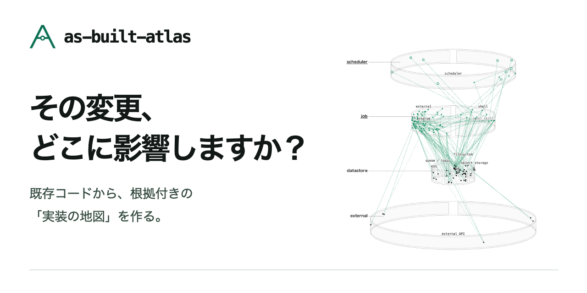
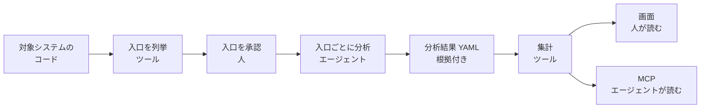
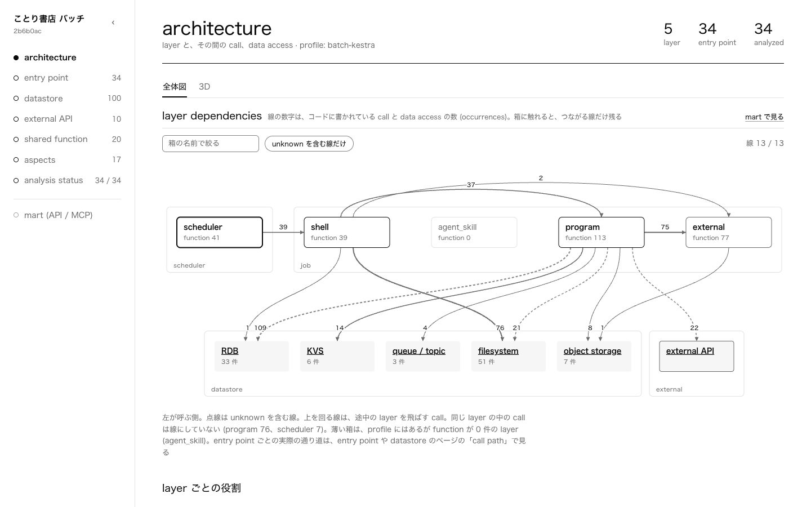
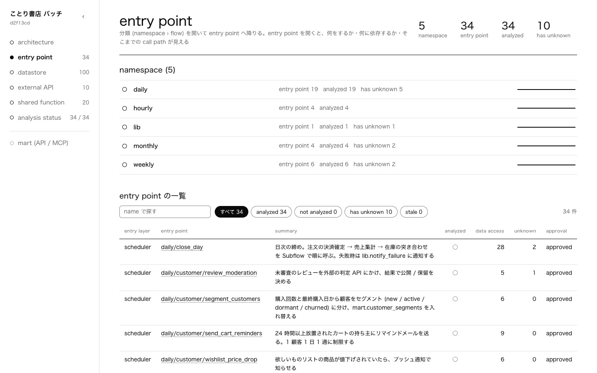
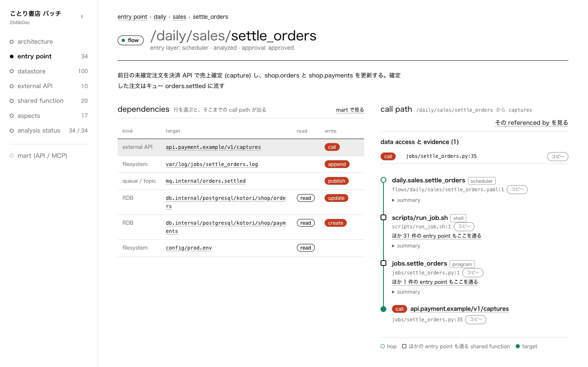
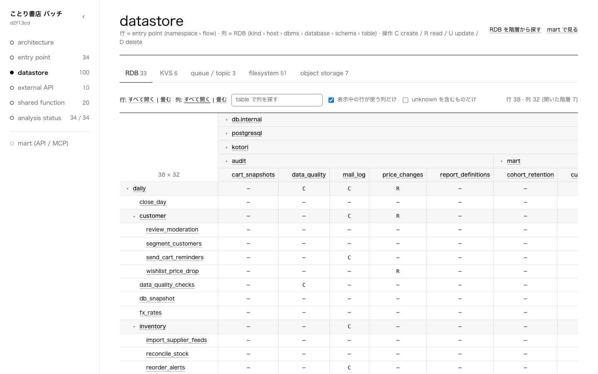
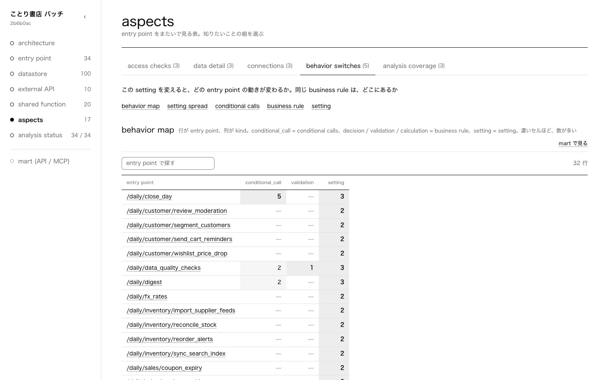
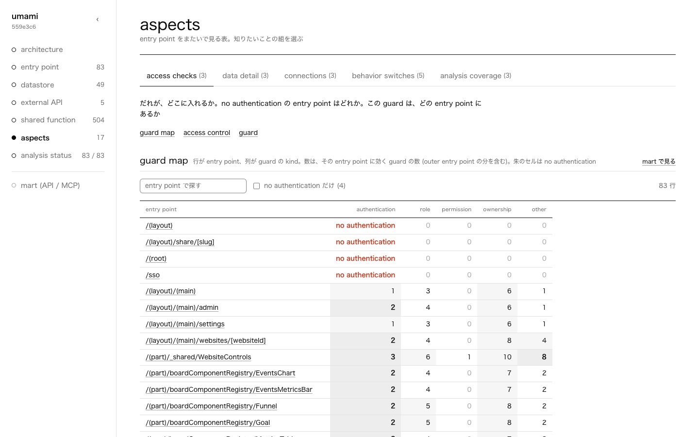
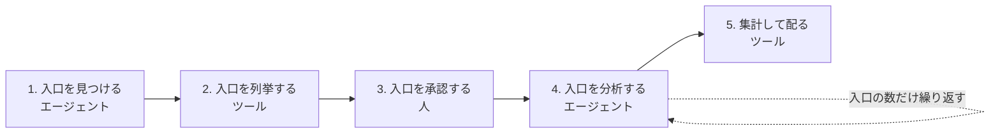
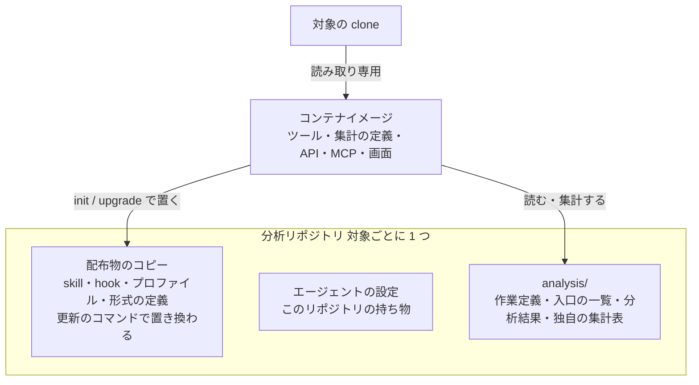

# as-built-atlas

日本語 · [English](README.md)

[](https://suwa-sh.github.io/as-built-atlas/?lang=ja)

> 入口から辿って、人とエージェントが同じ竣工図 (as-built) を見る。

既存システムの「どの入口が、何を呼び、どこを読み書きするか」を、根拠付きのデータにする道具です。

- コーディングエージェントが、入口 (バッチのジョブ、画面、API など) ごとにコードを読んで分析します。
- 分析結果は集計され、人は画面で、エージェントは MCP で、同じものを読みます。

| | |
|---|---|
| 誰が使うか | 既存システムの保守担当と、そのシステムを扱うコーディングエージェント |
| 解く困りごと | コードを全部読む時間は無い。LLM の要約は根拠が無く、判断に使えない |
| 他との違い | 自由文の wiki ではなく、形式を固定したデータ。主張ごとに「事実 / 解釈 / 不明 + 理由」と、根拠 (ファイルと行) を持つ |

## 目次

| 知りたいこと | 読む所 |
|---|---|
| どう動くか | [仕組み](#仕組み) |
| 何が見られるか | [何が見えるか](#何が見えるか) |
| まず動かしたい | [10 分で試す](#10-分で試す) |
| 自分のシステムに使いたい | [自分のシステムを分析する](#自分のシステムを分析する) |
| どんな対象に使えるか | [対応している対象](#対応している対象) |
| 分析結果の実例を見たい | [見本](#見本) |

## 仕組み



| 誰が | 何をするか |
|---|---|
| ツール | 再現できる処理 (入口の列挙、検査、集計) |
| エージェント | 入口を見つけることと、処理の読み取り |
| 人 | 分析する入口の承認 |

## 何が見えるか

同梱の見本「ことり書店」(架空のオンライン書店のバッチ、入口 34 件) を開いたところです。

| 全体の構成 | 入口の一覧 |
|---|---|
|  |  |
| 全体図で層のつながりを見る。「3D」タブでは、層ごとの曲面に点が並ぶ同心円筒を回しながら、入口から関数、テーブル、外部 API までを点と線でたどる。区分名を開くと、層間の呼び出しを詳しく見られる | 分類を開いて入口へ降りる。分析済みの数と、不明を含む数が見える |

| 入口 1 件 | データの読み書き |
|---|---|
|  |  |
| 左が触る相手 (データと外部 API)、右が、選んだ相手までの通り道。根拠のファイルと行が付く | 行 = 入口、列 = データ。セルは操作 (C / R / U / D) |

| 動きを変える物 | 権限の確認 |
|---|---|
|  |  |
| 行 = 入口、列 = 条件つきの呼び出し・ルール・設定。直す前に、響く入口を調べる | 行 = 入口、列 = 確認の種類。認証の無い入口が、先頭に赤で出る (画面を持つシステムの見本 umami) |

aspects (観点) のページは、上の 2 つのほかに、列ごとの読み書き、入口どうしのつながり、分析の届いた範囲を、図と表で出します。

画面のメニューは 8 つです。エージェントは、同じ内容を MCP (`describe_atlas` / `query_mart`) で読みます。

| メニュー | 答える問い |
|---|---|
| architecture | 全体はどんな層でできていて、どうつながっているか |
| entry point | どんな入口があり、それぞれ何をするか |
| datastore | このデータを、どの入口が読み書きするか |
| external API | この外部サービスを、どの入口が呼ぶか |
| shared function | この共通処理を直すと、どの入口に影響するか |
| aspects | この列・設定・権限の確認を直すと、どの入口に響くか。認証の要らない入口はどれか。分析は、対象のどこまで届いたか |
| analysis status | 分析はどこまで進んだか。不明な点は何か |
| mart (API / MCP) | 集計表そのものと、API・MCP での読み方 |

## 10 分で試す

同梱の見本「ことり書店」を、手元で開きます。必要なものは、Docker と git だけです。

**1. リポジトリとイメージを取る**

```bash
git clone https://github.com/suwa-sh/as-built-atlas.git
cd as-built-atlas
docker pull ghcr.io/suwa-sh/as-built-atlas:latest
```

**2. 見本を、checkout の外へコピーする**

対象 (`kotori-books`) と分析リポジトリ (`kotori-books-atlas`) を、並べて置きます。

```bash
mkdir -p ~/abatlas-try && cp -r examples/kotori-books examples/kotori-books-atlas ~/abatlas-try/
cd ~/abatlas-try/kotori-books-atlas
```

**3. 分析リポジトリとして初期化する**

既にある `.env` と `analysis/` は、そのまま残ります。

```bash
docker run --rm -v "$PWD:/ws/analysis" -w /ws/analysis ghcr.io/suwa-sh/as-built-atlas:latest init . --profile batch-kestra
```

**4. 集計して、画面を起動する**

```bash
docker compose run --rm abatlas build .
docker compose up -d api
```

**5. 開く**

| 読む人 | 方法 |
|---|---|
| 人 | ブラウザで <http://localhost:8765> を開く |
| エージェント | MCP を登録する: `claude mcp add --transport http abatlas http://localhost:8765/mcp` |

手元のコードからイメージを作るときは、手順 1 の `docker pull` の代わりに `docker build -t ghcr.io/suwa-sh/as-built-atlas:latest .` を使います。

## 自分のシステムを分析する

分析対象ごとに、「分析リポジトリ」を 1 つ作ります。

**1. 分析リポジトリを作る**

`<プロファイル>` を、対象に合うプロファイルの名前に置き換えます (例: `batch-kestra`。一覧は [対応している対象](#対応している対象))。

```bash
mkdir my-analysis && cd my-analysis
docker run --rm -v "$PWD:/ws/analysis" -w /ws/analysis ghcr.io/suwa-sh/as-built-atlas:latest init . --profile <プロファイル>
```

**2. 対象を書く**

| ファイル | 書くこと |
|---|---|
| `.env` | `ABATLAS_TARGET` に、対象の clone の場所 |
| `analysis/work-definition.yaml` | 対象のリポジトリ、範囲、コミット、画面に出す名前 |

**3. エージェントと交互に進める**



| 手順 | 誰が | やること | 使うもの |
|---|---|---|---|
| 1. 入口を見つける | エージェント | このリポジトリ向けの、入口の拾い方を書く。道具で取れない入口は、根拠を付けて足す | skill `abatlas-discover-entries` |
| 2. 入口を列挙する | ツール | 入口の候補を出す。同じコミットと同じ設定なら、同じ結果になる | `enumerate` |
| 3. 入口を承認する | 人 | 候補ごとに、分析するかどうかを決める | `analysis/entry-list.yaml` の `status` を `approved` か `rejected` にする |
| 4. 入口を分析する | エージェント | 入口 1 件を、YAML 1 ファイルにする。機械チェックに通し、別のエージェントがレビューする | skill `abatlas-analyze-entry` |
| 5. 集計して配る | ツール | 集計表を作り、画面と MCP を起動する | `build`、`docker compose up -d api` |

分析リポジトリの中身と、コマンドの詳しい説明は、[docs/architecture/analysis-repo.md](docs/architecture/analysis-repo.md) にあります。

## 対応している対象

対象の種類は、**プロファイル** (分析の型) で決まります。プロファイルは 11 個あります。

| 種類 | プロファイル | 対象 | 入口 1 件の単位 |
|---|---|---|---|
| バッチ | `batch-kestra` | Kestra のバッチ | Flow |
| バッチ | `batch-github-actions` | GitHub Actions の自動処理 | workflow |
| データの変換 | `transform-dbt` | dbt | model |
| コマンド | `cli` | コマンドラインから起動する道具 | コマンド (サブコマンドがあれば、サブコマンド) |
| サーバー | `api` | API、サーバー側で画面を作る webapp | 操作 (HTTP なら、URL とメソッドの組) |
| 画面 | `ui-nextjs` | Next.js (App Router、Pages Router) | 画面、画面を包む枠 |
| 画面 | `ui-vue-router` | Vue Router (バックエンドは、範囲の外) | 画面、アプリ全体の枠 |
| 画面 | `ui-nuxt` | Nuxt | 画面、画面を包む枠、アプリ全体の枠 |
| 画面 | `ui-sveltekit` | SvelteKit | 画面、画面を包む枠、どの要求でも動く処理 |
| 画面 | `ui-android` | Android のアプリ | 画面、Activity、OS から起動される処理 |
| 画面 | `ui-ios` | iOS のアプリ | 画面、アプリ全体の枠、OS から起動される入口 |

- 入口の決まりの詳しい説明は、[docs/architecture/profiles.md](docs/architecture/profiles.md) にあります (例: 多くの画面が描く大きな部品を、別の入口に分ける)。
- プロファイルは、自分のシステムに合わせて直せます (例: 使っていない層を外す)。手順も、同じ文書にあります。

## 見本

`examples/` に、プロファイルごとに 1 つ、分析結果の見本があります。

| 見本 | 中身 | 分析結果 |
|---|---|---|
| `kotori-books/` と `kotori-books-atlas/` | 架空の書店のバッチ (Kestra の Flow 34 本) と、その分析リポジトリ。実在の会社とは無関係 | 34 件すべて。対象と同じ仕様から生成した**正解** |
| `umami-atlas/` | 公開ソフト [umami](https://github.com/umami-software/umami) (Next.js) の画面 | 83 件すべて。AI が分析した実例 |
| ほかの 9 つ (`*-atlas/`) | API、コマンドラインの道具、dbt、GitHub Actions、画面 (Vue Router、Nuxt、SvelteKit、Android、iOS) | 3 件から 7 件。AI が分析した実例 |

- ことり書店のほかは、対象のコードを同梱していません。使い方は、見本ごとの `README.md` にあります。
- 対象とライセンスの一覧は、[docs/architecture/examples.md](docs/architecture/examples.md) にあります。

### 見本で、自分のエージェントの精度を測る

ことり書店の分析結果は正解なので、手元のエージェントに同じ入口を分析させて、突き合わせられます。

前提: [10 分で試す](#10-分で試す) を終えていること。コーディングエージェント (Claude Code、Codex など) と、ホストの `python3` が要ります。

| 手順 | やること | コマンド |
|---|---|---|
| 1 | 正解を退避する | `mv analysis/results analysis/truth && mkdir analysis/results` |
| 2 | 対象を git リポジトリにする | `cd ../kotori-books && git init -q && git add -A && git commit -qm sample && cd -` |
| 3 | 対象のコミットを書き換える | `analysis/work-definition.yaml` と `analysis/entry-list.yaml` の `target.commit` を、`git -C ../kotori-books rev-parse HEAD` の値にする |
| 4 | 入口を分析させる | エージェントを起動し、skill `abatlas-analyze-entry` で入口 (例: `daily.sales.settle_orders`) を分析させる |
| 5 | 突き合わせる | `docker compose run --rm abatlas evaluate analysis/results --truth analysis/truth` |

- 手順 2 で、git の `user.name` と `user.email` が未設定のときは、`git commit` に `-c user.name=you -c user.email=you@example.com` を付けます。
- `evaluate` は、処理の段・読み書き・パラメータの適合率と再現率を、入口ごとに出します。数え方は [docs/architecture/examples.md](docs/architecture/examples.md) にあります。

## 5 つの約束

| 約束 | 仕組みのどこで守るか |
|---|---|
| 入口から辿る | 入口 1 件 = 分析 1 件。入口はツールが列挙し、人が承認する |
| 根拠の無い主張を出さない | 項目ごとに「事実 / 解釈 / 不明 + 理由」。根拠はファイルと行で、機械チェックが実在を確かめる |
| 人とエージェントが同じものを見る | 正本は 1 つ。画面と MCP は、同じ API を読む |
| 決定論でできることは決定論で | 列挙・検査・集計・突き合わせはツール。エージェントは発見と解釈だけ |
| 対象の種類はプロファイルで増やす | 同じ手順で、プロファイルを足せる |

## 構成

分析リポジトリが依存するのは、コンテナイメージ 1 つだけです。



## 文書

**使う人向け**

| 文書 | 内容 |
|---|---|
| [CHANGELOG.md](CHANGELOG.md) | 版ごとの変更と、更新で手を動かすこと |
| [docs/architecture/](docs/architecture/README.md) | 仕組みの説明。分析リポジトリ、形式、プロファイル、集計、API、画面、見本 |
| [examples/kotori-books/](examples/kotori-books/README.md) | 見本の対象システムの説明と、正解に入れてある「不明」の見どころ |

**開発する人向け**

| 文書 | 内容 |
|---|---|
| [AGENTS.md](AGENTS.md) | コーディングエージェント共通の行動契約と、開発のコマンド |
| [docs/rules/](docs/rules/README.md) | 開発で守ること |
| [docs/adr/](docs/adr/README.md) | 決定の経緯 |
| [docs/brand.md](docs/brand.md) | コンセプト、名前の由来、声と見た目 |
| [DESIGN.md](DESIGN.md) | 画面の見た目の決まり |

エージェントの設定は、正本 (`AGENTS.md`、`docs/`、`.agents/`) から、製品別の設定 (`.claude/`、`.codex/` など) を生成する構成です。製品別の設定は手で直さず、`.agents/harness.yaml` を直して再生成します。

## ライセンス

MIT
