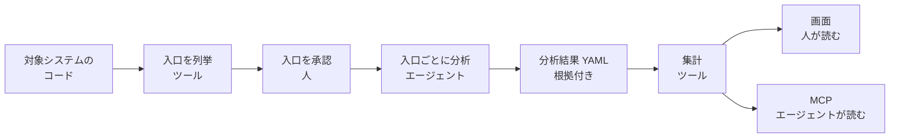
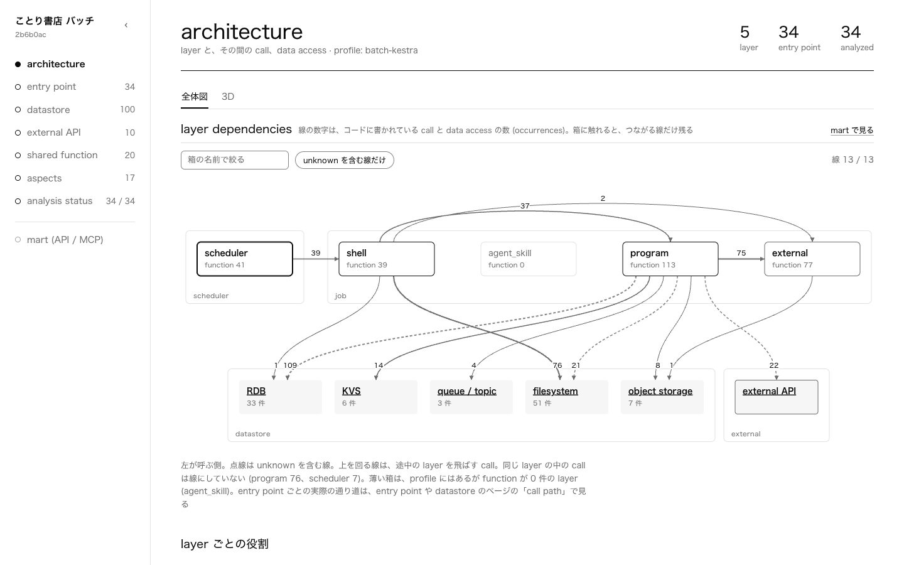
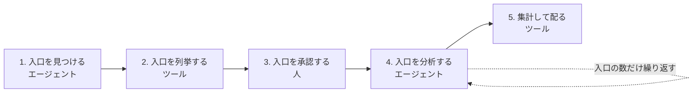
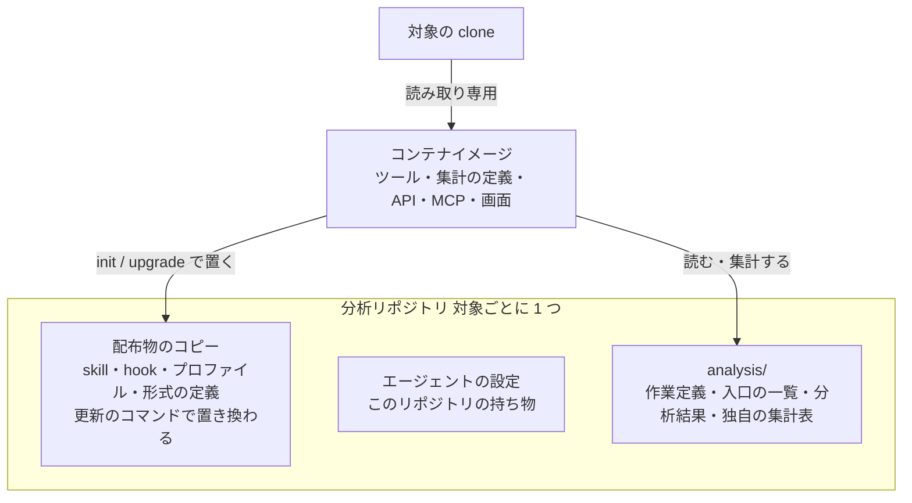

# as-built-atlas

> 入口から辿って、人とエージェントが同じ竣工図 (as-built) を見る。

既存システムを、入口 (バッチのジョブ、UI の画面など) ごとにコーディングエージェントが分析し、根拠付きのデータにします。データは集計して、画面 (webapp) と MCP で配ります。保守担当もコーディングエージェントも、同じものを読んで判断できます。

| | |
|---|---|
| 誰に | 既存システムの保守担当と、そのシステムを扱うコーディングエージェント |
| 困りごと | 「どの入口が何を呼び、どこを読み書きしているか」を知りたい。コードを全部読む時間は無い。LLM の要約は根拠が無く、判断に使えない |
| 他との違い | 自由文の wiki ではなく、形式を固定したデータ。主張ごとに「事実 / 解釈 / 不明 + 理由」と根拠 (ファイルと行) を持つ |

状態: 開発の初期 (0 系) です。想定しているプロファイルと分析の型がそろうまで、形式とコマンドは、互換を保たずに変わることがあります。

## 仕組み



再現できる処理 (列挙・検査・集計) はツールが行います。エージェントに任せるのは、入口を見つけることと、処理の読み取りだけです。

## 何が見えるか

同梱のサンプル「ことり書店」(架空のオンライン書店の Kestra バッチ、入口 34 件) を開いたところです。

| 全体の構成 | 入口の一覧 |
|---|---|
|  |  |
| 層 (layer) を箱にして、実際の呼び出しと読み書きを線でつなぐ。点線は、確かめられていない箇所を含む線 | 分類を開いて入口へ降りる。分析済みの数と、不明を含む数が見える |

| 入口 1 件 | データの読み書き |
|---|---|
|  |  |
| 左が触る相手 (データと外部 API)、右が、選んだ相手までの通り道。根拠のファイルと行が付く | 行 = 入口、列 = データ。どちらも階層ごとに開閉でき、セルは操作 (C / R / U / D) の和 |

画面のメニューは次の 7 つです。同じ内容を、エージェントは MCP (`describe_atlas` / `query_mart`) で読みます。

| メニュー | 答える問い |
|---|---|
| architecture | 全体はどんな層でできていて、どうつながっているか |
| entry point | どんな入口があり、それぞれ何をするか |
| datastore | このデータを、どの入口が読み書きするか |
| external API | この外部サービスを、どの入口が呼ぶか |
| shared function | この共通処理を直すと、どの入口に影響するか |
| analysis status | 分析はどこまで進んだか。不明な点は何か |
| mart (API / MCP) | 集計表そのものと、API・MCP での読み方 |

## 10 分で試す (同梱のサンプル)

必要なものは Docker と git だけです。

```bash
git clone https://github.com/suwa-sh/as-built-atlas.git
cd as-built-atlas
docker pull ghcr.io/suwa-sh/as-built-atlas:latest             # 手元のコードで試すときは docker build -t ghcr.io/suwa-sh/as-built-atlas:latest .

# 1. サンプル (対象 + 分析リポジトリ) を、checkout の外へ並べてコピーする
mkdir -p ~/abatlas-try && cp -r examples/kotori-books examples/kotori-books-atlas ~/abatlas-try/
cd ~/abatlas-try/kotori-books-atlas

# 2. 分析リポジトリとして初期化する (既にある .env と analysis/ はそのまま)
docker run --rm -v "$PWD:/ws/analysis" -w /ws/analysis ghcr.io/suwa-sh/as-built-atlas:latest init . --profile batch-kestra

# 3. 集計して、画面を起動する
docker compose run --rm abatlas build .
docker compose up -d api
```

ブラウザで <http://localhost:8765> を開きます。

コーディングエージェントには、MCP を URL 1 行で登録します。

```bash
claude mcp add --transport http abatlas http://localhost:8765/mcp
```

サンプルの中身は次のとおりです。

| 場所 | 何か |
|---|---|
| `examples/kotori-books/` | 分析される側。架空の書店の夜間・定期バッチ (Kestra の Flow 34 本)。実在の会社とは無関係 |
| `examples/kotori-books-atlas/` | その分析リポジトリ。作業定義、承認済みの入口の一覧、入口ごとの分析結果 (34 件) |
| `examples/generator/kotori_books.py` | 上の 2 つを**同じ仕様から**生成するスクリプト。分析結果は、根拠の行まで正しい「正解」になる |
| `examples/umami-atlas/` | 画面を持つシステムの見本。公開ソフト [umami](https://github.com/umami-software/umami) (Next.js) を AI が分析した実例。対象のコードは同梱しない ([手順](examples/umami-atlas/README.md)) |

### 自分のエージェントの精度を測る

サンプルの分析結果は正解なので、手元のエージェントに同じ入口を分析させて、突き合わせられます。

ここから先は、コーディングエージェント (Claude Code / Codex など) と、ホストの `python3` が要ります。

| 手順 | やること |
|---|---|
| 1 | 正解を退避する: `mv analysis/results analysis/truth && mkdir analysis/results` |
| 2 | 対象を git リポジトリにする: `cd ../kotori-books && git init -q && git add -A && git commit -qm sample && cd -`。git の `user.name` / `user.email` が未設定の環境では、`git commit` に `-c user.name=you -c user.email=you@example.com` を付ける |
| 3 | `analysis/work-definition.yaml` と `analysis/entry-list.yaml` の `target.commit` を、`git -C ../kotori-books rev-parse HEAD` の値に書き換える |
| 4 | エージェントを起動し、skill `abatlas-analyze-entry` で入口 (例: `daily.sales.settle_orders`) を分析させる |
| 5 | 突き合わせる: `docker compose run --rm abatlas evaluate analysis/results --truth analysis/truth` |

`evaluate` は、処理の段・読み書き・パラメータの適合率と再現率を、入口ごとに出します。数え方は [docs/architecture/examples.md](docs/architecture/examples.md) にあります。

## 自分のシステムを分析する

```bash
mkdir my-analysis && cd my-analysis
docker run --rm -v "$PWD:/ws/analysis" -w /ws/analysis ghcr.io/suwa-sh/as-built-atlas:latest init . --profile batch-kestra
```

`.env` の `ABATLAS_TARGET` (対象の clone の場所) と、`analysis/work-definition.yaml` (対象のリポジトリ・範囲・コミット、画面に出す名前) を埋めます。その後は、エージェントと交互に進めます。



| 手順 | 誰が | 何を |
|---|---|---|
| 1. 入口を見つける | エージェント (skill `abatlas-discover-entries`) | このリポジトリ向けの、入口の拾い方を書く。道具で取れない入口は、コードを読んで、根拠と理由を付けて足す |
| 2. 入口を列挙する | ツール (`enumerate`) | 候補を出す。同じコミットと同じ設定なら、同じ結果になる。エージェントが足した入口には、印が付く |
| 3. 入口を承認する | 人 | `analysis/entry-list.yaml` の `status` を `approved` か `rejected` にする |
| 4. 入口を分析する | エージェント (skill `abatlas-analyze-entry`) | 入口 1 件 = YAML 1 ファイル。機械チェックに通し、別の文脈のエージェントがレビューする |
| 5. 集計して配る | ツール (`build` で集計、`docker compose up -d api` で起動) | 集計表を作る。画面と MCP が、同じ API を読む |

対象の種類は**プロファイル** (分析の型) で増やします。

| プロファイル | 対象 | 入口 |
|---|---|---|
| `batch-kestra` | Kestra で定期起動されるバッチ | Flow 1 本 |
| `ui-nextjs` | Next.js (App Router) の画面を持つシステム | 画面 1 つ、画面を包む共通の枠 1 つ |
| `ui-vue-router` | Vue Router の画面を持つシステム (バックエンドは別) | 画面 1 つ、アプリ全体の枠 1 つ |

プロファイルは、自分のシステムに合わせて直せます (例: 使っていない層を外す)。手順は [docs/architecture/profiles.md](docs/architecture/profiles.md) にあります。

## 5 つの約束

| 約束 | 仕組みのどこで守るか |
|---|---|
| 入口から辿る | 入口 1 件 = 分析 1 件。入口はツールが列挙し、人が承認する |
| 根拠の無い主張を出さない | 項目ごとに「事実 / 解釈 / 不明 + 理由」。根拠はファイルと行で、機械チェックが実在を確かめる |
| 人とエージェントが同じものを見る | 正本は 1 つ。画面と MCP は、同じ API を読む |
| 決定論でできることは決定論で | 列挙・検査・集計・突き合わせはツール。エージェントは発見と解釈だけ |
| 対象の種類はプロファイルで増やす | バッチと UI の 2 例がある。同じ手順でプロファイルを足せる |

## 構成

分析対象ごとに「分析リポジトリ」を 1 つ作ります。必要な依存は Docker だけです。



## 文書

| 文書 | 内容 |
|---|---|
| [docs/architecture/](docs/architecture/README.md) | 仕組みの説明。全体像、設計の考え方、仕組みに入れていないものと、主題ごとの 7 つの文書への地図 |
| [docs/rules/](docs/rules/README.md) | 開発で守ること |
| [docs/adr/](docs/adr/README.md) | 決定の経緯 |
| [docs/brand.md](docs/brand.md) | コンセプト、名前の由来、声と見た目 |
| [DESIGN.md](DESIGN.md) | 画面の見た目の決まり |
| [examples/kotori-books/](examples/kotori-books/README.md) | サンプルの対象システムの説明と、正解に入れてある「不明」の見どころ |
| [AGENTS.md](AGENTS.md) | コーディングエージェント共通の行動契約 |

## このリポジトリを開発する人へ

エージェントの設定は、正本 (`AGENTS.md`、`docs/`、`.agents/`) から製品別の設定 (`.claude/`、`.codex/` など) を生成する構成です。製品別の設定は手で直さず、`.agents/harness.yaml` を直して再生成します。開発のコマンドは [AGENTS.md](AGENTS.md) にあります。

## ライセンス

MIT
