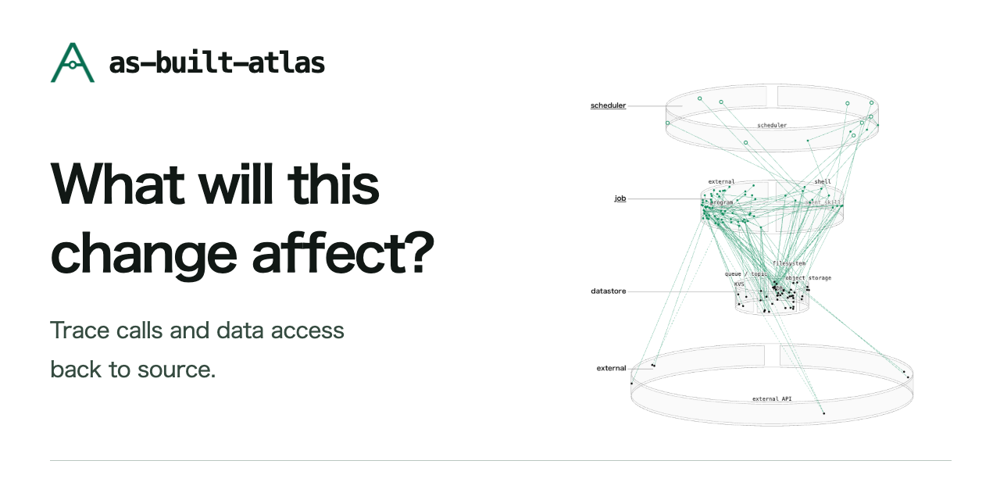
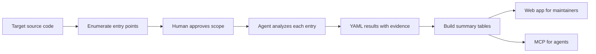
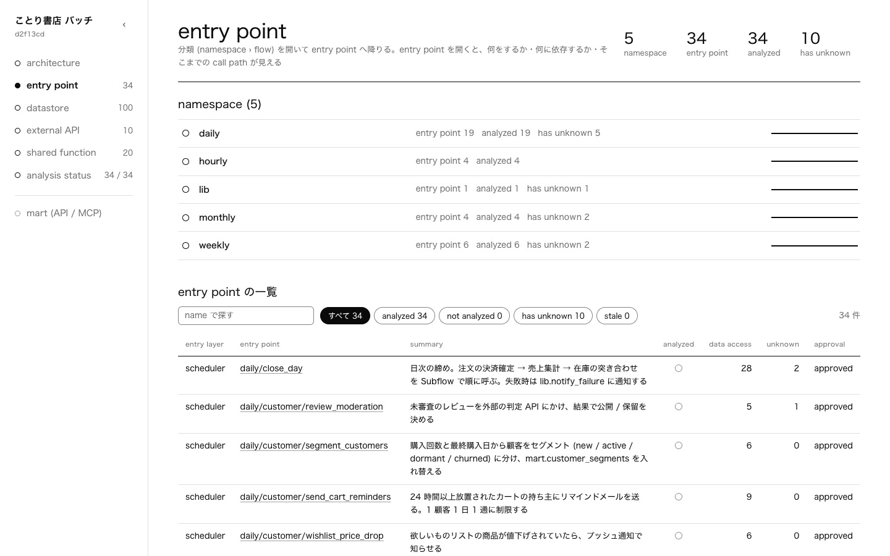
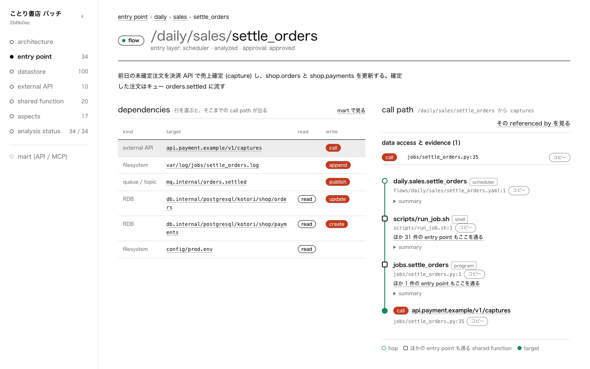
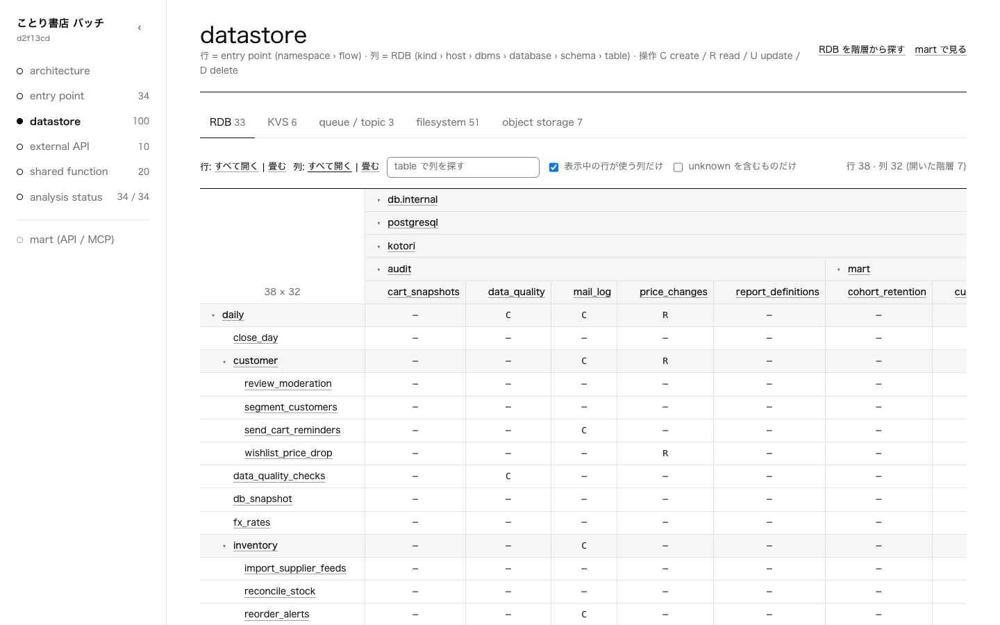
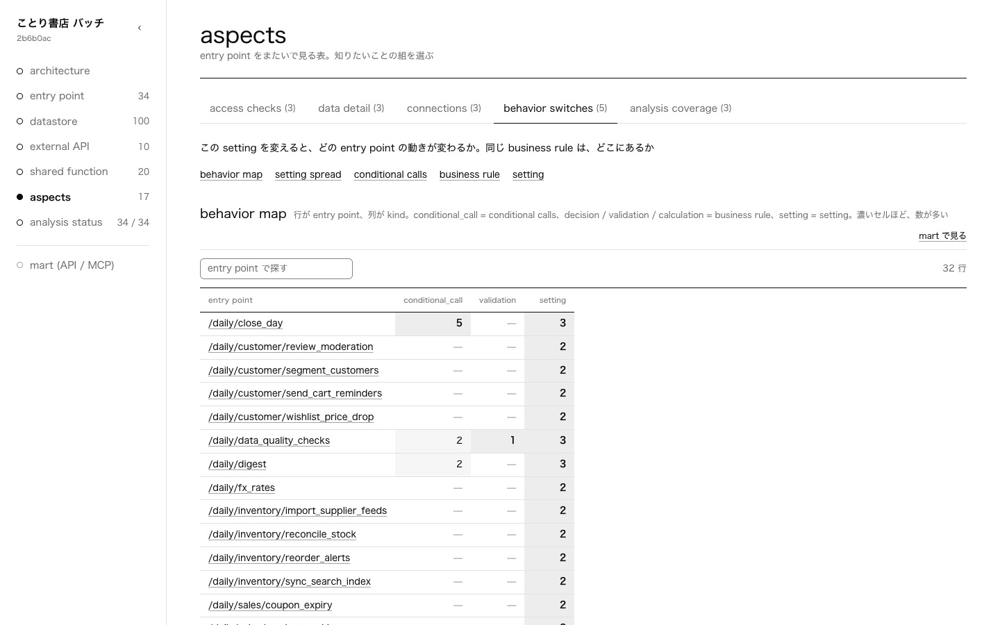
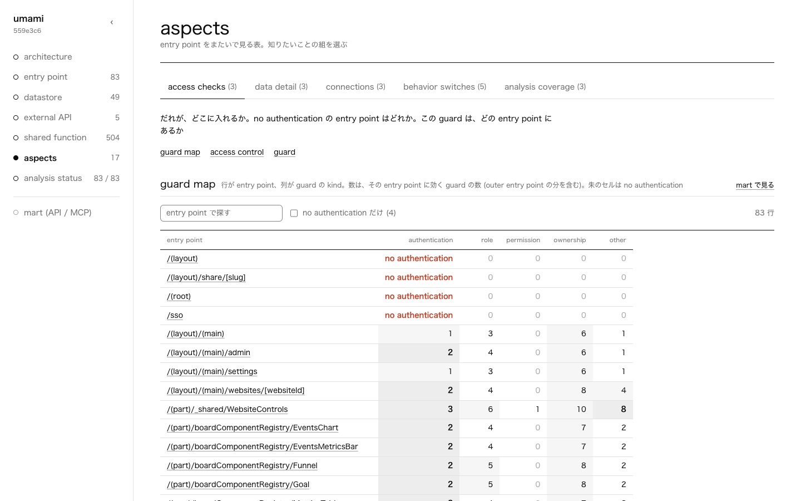
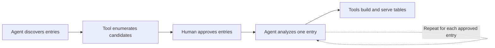
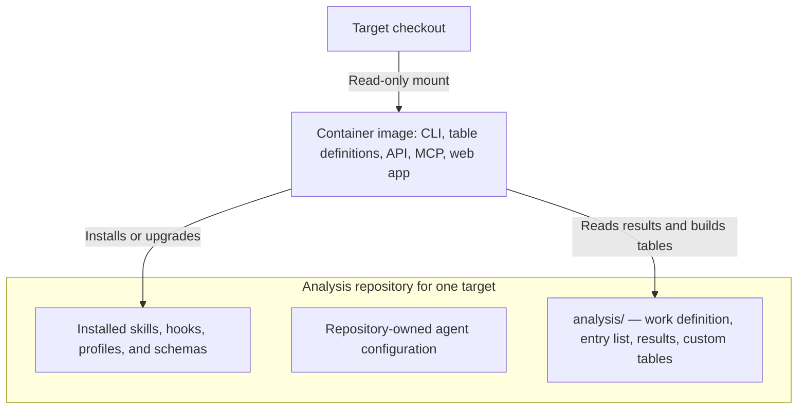

# as-built-atlas

[日本語](README.ja.md) · English

[](https://suwa-sh.github.io/as-built-atlas/en/)

**Trace a change from an entry point to the code and data it touches.** as-built-atlas maps what an existing system actually does. A coding agent follows each entry point (a batch job, screen, or API operation) and records what it calls, reads, and writes, with file and line references. Maintainers explore the results in a web app. Agents query the same data through the Model Context Protocol (MCP).

Use it when you need to investigate a change and want to check the evidence behind an agent's answer. Each result follows a schema that distinguishes facts, interpretations, and unknowns. An unknown includes the reason the agent could not resolve it.

<a name="目次"></a>

## Contents

- [How it works](#how-it-works)
- [Explore the analysis](#explore-the-analysis)
- [10-minute quickstart](#10-minute-quickstart)
- [Analyze your own system](#analyze-your-own-system)
- [Supported profiles](#supported-profiles)
- [Sample analyses](#sample-analyses)

<a name="仕組み"></a>

## How it works



Agents discover entry points and interpret code. A maintainer decides which entries to analyze. Tools handle the repeatable work of enumerating candidates, validating results, and building tables. Starting from the same saved analysis, people and agents get the same aggregates. Coverage and accuracy depend on the original analysis.

<a name="何が見えるか"></a>

## Explore the analysis

The screenshots show Kotori Books, a fictional online bookstore with 34 batch entry points, except for the access checks example from umami.

| Architecture | Entry point list |
|---|---|
|  |  |
| See how layers connect. In the **3D** tab, rotate the concentric cylinders to trace calls from entry points to functions, tables, and external APIs. Open a tier to inspect calls between its layers. | Expand a category to see its entries, how many have been analyzed, and how many results contain unknowns. |

| One entry point | Data access |
|---|---|
|  |  |
| Select a resource or external API on the left. The right side shows the call path to it and the source files and lines that support it. | Each row represents an entry point. Each column represents data it can create, read, update, or delete. |

| Behavior | Access checks |
|---|---|
|  |  |
| Find the entries affected by a conditional call, rule, or setting before changing it. | Compare checks across entries. The umami example shows entries with no recorded authentication check first, in red. |

The web app has eight views. Agents can read the profile and vocabulary with `describe_atlas`, inspect a table's definition with `describe_mart`, and retrieve rows with `query_mart`.

| View | What you can find |
|---|---|
| architecture | The system's layers and how they connect |
| entry point | Where execution starts and what each entry does |
| datastore | Which entries read or write a resource |
| external API | Which entries call an external service |
| shared function | Which entries depend on a function you plan to change |
| aspects | Column-level reads and writes, settings, access checks, connections between entries, and the scope of the analysis |
| analysis status | Progress and unresolved questions |
| mart (API / MCP) | The underlying summary tables and how to query them |

<a name="10-分で試す"></a>

## 10-minute quickstart

Open the bundled Kotori Books sample locally. You need Git and Docker with Docker Compose. The sample includes the analysis results, so you can explore it without running a coding agent.

**1. Clone the repository and pull the image.**

```bash
git clone https://github.com/suwa-sh/as-built-atlas.git
cd as-built-atlas
docker pull ghcr.io/suwa-sh/as-built-atlas:latest
```

To build the image from your checkout, run `docker build -t ghcr.io/suwa-sh/as-built-atlas:latest .` in place of the pull command.

**2. Copy the sample outside the checkout.** Keep the target source (`kotori-books`) and the analysis repository (`kotori-books-atlas`) side by side.

```bash
mkdir -p ~/abatlas-try && cp -r examples/kotori-books examples/kotori-books-atlas ~/abatlas-try/
cd ~/abatlas-try/kotori-books-atlas
```

**3. Initialize the analysis repository.** The initializer preserves the sample's existing `.env` and `analysis/` data.

```bash
docker run --rm -v "$PWD:/ws/analysis" -w /ws/analysis ghcr.io/suwa-sh/as-built-atlas:latest init . --profile batch-kestra
```

**4. Build the tables and start the web app.**

```bash
docker compose run --rm abatlas build .
docker compose up -d api
```

**5. Explore the results.** Open <http://localhost:8765> in a browser. To explore the same data from an agent, connect its MCP client to `http://localhost:8765/mcp`. With Claude Code, run:

```bash
claude mcp add --transport http abatlas http://localhost:8765/mcp
```

<a name="自分のシステムを分析する"></a>

## Analyze your own system

Create one analysis repository per target system.

**1. Initialize a repository.** Choose a [supported profile](#supported-profiles) that matches the target. This example uses the Kestra batch profile.

```bash
mkdir my-analysis && cd my-analysis
docker run --rm -v "$PWD:/ws/analysis" -w /ws/analysis ghcr.io/suwa-sh/as-built-atlas:latest init . --profile batch-kestra
```

**2. Identify the target.**

| File | What to set |
|---|---|
| `.env` | Set `ABATLAS_TARGET` to the path to your local clone of the target repository. |
| `analysis/work-definition.yaml` | Specify the repository, scope, target commit, and display name. |

**3. Discover, approve, and analyze entry points.**



| Step | Action |
|---|---|
| Discover | With the `abatlas-discover-entries` skill, the agent configures discovery for this repository and adds entries the extractor misses, with evidence. |
| Enumerate | Run `docker compose run --rm abatlas enumerate analysis/entry-list.yaml` to list candidates. The same commit and configuration produce the same list. |
| Approve | Use `abatlas-run-analysis` to prepare the entry list and worklist. Answer open questions and approve the plan once. The agent then dispatches one analysis per entry. [Workflow](docs/architecture/impact.md) |
| Analyze | With `abatlas-analyze-entry`, the agent produces one YAML file per approved entry. The result goes through automated checks and a separate agent review. |
| Serve | Run `docker compose run --rm abatlas build .` to build the tables, then `docker compose up -d api` to serve the web app and MCP. |

See the [analysis repository guide](docs/architecture/analysis-repo.md) for the directory layout and command reference.

<a name="対応している対象"></a>

## Supported profiles

A profile defines what counts as an entry point and which layers to trace. The repository includes 11 profiles.

| Profile | Target | Entry point |
|---|---|---|
| `batch-kestra` | Kestra batch processing | Flow |
| `batch-github-actions` | GitHub Actions automation | Workflow |
| `transform-dbt` | dbt transformations | Model |
| `cli` | Command-line tools | Command, or subcommand when present |
| `api` | APIs and server-rendered web apps | Operation, such as an HTTP method and URL pair |
| `ui-nextjs` | Next.js App Router and Pages Router | Page or enclosing layout |
| `ui-vue-router` | Vue Router front end (backend outside scope) | Page or application shell |
| `ui-nuxt` | Nuxt | Page, layout, or application shell |
| `ui-sveltekit` | SvelteKit | Page, layout, or request-wide handler |
| `ui-android` | Android apps | Screen, Activity, or OS-triggered operation |
| `ui-ios` | iOS apps | Screen, application shell, or OS-triggered entry |

You can adapt a profile to your system, for example by removing unused layers or identifying a large component shared by many screens as a separate entry. See the [profile guide](docs/architecture/profiles.md).

<a name="見本"></a>

## Sample analyses

The [examples directory](examples/) contains one analysis repository per profile.

| Sample | Target | Results |
|---|---|---|
| [Kotori Books](examples/kotori-books/) and [its analysis](examples/kotori-books-atlas/) | A fictional bookstore with 34 Kestra flows | All 34 entries. The code and reference results are generated from the same specification, so the results serve as ground truth. |
| [umami analysis](examples/umami-atlas/) | The Next.js interface of [umami](https://github.com/umami-software/umami) | AI-generated analyses for all 83 entries |
| Nine other `*-atlas/` examples | API, CLI, dbt, GitHub Actions, Vue Router, Nuxt, SvelteKit, Android, and iOS | AI-generated analyses of 3 to 7 entries per sample |

Only Kotori Books includes the target source code. Each sample has its own README with setup instructions. The [sample catalog](docs/architecture/examples.md) lists targets and licenses.

<a name="見本で自分のエージェントの精度を測る"></a>

### Evaluate an agent against the sample

After the [quickstart](#10-minute-quickstart), you can compare your agent's analysis of Kotori Books with the bundled ground truth. You need a coding agent such as Claude Code or Codex, and `python3` on the host. Start in the **copied** `kotori-books-atlas` directory.

| Step | Action |
|---|---|
| 1. Set the reference results aside | Run `mv analysis/results analysis/truth && mkdir analysis/results`. |
| 2. Give the sample source its own Git history | Run `cd ../kotori-books && git init -q && git add -A && git commit -qm sample && cd -`. If Git has no identity configured, use `git -c user.name=you -c user.email=you@example.com commit -qm sample` for the commit. |
| 3. Record the target commit | Set `target.commit` in both `analysis/work-definition.yaml` and `analysis/entry-list.yaml` to the output of `git -C ../kotori-books rev-parse HEAD`. |
| 4. Analyze an entry | Ask your agent to run the `abatlas-analyze-entry` skill on an entry such as `daily.sales.settle_orders`. |
| 5. Compare results | Run `docker compose run --rm abatlas evaluate analysis/results --truth analysis/truth`. |

The evaluator reports precision and recall per entry for frames (steps in the call path), data access, and parameters. The [evaluation guide](docs/architecture/examples.md) explains how matches are counted.

<a name="5-つの約束"></a>

## Design principles

| Principle | How it works |
|---|---|
| Trace from an entry point | Each approved entry gets its own analysis. |
| Keep claims verifiable | Results distinguish facts, interpretations, and unknowns with reasons. When the target source is available, checks verify that cited files and lines exist. |
| Give people and agents the same data | The web app and MCP query the same API. |
| Keep repeatable work deterministic | Tools enumerate, validate, aggregate, and compare. Agents discover entry points and interpret code. |
| Extend through profiles | Additional target types use the same workflow with a new profile. |

<a name="構成"></a>

## Repository layout

An analysis repository depends on a single container image. The target source is mounted read-only.



<a name="文書"></a>

Use [impact and reuse](docs/architecture/impact.md) to update an analysis after the target Git revision changes.

## Documentation

The following guides are in Japanese.

| For users | Contents |
|---|---|
| [Changelog](CHANGELOG.md) | Changes and upgrade instructions by version |
| [Architecture](docs/architecture/README.md) | Analysis repositories, formats, profiles, tables, API, web app, and samples |
| [Kotori Books](examples/kotori-books/README.md) | The sample system and the deliberately unresolved questions in its ground truth |

| For contributors | Contents |
|---|---|
| [Agent instructions](AGENTS.md) | Shared rules for coding agents and development commands |
| [Development rules](docs/rules/README.md) | Repository conventions |
| [Architecture decision records](docs/adr/README.md) | Design decisions and their rationale |
| [Brand guide](docs/brand.md) | Product concept, naming, voice, and visual identity |
| [UI design guide](DESIGN.md) | Web app design conventions |

Product-specific agent configuration (such as `.claude/` and `.codex/`) is generated from `AGENTS.md`, `docs/`, and `.agents/`. To update the adapters, edit `.agents/harness.yaml` and regenerate them.

<a name="ライセンス"></a>

## License

[MIT](LICENSE)
