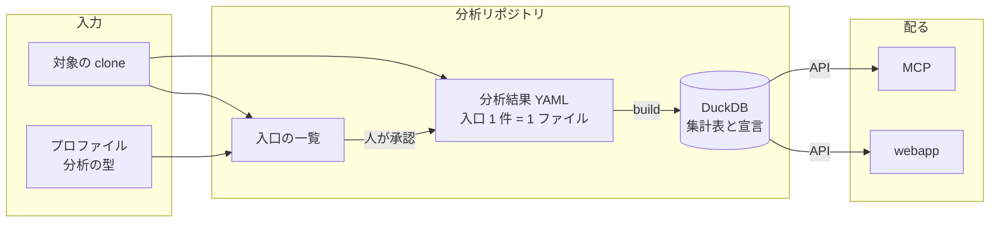

# architecture

as-built-atlas の仕組みの説明です。いま動いているものの、期待する状態を書きます。

as-built-atlas のリポジトリには、ほかに次の文書があります (分析リポジトリには配りません)。

| 文書 | 場所 |
|---|---|
| 開発で守ること | `docs/rules/` |
| 決定の経緯 | `docs/adr/` |
| 画面の見た目の決まり | `DESIGN.md` |

## 全体像

| 段 | 誰が | 何をするか |
|---|---|---|
| コードマップを作る | ツール | 固定コミットのファイルを並べ、規則で指定した入口の定義ファイルを特定する。[照合手順](impact.md) |
| 入口を列挙する | ツール | 対象から入口の候補を出す。同じコミットと同じ設定なら、同じ結果 |
| 今回の分析を承認する | 人 | AI が整理した疑問に答え、入口と作業を一度で確定する。[手順](impact.md) |
| 入口を分析する | エージェント | 入口から処理を辿り、根拠付きの YAML を書く |
| 集計する | ツール | YAML を表にし、集計表 (mart) を作る |
| 配る | ツール | 画面と MCP が、同じ API から集計表を読む |

## 登場人物

| 誰 | 何をするか |
|---|---|
| 保守担当 (人) | 分析する入口を承認する。画面で結果を読む |
| 分析するエージェント | 入口の拾い方を決め、道具で取れない入口を、根拠を付けて足す。入口ごとに処理を辿って、分析結果を書く。別の文脈でレビューする |
| 結果を使うエージェント | MCP で集計表を読む。分析するエージェントとは別の役 |

## 設計の考え方

もとは、ジョブスケジューラで動くバッチを、入口ごとにエージェントに分析させて、保守に使っていたやり方です。それを、バッチ以外の対象にも使えるように汎用にしました。

| 考え方 | 仕組みのどこに現れるか | 文書 |
|---|---|---|
| 人とエージェントが、同じ結果を見る | 正本は分析結果の YAML だけ。画面と MCP は、同じ API を読む | [api.md](api.md) |
| 入口を見つけるのはエージェント、確かめるのは人 | エージェントが書くのは、入口の拾い方 (抽出器とパラメータ) と、抽出器で取れない入口 (根拠と理由を付ける)。どちらも設定に書く。一覧はツールが作り、人が承認する | [pipeline.md](pipeline.md) |
| 決定論でできることは、決定論で行う | 列挙・検査・表への変換・集計は、ツールが行う。エージェントに任せるのは、入口を見つけることと、処理の読み取りだけ | [pipeline.md](pipeline.md) |
| 根拠の無い主張を出さない | 項目ごとに「事実 / 解釈 / 不明 + 理由」を持つ。根拠はファイルと行で、検査が実在を確かめる | [formats.md](formats.md) |
| 対象の種類は、プロファイルで増やす | 形式の定義・表への変換・コアの集計表・画面は、プロファイルに依らない | [profiles.md](profiles.md) |
| 集計表を足すと、画面と API が増える | 画面と API と MCP は、集計表の宣言だけを読む。集計表は、コア・プロファイル・分析リポジトリ独自の 3 層 | [pipeline.md](pipeline.md) |
| 配布物と、育てる資産を分ける | 配布物の更新は、配布物のコピーを置き換え、製品別の設定を作り直す。分析の資産と、エージェントの設定の正本には触らない | [analysis-repo.md](analysis-repo.md) |
| 仕組みと運用を分ける | 仕組みが持つのは、結果を正しく見るために要るものだけ。分析の回し方は決めない | 下の「仕組みに入れていないもの」 |

## 残るものと、作り直すもの

| もの | 置き場 | 扱い |
|---|---|---|
| 作業定義、入口の一覧 (拾い方・候補・承認の状態)、分析結果、レビューの指摘、独自の集計表 | `analysis/` (git で管理する) | 正本。残る |
| 表にした CSV、合成した dbt プロジェクト、DuckDB (集計表と宣言) | `analysis/data/` (git で管理しない) | 派生物。集計のたびに、正本から作り直す |

何かを変えたときに、やり直す範囲は次のとおりです。

| 変えたこと | やり直すこと |
|---|---|
| 対象のコミットを進めた | 作業定義と入口の一覧のコミットを書き換え、列挙からやり直す。[impact](impact.md) で入口ごとの変更理由を読み、追加分析・再分析・再利用を判断する |
| プロファイルの版を上げた。分析 skill の版が上がった | 版が違う結果を、分析し直す |
| 形式の項目名が変わった配布物に更新した | 項目名を移し (`migrate`)、検査と集計をやり直す |
| 集計表か宣言だけを変えた。形式の変わらない配布物に更新した | 集計だけをやり直す |

分析し直すかどうかの条件は、[formats.md](formats.md) の「来歴」にあります。

## 仕組みに入れていないもの

| もの | いまの状態 |
|---|---|
| 分析の回し方 (誰が、いつ、何件を並べて分析するか) | 入れない。体制ごとに違うので、運用で決める。仕組みは、分析し直すかを判定できる項目を持つだけ |
| 入口の拾い方に当たらなかった候補を、承認のときに見せること | 無い。構文を読む抽出器は、読めなかった場所を列挙のときに知らせる。エージェントがそこを読んで、入口を足す。足した入口には印が付く ([profiles.md](profiles.md) の「抽出器の契約」) |
| 正規表現で入口を拾う、コア同梱の抽出器 | 無い。足りないときは、専用の抽出器をプロファイルに置くか、エージェントが読んで足す |
| サーバや外部の接続先の台帳との突き合わせ | 無い。外部接続は、分析結果に現れたホストで集める |
| 画面からの書き込み | 集計のやり直しだけ。分析結果は、画面から直せない |

## 文書の地図

知りたいことから、読む文書を選びます。

| 知りたいこと | 文書 |
|---|---|
| 分析リポジトリの中身、コマンド、このリポジトリのどこに何があるか、前提と制約 | [analysis-repo.md](analysis-repo.md) |
| データが入口の一覧から集計表になるまでの流れ、集計表の一覧、集計表の宣言 | [pipeline.md](pipeline.md) |
| 集計表 API と MCP | [api.md](api.md) |
| 画面の作り (宣言からの組み立て、ファイルの分け方、足し方) | [webapp.md](webapp.md) |
| 分析結果の形式 (主張、処理の段、読み書き、根拠、来歴) | [formats.md](formats.md) |
| プロファイル (分析の型)、抽出器の契約、入口を包む入口、プロファイルの足し方と直し方 | [profiles.md](profiles.md) |
| 公開サンプルと、分析結果の突き合わせ (`evaluate`) | [examples.md](examples.md) |

## 言葉

この文書群は仕組みの説明なので、日本語の呼び名で書いています。画面は、英語の呼び名で出します。

| この文書での呼び名 | 画面での呼び名 | 意味 |
|---|---|---|
| 入口 | entry point | 処理が始まる所。バッチのジョブ、画面など。分析の単位 |
| 層 | layer | 処理が属する段。プロファイルの `layers` の 1 つ (例: scheduler、shell、program)。分析結果と入口の一覧では、項目 `layer` に層の id を書く |
| 区分 | tier | 層をまとめる役割の名前。プロファイルの `layers[].tier` (例: frontend、backend) |
| 処理の段 (フレーム) | function | 入口から呼ばれる処理 1 つ。分析結果の `callstack` の 1 要素 |
| 読み書き (I/O) | data access | 処理がデータや外部 API に触る箇所 |
| データ | datastore | 読み書きの相手。RDB、KVS、キュー、ファイルシステム、オブジェクトストレージ |
| 外部接続 | external API | 外部のサービスへの呼び出し |
| 共有処理 | shared function | 2 件以上の入口から呼ばれる処理 |
| 集計表 | mart | dbt で作る表。画面と MCP が読む |
| 不明 | unknown | 確かめられなかった主張。理由を必ず持つ |

設定や分析結果の項目名も、画面の呼び名と同じ語にそろえています (`layers`、`layer`、`tier`)。集計表の宣言で、集計表の持ち主 (core / profile / repo) を表す項目は `origin` です。

呼び名の正本は用語集 (`schema/vocab/terms.yaml`) です。仕組みは [pipeline.md](pipeline.md) の「画面に出す呼び名」にあります。
