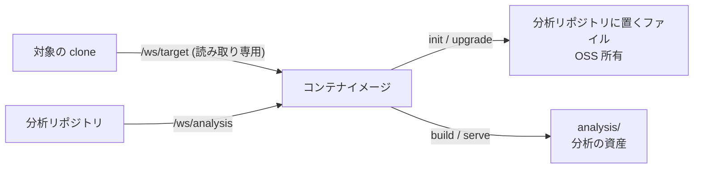

# 分析リポジトリと配布物

[← architecture の地図へ](README.md)

分析は、対象ごとに作る**分析リポジトリ**で行います。人はそこでコーディングエージェントを起動し、エージェントの設定 (中ハーネス) が振る舞いを固定します。

## 配布物は 2 つ

分析リポジトリに必要な依存は Docker だけです。Python、uv、dbt は分析リポジトリに置きません。

| 配布物 | 中身 |
|---|---|
| コンテナイメージ | ツール、dbt、形式の定義、プロファイル、dbt のテンプレート、エージェントの設定を生成するスクリプト |
| 分析リポジトリに置くファイル | skill、hook、参照物 (形式の定義・プロファイル・見本・文書)、`compose.yaml` |

## 分析リポジトリの中身

誰の持ち物かで、3 つに分かれます。

| 持ち主 | パス | 内容 |
|---|---|---|
| OSS (配布物) | `compose.yaml` | docker compose の定義。設定は `.env` に書く |
| OSS | `.abatlas/` | エージェントが読む参照物: `schema/`、`profiles/<id>/`、`tests/fixtures/`、`docs/architecture/`、`docs/guide/`、`docs/reference/`、`OWNED.md` |
| OSS | `.agents/skills/abatlas-*`、`.agents/skills/mid-harness` | skill の実体 (symlink ではない) |
| OSS | `scripts/agent-hooks/pre-tool-policy.sh` | hook の本体 |
| 分析リポジトリ | `AGENTS.md`、`CLAUDE.md`、`docs/` | エージェントの設定の正本。初回だけ置く |
| 分析リポジトリ | `.agents/harness.yaml`、`.agents/agent-specs/`、`.agents/memory/` | 同上。`memory/` は、このリポジトリ固有の分析の癖 |
| 分析リポジトリ | `.env` | `ABATLAS_TARGET` (対象の clone の場所) など |
| 分析リポジトリ | `analysis/` | 分析の資産 (下の表) |
| 生成物 | `.claude/`、`.codex/`、`.cursor/`、`.grok/`、`.github/`、`.agents/hooks.json` | 製品別の設定 (6 製品)。手で直さない。`upgrade` で作り直す |

OSS 所有のパスは、`abatlas upgrade` が配布物の内容で置き換えます (一覧は `.abatlas/OWNED.md`)。それ以外には触りません。

`analysis/` の中身は次のとおりです。

| パス | 内容 | git |
|---|---|---|
| `work-definition.yaml` | 作業定義。対象のリポジトリ・範囲・コミット、画面に出す名前、プロファイル | 管理する |
| `entry-list.yaml` | 入口の一覧、全体承認、分析待ちの仕事と再利用の記録 | 管理する |
| `batch-draft.yaml` | AI の判定理由と人に聞く質問。全体承認で使った内容は入口一覧にも残る | 管理する |
| `results/<file>` | 分析結果。入口 1 件 = 1 ファイル | 管理する |
| `reviews/<file>` | レビューの指摘 | 管理する |
| `data-dictionary.yaml` | データの辞書。列ごとの区分 (個人情報など)。無くてもよい | 管理する |
| `dbt/models/repo/` | この分析リポジトリ独自の集計表 | 管理する |
| `data/` | 派生物。`abatlas.duckdb` (集計表と宣言) と、合成した dbt プロジェクト | 管理しない (作り直せる) |

`<file>` は、入口 id の `/` を `__` に置き換えて `.yaml` を付けた名前です。

## コンテナからの見え方

| ホスト側 | コンテナ内 | 権限 |
|---|---|---|
| 分析リポジトリ | `/ws/analysis` | 読み書き |
| 対象の clone (`.env` の `ABATLAS_TARGET`) | `/ws/target` | 読み取り専用 |

ツールは、環境変数 `ABATLAS_TARGET_ROOT` (= `/ws/target`) があれば、作業定義の `clone_path` の代わりにそれを使います。

skill の中の書き方は、置き場によって読み替えます。

| skill の中の書き方 | 分析リポジトリでは | OSS の checkout で試すとき |
|---|---|---|
| `<oss>` | `.abatlas/` | checkout のルート |
| `<abatlas>` | `docker compose run --rm abatlas` | `uv run abatlas` |

## 前提と既知の制約

| 制約 | 内容 |
|---|---|
| ホストの `python3` | 分析リポジトリに必要なのは Docker、git、コーディングエージェント。例外として、hook のスクリプトが JSON を読むためにホストの `python3` (標準ライブラリだけ) を使う |
| 画面と API を開ける相手 | Host がループバック名 (または `ABATLAS_ALLOWED_HOSTS` に書いた名前) のときだけ開ける。応答には CSP (`default-src 'self'`) が付く |
| hook の実行 | 各製品が hook を実行するには、製品ごとの trust 設定が要る (`.agents/skills/mid-harness/references/adapters/`)。配布物では解決できない |
| Linux ホストでの所有者 | コンテナが書いたファイル (init / upgrade / build の出力) の所有者が root になる。macOS の Docker Desktop では起きない |
