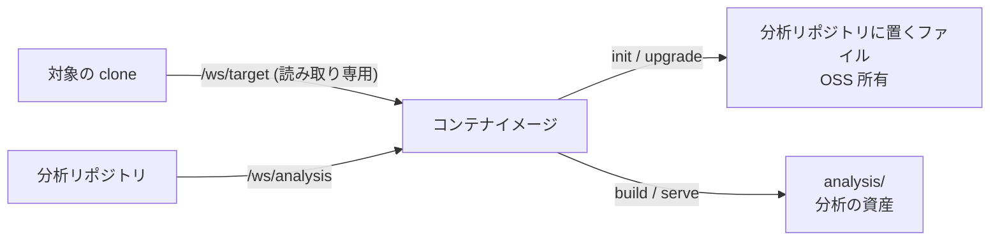

# 分析リポジトリと配布物

[← architecture の地図へ](README.md)

分析は、対象ごとに作る**分析リポジトリ**で行います。人はそこでコーディングエージェントを起動し、エージェントの設定 (中ハーネス) が振る舞いを固定します。

## 配布物は 2 つ

分析リポジトリに必要な依存は Docker だけです。Python、uv、dbt は分析リポジトリに置きません。

| 配布物 | 中身 |
|---|---|
| コンテナイメージ | ツール、dbt、形式の定義、プロファイル、dbt のテンプレート、エージェントの設定を生成するスクリプト |
| 分析リポジトリに置くファイル | skill、hook、参照物 (形式の定義・プロファイル・見本・文書)、`compose.yaml` |



## 分析リポジトリの中身

誰の持ち物かで、3 つに分かれます。

| 持ち主 | パス | 内容 |
|---|---|---|
| OSS (配布物) | `compose.yaml` | docker compose の定義。設定は `.env` に書く |
| OSS | `.abatlas/` | エージェントが読む参照物: `schema/`、`profiles/<id>/`、`tests/fixtures/`、`docs/architecture/`、`OWNED.md` |
| OSS | `.agents/skills/abatlas-*`、`.agents/skills/mid-harness` | skill の実体 (symlink ではない) |
| OSS | `scripts/agent-hooks/pre-tool-policy.sh` | hook の本体 |
| 分析リポジトリ | `AGENTS.md`、`CLAUDE.md`、`docs/` | エージェントの設定の正本。初回だけ置く |
| 分析リポジトリ | `.agents/harness.yaml`、`.agents/agent-specs/`、`.agents/memory/` | 同上。`memory/` は、このリポジトリ固有の分析の癖 |
| 分析リポジトリ | `.env` | `ABATLAS_TARGET` (対象の clone の場所) など |
| 分析リポジトリ | `analysis/` | 分析の資産 (下の表) |
| 生成物 | `.claude/`、`.codex/`、`.cursor/`、`.grok/`、`.github/`、`.agents/hooks.json` | 製品別の設定 (6 製品)。手で直さない。`upgrade` で作り直す |

OSS 所有のパスは、`abatlas upgrade` が配布物の内容で置き換えます (一覧は `.abatlas/OWNED.md`)。それ以外には触りません。

`analysis/` の中身は次のとおりです。

| パス | 内容 | git |
|---|---|---|
| `work-definition.yaml` | 作業定義。対象のリポジトリ・範囲・コミット、画面に出す名前、プロファイル | 管理する |
| `entry-list.yaml` | 入口の一覧 (承認の状態、階層パス付き) | 管理する |
| `results/<file>` | 分析結果。入口 1 件 = 1 ファイル | 管理する |
| `reviews/<file>` | レビューの指摘 | 管理する |
| `data-dictionary.yaml` | データの辞書。列ごとの区分 (個人情報など)。無くてもよい | 管理する |
| `dbt/models/repo/` | この分析リポジトリ独自の集計表 | 管理する |
| `data/` | 派生物。`abatlas.duckdb` (集計表と宣言) と、合成した dbt プロジェクト | 管理しない (作り直せる) |

`<file>` は、入口 id の `/` を `__` に置き換えて `.yaml` を付けた名前です。

## コンテナからの見え方

| ホスト側 | コンテナ内 | 権限 |
|---|---|---|
| 分析リポジトリ | `/ws/analysis` | 読み書き |
| 対象の clone (`.env` の `ABATLAS_TARGET`) | `/ws/target` | 読み取り専用 |

ツールは、環境変数 `ABATLAS_TARGET_ROOT` (= `/ws/target`) があれば、作業定義の `clone_path` の代わりにそれを使います。

skill の中の書き方は、置き場によって読み替えます。

| skill の中の書き方 | 分析リポジトリでは | OSS の checkout で試すとき |
|---|---|---|
| `<oss>` | `.abatlas/` | checkout のルート |
| `<abatlas>` | `docker compose run --rm abatlas` | `uv run abatlas` |

## コマンド

```bash
# 分析リポジトリを作る (最初の 1 回だけ docker run。以後は compose.yaml がある)
mkdir my-analysis && cd my-analysis
docker run --rm -v "$PWD:/ws/analysis" -w /ws/analysis ghcr.io/suwa-sh/as-built-atlas:latest init . --profile batch-kestra
```

`.env` の `ABATLAS_TARGET` と `analysis/work-definition.yaml` を埋めてから、次を使います。

| やること | コマンド |
|---|---|
| 作業定義を検査する | `docker compose run --rm abatlas validate work analysis/work-definition.yaml` |
| 入口の一覧を検査する | `docker compose run --rm abatlas validate entries analysis/entry-list.yaml` |
| 入口を列挙する | `docker compose run --rm abatlas enumerate analysis/entry-list.yaml` |
| 対象のコードを、構文で探す | `docker compose run --rm abatlas code-search analysis/work-definition.yaml --language <言語> --files <glob> --pattern '<コードの形>'` |
| 分析結果を検査する | `docker compose run --rm abatlas validate result analysis/results/<file> --work analysis/work-definition.yaml` |
| 分析結果に出てきた列を、データの辞書に足す | `docker compose run --rm abatlas dictionary .` (区分は決めない。案は skill `abatlas-classify-data` が書き、人が承認する) |
| 集計する | `docker compose run --rm abatlas build .` |
| 前の分析結果と比べる | `docker compose run --rm abatlas diff . --from <git の版>` (下の「分析結果の差分」) |
| 画面・API・MCP を起動する | `docker compose up -d api` (画面は <http://localhost:8765>、MCP は <http://localhost:8765/mcp>) |
| 配布物を更新する | `docker compose pull && docker compose run --rm abatlas upgrade . && docker compose up -d --force-recreate api` |
| 前の形式のファイルを、いまの形式に移す | `docker compose run --rm abatlas migrate . --dry-run` で、書き換わるファイルを見てから、`docker compose run --rm abatlas migrate .` |

検査と列挙は、プロファイルを、作業定義の `profile.dir` から自動で読みます (集計と同じファイル)。`--profile <profile.yaml>` で渡すこともできますが、集計が読むものと違うときは警告が出ます ([profiles.md](profiles.md) の「ツールが読むプロファイル」)。

`migrate` は、形式の項目名が変わった配布物に更新したときに使います。書き換えるのは、分析する側が持つファイル (入口の一覧、分析結果、独自の集計表の宣言、自分用のプロファイル) の項目の名前だけです。値とコメントは変えません。例外は 1 つで、文 (値) の中で項目を指している「(tier: <id>)」という書き方は、「(layer: <id>)」に直します。書き換えるのは、形式で決まった場所の項目だけです (抽出器の `params` や、入口の `attributes` のような、自由に書ける対応表の中は触りません)。機械で安全に移せないファイル (文やコメントや、自由に書ける対応表の中に、項目と同じ形の行がある、アンカーなどの特殊な書き方、前の名前といまの名前が並んでいる、コメントの中にも「(tier: <id>)」がある) は、書き換えずに知らせます (終了コード 1)。分析リポジトリの外と、配布物のコピー (`.abatlas/`) にあるファイルには、リンクを辿った先も含めて、触りません。リンクになっているファイルも、書き換えずに知らせます。集計表の宣言で直すのは、`abatlas:` の直下の `tier` だけです。SQL は書き換えず、前の名前らしい語があるファイルを知らせます。書き換えた後は、検査と集計をやり直します。

### 分析結果の差分

対象が変わった後に分析し直したら、`diff` で、前の分析結果と比べられます。比べる相手は、分析リポジトリの git の版 (コミット、タグ、`HEAD~1` など) にある分析結果です。分析結果を commit していることが前提です。

| 出るもの | 内容 |
|---|---|
| 1 行目 | 分析結果が変わった入口、足された入口、消えた入口の数 |
| `~ <入口>` | 変わった入口。観点 (入口の階層パスと層、処理の段と呼び出し元、読み書き、列、呼び出しの条件、つながり、権限の確認、設定、業務のルール、テスト) ごとに、足されたもの (`+`) と消えたもの (`-`) |
| `+ <入口>` / `- <入口>` | 分析結果が足された入口、消えた入口 |

- 比べるのは中身 (何を呼ぶか、どのデータをどう使うか) で、根拠の行番号と説明の文は見ません。対象の行がずれただけ、言い回しが変わっただけの違いは、出ません。
- 呼び出しの条件は、いつ起きるか (いつも / 条件つき / 失敗のとき) の変化だけを出します。条件の文だけが変わっても、出ません (分析のたびに言い回しが変わるためです)。
- 業務のルールは、内容の文で比べます。言い回しが変わると、「消えて、足された」と出ます。
- 同じ読み書きが 1 か所増えた、のような増減は、その個数の分だけ出ます。
- 分析の skill の版が違う結果どうしを比べると、観点が増えた分も差分に出ます (その旨が、入口の行に出ます)。
- コンテナの中で git が使えるように、分析リポジトリの `.git` が見える場所で実行します (`docker compose run` は、分析リポジトリのルートをマウントしています)。

エージェントへの MCP の登録は URL 1 行です (streamable HTTP)。

```bash
claude mcp add --transport http abatlas http://localhost:8765/mcp
```

### 作業定義に書くこと

| 項目 | 必須 | 内容 |
|---|---|---|
| `target.repo` | ○ | 対象の識別 (URL か名前) |
| `target.name` | | 画面の見出しとタブに出す名前。省略すると、`repo` の最後の区切りより後ろ |
| `target.clone_path` | | 対象の clone の場所。相対なら分析リポジトリのルートから |
| `target.scope` | | clone の中で分析する範囲 (モノレポの一部だけを対象にするとき)。既定は `.` |
| `target.commit` | ○ | 対象のコミット。列挙と分析は、このコミットで行う |
| `profile.id` | ○ | プロファイルの id |
| `profile.dir` | | プロファイルの置き場所。[profiles.md](profiles.md) の「ツールが読むプロファイル」 |
| `analysis.tests` | | `true` にすると、処理の段を通るテストも分析する。範囲 (`target.scope`) にテストのコードが入っているときだけ使う。既定は `false` |

## このリポジトリの構成 (配布物になるもの)

| パス | 役割 | 届く先 |
|---|---|---|
| `schema/*.schema.json`、`schema/vocab/*.yaml` | 形式の正本 (JSON Schema) と固定の語彙 (データの種類ごとの段と操作、不明の理由、画面に出す呼び名) | イメージ、`.abatlas/schema/` |
| `abatlas/` | Python パッケージ。検査、列挙、抽出器、ETL、init / upgrade / migrate、build、API、MCP、webapp (静的ファイル) | イメージ |
| `profiles/<id>/` | プロファイル。`profile.yaml`、`context.md`、`dbt-template/` | イメージ、`.abatlas/profiles/<id>/` (`dbt-template/` を除く) |
| `dbt-template/` | コアの dbt プロジェクト。**ここで直接 dbt を動かさない** | イメージ |
| `.agents/skills/abatlas-*` | 入口の発見・分析・レビューの skill | `.agents/skills/` |
| `.agents/skills/mid-harness/` | 同梱する mid-harness skill (`scripts/vendor-mid-harness.sh` で取り込む。出自は `VENDOR.md`) | イメージ、`.agents/skills/` |
| `Dockerfile` | 配布物のイメージ。`abatlas` がエントリポイント | ghcr.io (版のタグを push したときに出る) |
| `tests/` | コアのテストと見本 (`fixtures/result-housekeeping.yaml` が分析結果の正しい例) | 見本だけ `.abatlas/tests/fixtures/` |
| `examples/` | 公開サンプル ([examples.md](examples.md)) | イメージには入れない |

主なテストの役割は次のとおりです。

| テスト | 確かめること |
|---|---|
| `test_layout_api_mcp.py` | init → build → API → MCP の一周、プロファイルの読み先 |
| `test_round*_findings.py` | 外部レビューで見つかった問題の回帰 |
| `test_examples.py`、`test_examples_umami.py` | 公開サンプル |
| `test_webapp.py`、`test_terms.py` | 画面のファイルの分け方、画面に出す呼び名 |

## 前提と既知の制約

| 制約 | 内容 |
|---|---|
| ホストの `python3` | 分析リポジトリに必要なのは Docker、git、コーディングエージェント。例外として、hook のスクリプトが JSON を読むためにホストの `python3` (標準ライブラリだけ) を使う |
| 画面と API を開ける相手 | Host がループバック名 (または `ABATLAS_ALLOWED_HOSTS` に書いた名前) のときだけ開ける。応答には CSP (`default-src 'self'`) が付く |
| hook の実行 | 各製品が hook を実行するには、製品ごとの trust 設定が要る (`.agents/skills/mid-harness/references/adapters/`)。配布物では解決できない |
| Linux ホストでの所有者 | コンテナが書いたファイル (init / upgrade / build の出力) の所有者が root になる。macOS の Docker Desktop では起きない |
