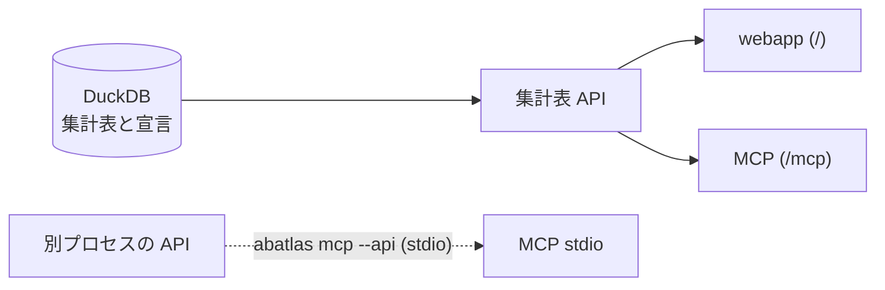

# 集計表 API と MCP

[← architecture の地図へ](README.md)

`abatlas serve` は、1 つのプロセスで API、MCP、webapp を出します。3 つとも、DuckDB の中の宣言と集計表を読みます ([pipeline.md](pipeline.md) の「集計表の宣言」)。

出すのは、宣言のある集計表だけです。途中の表 (staging) は出しません。

## エンドポイント

| エンドポイント | 返すもの |
|---|---|
| `GET /meta` | プロファイル、データの種類の語彙、用語集、分析対象 ([pipeline.md](pipeline.md) の「meta」) |
| `GET /marts` | 集計表の一覧。名前、説明、宣言、列 |
| `GET /marts/{name}` | 説明と件数 |
| `GET /marts/{name}/rows` | 行 (下の「行を読む」) |
| `GET /marts/{name}/tree` | 階層の 1 段 (下の「階層を 1 段ずつ降りる」) |
| `POST /marts/{name}/pivot` | 行の節 × 列の節 で畳んだ値 (下の「畳んだ値を読む」) |
| `POST /recompute` | 集計のやり直し (ETL → dbt build) |
| `POST /mcp` | MCP (streamable HTTP) |
| `GET /` と、その下の静的ファイル | webapp。上の API だけを読む |

## 行を読む (`rows`)

`GET /marts/{name}/rows?limit=&offset=&order=&<絞り込み>`

| 絞り込みの書き方 | 意味 |
|---|---|
| `<列>=<値>` | 一致 |
| `<列>__prefix=` | 前方一致 |
| `<列>__contains=` | 部分一致 (大文字と小文字を区別しない) |
| `<列>__under=` | 階層パスが、そのパス自身か、その下 |
| `<列>__min=`、`<列>__max=` | 数値の範囲 |

- `order=列` で並べ替えます。先頭に `-` を付けると降順です。
- 宣言に無い列で絞ると、400 を返します。
- 1 回の上限は 10000 行です。続きは `offset` で読みます。

## 階層を 1 段ずつ降りる (`tree`)

`GET /marts/{name}/tree?col=&under=&flag=&distinct=&<絞り込み>`

階層パスの列 `col` の、節 `under` の直下の子を返します。子ごとに次を返します。

| 返す値 | 意味 |
|---|---|
| 葉の数、行数 | その子の下にあるもの |
| 自身が葉か | これ以上降りられないか |
| `flag` 列の有無 | その子の下に、印 (例: 不明) の付いた行があるか |
| `distinct` 列の相異なる数 | その子の下の、別の列の種類の数 |

入口の階層もデータの階層も、画面はこれで 1 段ずつ降ります。全行は読みません。

## 畳んだ値を読む (`pivot`)

`POST /marts/{name}/pivot` (JSON: `row` / `col` / `value` / `flag` / `row_keys` / `col_keys` / `filters`)

行の節 × 列の節 で値を畳みます。節は 2000 個までです。

| 値の種類 | 畳み方 |
|---|---|
| 操作の 1 文字だけの文字列 | 和集合。`filters` に `keys.kind` の列があれば、その種類の語彙の並び順 |
| 数値 | 和 |
| それ以外 | 値を並べる |

## 集計のやり直し (`recompute`)

| 条件 | 応答 |
|---|---|
| 実行中 | 409 |
| Host がループバック名でない、または Origin が違う | 403 |

## MCP

MCP は、API の薄いラッパーです。

| ツール | 対応する API |
|---|---|
| `describe_atlas` | `GET /meta` |
| `list_marts` | `GET /marts` |
| `describe_mart` | `GET /marts/{name}` |
| `query_mart` | `GET /marts/{name}/rows` |
| `recompute` | `POST /recompute` |

| つなぎ方 | 動き |
|---|---|
| `abatlas serve` と同じプロセス (`/mcp`) | ASGI で API に直接つなぐ (ポートを経由しない) |
| `abatlas mcp --api <url>` | stdio で動き、別プロセスの API を呼ぶ |

## 開ける相手の制限

API と MCP は、DNS rebinding の対策として、Host と Origin を検査します。

- 許す名前は、ループバック名と、`ABATLAS_ALLOWED_HOSTS` に書いた名前です。
- MCP の許可は、API と同じ集合から作ります。ポートの有無は、どちらも許します。
