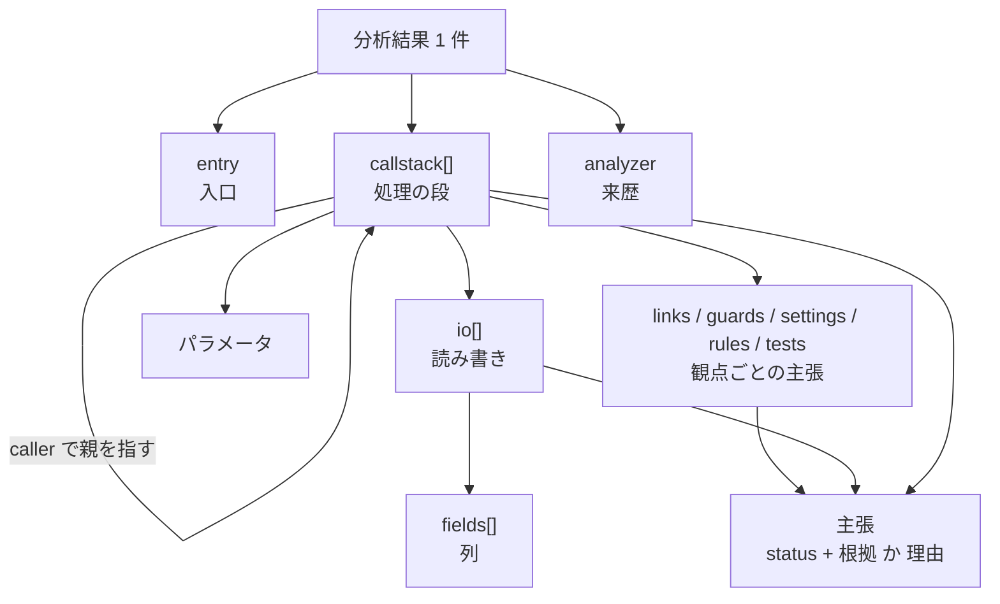

# 分析結果の形式

[← architecture の地図へ](README.md)

分析結果は、入口 1 件につき YAML 1 ファイルです。形式の正本は `schema/analysis-result.schema.json`、正しい例は `tests/fixtures/result-housekeeping.yaml` です。ここでは、形式の考え方を書きます。

## 主張

分析結果の項目は、すべて「主張」です。主張は `status` を持ちます。

| `status` | 呼び名 | 意味 | 必ず持つもの |
|---|---|---|---|
| `fact` | 事実 | コードや定義に、そのまま書いてある | `evidence` |
| `interpretation` | 解釈 | 読み取って要約した | `evidence` |
| `unknown` | 不明 | 分からない | `reason` |

`evidence` は、ファイルと行です。`reason` は、`schema/vocab/unknown-reasons.yaml` の key です。

## 処理の段 (`callstack`)

| 決まり | 内容 |
|---|---|
| 親の指し方 | 各段は `caller` で呼び出し元を指す |
| 入口の段 | `caller: null`。層は `entry.layer` と同じ |
| 到達できること | すべての段に、入口から `caller` を辿って到達できる。循環と、切れた参照は不可 |
| 層 | 各段は `layer` (層の id) を名乗る。機械チェックが、プロファイルの層と突き合わせる |
| 層の順序 | 検査しない。program → shell のような逆向きの呼び出しは実在する |
| 葉 (誰も呼ばない段) | 外との境の層 (boundary) か、読み書きか業務のルールを持つか、不明の主張を持つ。業務のルールだけを持つ葉は、読み書きも外部の呼び出しもしない、判定や計算の関数 |

## 読み書き (`io`)

`io[]` は、`op` (操作) と、`resource.kind` (種類) + `resource.levels` (段) を持ちます。**操作は、データの種類ごとに決まっています。** 正本は `schema/vocab/resource-kinds.yaml` です。

| 種類 (`kind`) | 操作 (`op`) |
|---|---|
| `rdb` | create / read / update / delete |
| `kvs` | get / set / delete / expire |
| `queue` | publish / consume |
| `filesystem` | read / write / append / delete / list |
| `object_storage` | get / put / delete / list |
| `external_api` | call |

- 各操作は、表のセルに出す 1 文字 (`letter`) と、データの流れの向き (`direction`: in = 読む側、out = 書く側) を持ちます。
- 段の名前も、同じファイルに従います。
- 分からない段は書きません。主張全体を `unknown` + `reason` にします。
- 機械チェックと ETL が、種類と操作の組み合わせを検査します。
- プロファイルの層が `io` を宣言していれば、その層の段の読み書きは、その種類に限られます。

## 呼び出しの条件 (`call.when`)

呼び出しの主張は、その呼び出しがいつ起きるかを持ちます。

| `when` | いつ | `condition` |
|---|---|---|
| `always` | 呼び出し元が動けば、必ず呼ぶ | 書かない |
| `conditional` | 条件を満たすときだけ呼ぶ | 必ず書く (1 文)。`when` を書かずに `condition` だけを書くことはできない |
| `on_failure` | 呼び出し元の処理が失敗したときだけ呼ぶ (例外の処理、失敗の通知、後片付け、やり直し) | 必ず書く (何が失敗したときか) |

- 入口の段は、呼び出し元が無いので、書きません。
- `when` が無い呼び出しは、「分析していない」です (この観点を書く前の版の結果)。
- 失敗したときの動きは、この `on_failure` で表します。まとめて取り消される範囲や、やり直しの安全さは、持ちません。

## 列 (`io[].fields`)

読み書きは、触る列を持てます。

| 項目 | 内容 |
|---|---|
| `name` | 列の名前。データの側の名前で書く。全部の列は `*` |
| `use` | 使い方の並び。`read` (値を読む)、`write` (値を書く)、`filter` (絞り込み・結合・並べ替えの条件に使う) |
| `set_to` | 書く値が決まっているときの値 (状態の列に書く値)。`use` に `write` があるときだけ |

- 同じ読み書きの中で、同じ列を 2 回書きません (使い方は `use` にまとめます)。
- 列が読めないときは、`fields` を書きません。
- 列ごとの区分 (個人情報など) は、ここには書きません。下の「データの辞書」に書きます。

## 観点ごとの主張 (処理の段)

処理の段は、次の並びを持てます。どれも主張なので、`status` と、根拠か理由を持ちます。見て無かったときは、並びごと書きません。

| 並び | 書くこと | 主な項目 |
|---|---|---|
| `links` | ほかの入口へのつながり | `kind` (`navigate` = 画面の遷移 / `trigger` = 起動 / `overlay` = 重ねて開く画面)、`target` (コードに書いてあるとおりの行き先)、`entry_id` (行き先の入口が分かるとき) |
| `guards` | 権限の確認 | `kind` (`authentication` / `role` / `permission` / `ownership` / `other`)、`value` (求める値。役割・権限・持ち主の確認では、不明でなければ必ず書く) |
| `settings` | 動きを変える設定 | `name`、`kind` (`env` / `feature_flag` / `config_file` / `remote` / `other`)、`effect` (動きがどう変わるか。不明でなければ必ず書く) |
| `rules` | 業務のルール | `kind` (`calculation` / `validation` / `decision`)、`value` (内容。不明でなければ必ず書く) |
| `tests` | この段 (関数やスクリプト) を直接呼ぶテスト | `name`、`kind` (`unit` / `integration` / `e2e`) |

- 同じリポジトリの中の関数の呼び出しは、`links` ではなく `caller` で表します。外部の API は、`io` に書きます。
- つながりの行き先は、集計が、入口の一覧と突き合わせます (`entry_id` があればそれ、無ければ `target` が入口の id か階層パスと一致するもの)。
- 権限の確認は、確認を実際に行っている段に書きます。入口ごとの「認証が要るか」は、集計が、その入口を包む入口の確認と合わせて出します。
- `tests` は、作業定義の `analysis.tests` が `true` のときだけ分析します。分析した結果は、`analyzer.tests: true` を持ちます (これが無い結果で `tests` が空でも、「テストが無い」とは言えません)。

## データの辞書 (`analysis/data-dictionary.yaml`)

列ごとの区分 (個人情報、認証の情報など) は、分析結果ではなく、分析リポジトリに 1 つある辞書に書きます。同じ列の区分が、入口ごとにぶれないようにするためです。形式の正本は `schema/data-dictionary.schema.json`、区分の語彙は `schema/vocab/data-categories.yaml` です。

| 項目 | 内容 |
|---|---|
| `resource` | データを 1 本のパスにしたもの (`/` + 種類 + 分かっている段の値)。集計表の `resource_path` と同じ |
| `field` | 列の名前 (分析結果と同じ綴り) |
| `category` | 区分。語彙の key。無ければ、まだ区分していない |
| `status` | `candidate` (案) か `approved` (人が確かめた)。集計は、`approved` だけを使う |

- 列を足すのは、コマンド `abatlas dictionary` だけです。既にある行の値は変えません。列を足すときにファイルを書き直すので、手で書いたコメントは残りません (メモは `note` に書きます)。
- 区分の案は、skill `abatlas-classify-data` が書きます。承認は、人がします。
- 区分 `none` は、「確かめた結果、どれにも当てはまらない」です。

## 根拠の実在

`validate result` に `--work` (作業定義) を渡すと、次を検査します。

- 根拠と `source` のファイルが、範囲 (scope) の中に実在する。
- 行番号が、ファイルの行数以内である。

範囲を解決できないときは、その旨が指摘として出ます (黙って省きません)。コンテナでは、`ABATLAS_TARGET_ROOT` (= `/ws/target`) が `clone_path` の代わりになります。

## 来歴 (`analyzer`) と、再分析の判定

| 項目 | 中の項目 | 内容 | 書く人 |
|---|---|---|---|
| `profile` | `id` `version` | 分析に使ったプロファイル | 分析 skill |
| `skill_version` | — | 分析 skill の版 | 分析 skill |
| `model` | — | モデル | 分析 skill |
| `tests` | — | テストとの対応を分析したか。作業定義で選んだときだけ `true` | 分析 skill |
| `analyzed_at` | — | 分析した日時 | 分析 skill |
| `reviewed` | `by` `at` `findings_open` | レビューの記録 | レビューの後 |
| `run` | `cost_usd` `duration_s` `by` | 費用と時間。任意 | エージェントを呼び出した側 |

**再分析しない条件**: `target.commit`、`analyzer.profile.version`、`analyzer.skill_version` の 3 つが一致し、テストとの対応の選択 (作業定義の `analysis.tests` と、結果の `analyzer.tests`) も同じ結果があるとき。判定は、運用側のランナーが行います (コアは項目を持つだけです)。

| 決まり | 理由 |
|---|---|
| skill の版を上げるのは、出力の形や判断の規則が変わったときだけ。変えた理由を、skill の末尾に書く | 版を上げると、旧版で書かれた結果がすべて再分析の対象になる |
| 分析 skill は `analyzer.run` を書かない | 実行中のセッションは、自身の費用を知れない。`claude -p` などを呼んだ側が、終了後に書く。進み具合の集計表の見積もりに使う |
