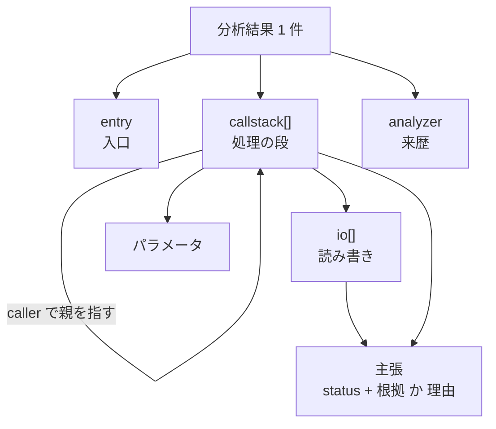

# 分析結果の形式

[← architecture の地図へ](README.md)

分析結果は、入口 1 件につき YAML 1 ファイルです。形式の正本は `schema/analysis-result.schema.json`、正しい例は `tests/fixtures/result-housekeeping.yaml` です。ここでは、形式の考え方を書きます。

## 主張

分析結果の項目は、すべて「主張」です。主張は `status` を持ちます。

| `status` | 呼び名 | 意味 | 必ず持つもの |
|---|---|---|---|
| `fact` | 事実 | コードや定義に、そのまま書いてある | `evidence` |
| `interpretation` | 解釈 | 読み取って要約した | `evidence` |
| `unknown` | 不明 | 分からない | `reason` |

`evidence` は、ファイルと行です。`reason` は、`schema/vocab/unknown-reasons.yaml` の key です。

## 処理の段 (`callstack`)

| 決まり | 内容 |
|---|---|
| 親の指し方 | 各段は `caller` で呼び出し元を指す |
| 入口の段 | `caller: null`。層は `entry.layer` と同じ |
| 到達できること | すべての段に、入口から `caller` を辿って到達できる。循環と、切れた参照は不可 |
| 層 | 各段は `layer` (層の id) を名乗る。機械チェックが、プロファイルの層と突き合わせる |
| 層の順序 | 検査しない。program → shell のような逆向きの呼び出しは実在する |
| 葉 (誰も呼ばない段) | 外との境の層 (boundary) か、読み書きを持つか、不明の主張を持つ |

## 読み書き (`io`)

`io[]` は、`op` (操作) と、`resource.kind` (種類) + `resource.levels` (段) を持ちます。**操作は、データの種類ごとに決まっています。** 正本は `schema/vocab/resource-kinds.yaml` です。

| 種類 (`kind`) | 操作 (`op`) |
|---|---|
| `rdb` | create / read / update / delete |
| `kvs` | get / set / delete / expire |
| `queue` | publish / consume |
| `filesystem` | read / write / append / delete / list |
| `object_storage` | get / put / delete / list |
| `external_api` | call |

- 各操作は、表のセルに出す 1 文字 (`letter`) と、データの流れの向き (`direction`: in = 読む側、out = 書く側) を持ちます。
- 段の名前も、同じファイルに従います。
- 分からない段は書きません。主張全体を `unknown` + `reason` にします。
- 機械チェックと ETL が、種類と操作の組み合わせを検査します。
- プロファイルの層が `io` を宣言していれば、その層の段の読み書きは、その種類に限られます。

## 根拠の実在

`validate result` に `--work` (作業定義) を渡すと、次を検査します。

- 根拠と `source` のファイルが、範囲 (scope) の中に実在する。
- 行番号が、ファイルの行数以内である。

範囲を解決できないときは、その旨が指摘として出ます (黙って省きません)。コンテナでは、`ABATLAS_TARGET_ROOT` (= `/ws/target`) が `clone_path` の代わりになります。

## 来歴 (`analyzer`) と、再分析の判定

| 項目 | 中の項目 | 内容 | 書く人 |
|---|---|---|---|
| `profile` | `id` `version` | 分析に使ったプロファイル | 分析 skill |
| `skill_version` | — | 分析 skill の版 | 分析 skill |
| `model` | — | モデル | 分析 skill |
| `analyzed_at` | — | 分析した日時 | 分析 skill |
| `reviewed` | `by` `at` `findings_open` | レビューの記録 | レビューの後 |
| `run` | `cost_usd` `duration_s` `by` | 費用と時間。任意 | エージェントを呼び出した側 |

**再分析しない条件**: `target.commit`、`analyzer.profile.version`、`analyzer.skill_version` の 3 つが一致する結果があるとき。判定は、運用側のランナーが行います (コアは項目を持つだけです)。

| 決まり | 理由 |
|---|---|
| skill の版を上げるのは、出力の形や判断の規則が変わったときだけ。変えた理由を、skill の末尾に書く | 版を上げると、旧版で書かれた結果がすべて再分析の対象になる |
| 分析 skill は `analyzer.run` を書かない | 実行中のセッションは、自身の費用を知れない。`claude -p` などを呼んだ側が、終了後に書く。進み具合の集計表の見積もりに使う |
