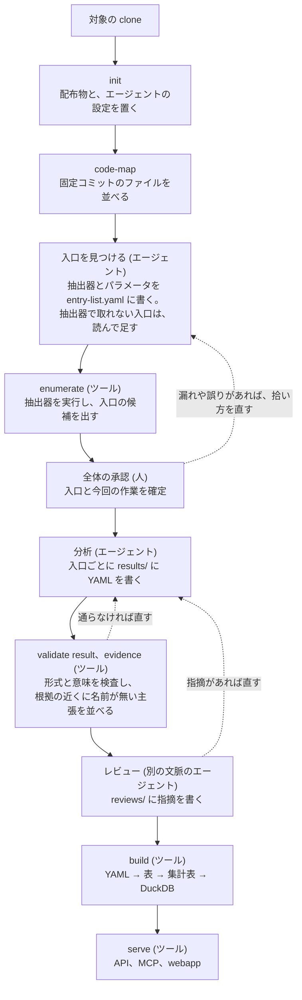
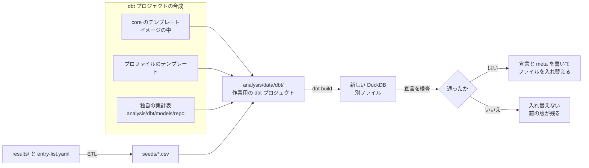

# データの流れと集計表

[← architecture の地図へ](README.md)

対象のコードから、画面と MCP が読む集計表 (mart) ができるまでの流れです。

## 流れ

| 段 | 誰が | 入力 | 出力 |
|---|---|---|---|
| init | ツール | プロファイルの id | OSS 所有のファイル、作業定義のひな形、エージェントの設定 (6 製品分) |
| code-map | ツール | 作業定義、対象 Git | ファイルの一覧。定義ファイルの規則を指定すると、承認前に入口と[照合](../reference/update-commands.md)する |
| 入口を見つける | エージェント (入口発見 skill) | 対象のコード | `entry-list.yaml` の `extractors`。抽出器で取れない入口は、根拠と理由を付けて、`listed` 抽出器の設定に書く |
| enumerate | ツール | `extractors` | `entries` (`status: candidate`)。抽出器の出力は形式を検査する |
| 全体の承認 | 人 | AI が準備した入口・作業案と要確認への回答 | `entry-list.yaml` の入口の状態と `approval`。取りまとめ役が入口ごとに実行する |
| 分析 | エージェント (分析 skill) | 承認済みの入口、`.agents/memory` の癖 | `results/<file>` |
| validate result | ツール | 分析結果 | 指摘。形式に加えて、層・呼び出し元・不明の理由・根拠の実在を見る |
| evidence | ツール | 分析結果、対象のコード | 根拠の行の近くに名前が見つからない主張の一覧。合否は付けない。分析する側が根拠を直すか理由を書き、レビューが先に確かめる ([commands.md](../reference/commands.md)) |
| レビュー | エージェント (レビュー skill) | 分析結果 | `reviews/<file>`。形式を検査する |
| build | ツール | `results/`、`entry-list.yaml`、プロファイル | `analysis/data/abatlas.duckdb` |
| serve | ツール | DuckDB | API、MCP (`/mcp`)、webapp (`/`) |

入口を列挙する主体は、エージェントです。抽出器は、その土台です。抽出器が取れた入口も、エージェントが足した入口も、同じ `entries` に並び、人が承認します。エージェントが足した入口には、印 (`attributes.listed_by: agent`) と理由が付きます ([profiles.md](../reference/profiles.md) の「抽出器の契約」)。

分析にかかった費用と時間 (`analyzer.run`) は、エージェントを呼び出した側が後から追記します。分析 skill は書きません ([formats.md](../reference/formats.md) の「来歴」)。

## build の中身

集計は、分析結果を、検査のコマンド (`validate result`) と同じ検査に通してから始めます (形式、呼び出しの木、語彙、列、プロファイルの層との突き合わせ)。1 件でも通らなければ、何も書かずに止まります。検査で落ちる結果が、集計には通る、ということが無いようにするためです。検査のコマンドとの違いは 2 つです。根拠のファイルの実在と行数は、対象の clone が読めるときだけ見ます (読めない場所でも、集計は動かせます)。有効な[再利用の確認記録](../reference/update-commands.md)がなく、対象 (リポジトリ、範囲、コミット) が作業定義と違う結果は、止めずに知らせます (対象を更新した後、入口を 1 件ずつ分析し直す間も、集計して画面で見られるようにするためです)。

| 決まり | 理由 |
|---|---|
| ETL は決定論 (同じ入力なら同じ CSV) | 再現できる処理はツールが行う |
| DuckDB は別ファイルに作ってから入れ替える | API が読んでいる最中でも壊れない |
| 宣言の検査に通らなければ入れ替えない | 画面と MCP に、読めない宣言を出さない |
| 一部だけ build しても (`--select`)、宣言はすべて検査する | 選ばなかった表も、引き継いだ DuckDB の中にある |
| 読んだプロファイルを検査する | [profiles.md](../reference/profiles.md) の「ツールが読むプロファイル」 |

`POST /recompute` (画面の「mart を rebuild」) も、同じ build をやり直します。

## 集計表の 3 層

| 持ち主 (`origin`) | 置き場 | 合成先 (派生物) | 直す人 |
|---|---|---|---|
| core | イメージの `dbt-template/models/core/` | `analysis/data/dbt/models/core/` | OSS |
| profile | イメージの `profiles/<id>/dbt-template/models/profile/`。作業定義の `profile.dir` に `dbt-template/` があれば、そちら | `analysis/data/dbt/models/profile/` | OSS (写したプロファイルなら分析リポジトリ) |
| repo | `analysis/dbt/models/repo/` | `analysis/data/dbt/models/repo/` | 分析リポジトリ |

分析リポジトリには core と profile のモデルを置きません。配布物との版のずれを気にする対象は、`analysis/dbt/models/repo/` だけです。

## 同じ木の繰り返し

分析結果は、入口 1 件 = 1 つの木です。同じ処理が、木の中や、入口の間で繰り返されることがあります。集計は、次の 2 つを行います。

| 繰り返し | 起きること | 集計の扱い |
|---|---|---|
| 同じ入口の中で、同じ処理を、もう一度書いたフレーム (分析の決まりで、呼び出し元を終端にしないために書く写しと、呼び出し元によって開く枝が違うときに書く写し) | 写しの読み書きを数えると、同じ読み書きを 2 回数える | 読み書きの行に印 (`stg_io` と `stg_io_fields` の `is_repeat`) を付け、箇所の数 (入口の概要、読み書きの表、列の読み書き、層のつながり、状態の変化) から除く。行そのものは残す (経路の表示に使う)。除くのは箇所の数だけで、不明の印と、列の使い方は、写しの分も合わせる |
| 多くの入口が通る、大きな処理 (多くの画面が描く部品など) | 入口の数だけ、同じ木が分析結果に書かれる。分析の費用が増え、入口ごとに書き方が割れる | 候補を出す (`mart_split_candidates`)。出すのは、プロファイルが、別の入口に分けられると決めた層 (`profile.yaml` の `split_from`) の処理だけ。その部品を別の入口に分けるかは、人が決める ([ui-nextjs.md](../reference/profiles/ui-nextjs.md)、経緯は ADR 0014 と 0016) |

`is_repeat` の判定は、決定論です: 定義の場所 (ファイルと行)・名前・層が同じフレームのうち、入口の中で、より前のフレームに、同じ相手 (種類とパス) への同じ操作がある読み書き (最初のフレームに読み書きが無く、後の 2 つに同じ読み書きがあるときは、後ろの 1 つだけが当たる)。引数で届く先が変わる処理を、届く先ごとに書いたとき (相手が違う) は、当たりません。
