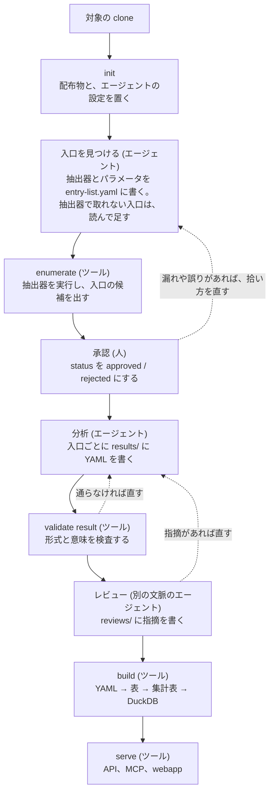
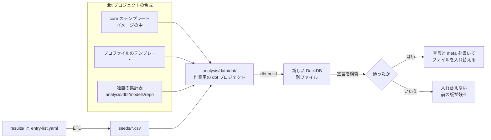
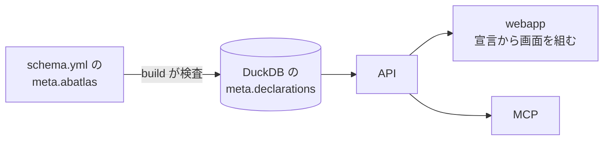
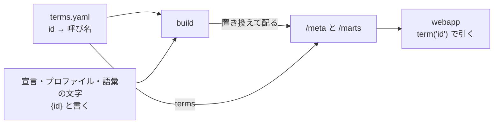

# データの流れと集計表

[← architecture の地図へ](README.md)

対象のコードから、画面と MCP が読む集計表 (mart) ができるまでの流れです。

## 流れ

| 段 | 誰が | 入力 | 出力 |
|---|---|---|---|
| init | ツール | プロファイルの id | OSS 所有のファイル、作業定義のひな形、エージェントの設定 (6 製品分) |
| 入口を見つける | エージェント (入口発見 skill) | 対象のコード | `entry-list.yaml` の `extractors`。抽出器で取れない入口は、根拠と理由を付けて、`listed` 抽出器の設定に書く |
| enumerate | ツール | `extractors` | `entries` (`status: candidate`)。抽出器の出力は形式を検査する |
| 承認 | 人 | `entries` | `entries[].status` = `approved` / `rejected` |
| 分析 | エージェント (分析 skill) | 承認済みの入口、`.agents/memory` の癖 | `results/<file>` |
| validate result | ツール | 分析結果 | 指摘。形式に加えて、層・呼び出し元・不明の理由・根拠の実在を見る |
| レビュー | エージェント (レビュー skill) | 分析結果 | `reviews/<file>`。形式を検査する |
| build | ツール | `results/`、`entry-list.yaml`、プロファイル | `analysis/data/abatlas.duckdb` |
| serve | ツール | DuckDB | API、MCP (`/mcp`)、webapp (`/`) |

入口を列挙する主体は、エージェントです。抽出器は、その土台です。抽出器が取れた入口も、エージェントが足した入口も、同じ `entries` に並び、人が承認します。エージェントが足した入口には、印 (`attributes.listed_by: agent`) と理由が付きます ([profiles.md](profiles.md) の「抽出器の契約」)。

分析にかかった費用と時間 (`analyzer.run`) は、エージェントを呼び出した側が後から追記します。分析 skill は書きません ([formats.md](formats.md) の「来歴」)。

## build の中身

集計は、分析結果を、検査のコマンド (`validate result`) と同じ検査に通してから始めます (形式、呼び出しの木、語彙、列、プロファイルの層との突き合わせ)。1 件でも通らなければ、何も書かずに止まります。検査で落ちる結果が、集計には通る、ということが無いようにするためです。検査のコマンドとの違いは 2 つです。根拠のファイルの実在と行数は、対象の clone が読めるときだけ見ます (読めない場所でも、集計は動かせます)。対象 (リポジトリ、範囲、コミット) が作業定義と違う結果は、止めずに知らせます (対象を更新した後、入口を 1 件ずつ分析し直す間も、集計して画面で見られるようにするためです)。

| 決まり | 理由 |
|---|---|
| ETL は決定論 (同じ入力なら同じ CSV) | 再現できる処理はツールが行う |
| DuckDB は別ファイルに作ってから入れ替える | API が読んでいる最中でも壊れない |
| 宣言の検査に通らなければ入れ替えない | 画面と MCP に、読めない宣言を出さない |
| 一部だけ build しても (`--select`)、宣言はすべて検査する | 選ばなかった表も、引き継いだ DuckDB の中にある |
| 読んだプロファイルを検査する | [profiles.md](profiles.md) の「ツールが読むプロファイル」 |

`POST /recompute` (画面の「mart を rebuild」) も、同じ build をやり直します。

## 集計表の 3 層

| 持ち主 (`origin`) | 置き場 | 合成先 (派生物) | 直す人 |
|---|---|---|---|
| core | イメージの `dbt-template/models/core/` | `analysis/data/dbt/models/core/` | OSS |
| profile | イメージの `profiles/<id>/dbt-template/models/profile/`。作業定義の `profile.dir` に `dbt-template/` があれば、そちら | `analysis/data/dbt/models/profile/` | OSS (写したプロファイルなら分析リポジトリ) |
| repo | `analysis/dbt/models/repo/` | `analysis/data/dbt/models/repo/` | 分析リポジトリ |

分析リポジトリには core と profile のモデルを置きません。配布物との版のずれを気にする対象は、`analysis/dbt/models/repo/` だけです。

## コアの集計表

| 集計表 | 表示の種類 | 内容 |
|---|---|---|
| `mart_layer_flow` | 層の図 | 層のつながり。呼び出しと読み書きを、層の単位に集めたもの |
| `mart_entry_overview` | 表 | 入口ごとの概要。分析済みか、処理の段の数、読み書きの数、事実 / 解釈 / 不明の件数、実行の記録、古い版のプロファイルで分析したか (`profile_stale`) |
| `mart_entry_complexity` | 表 | 入口ごとの複雑度。分析済みの入口だけ。1 つの点数にまとめず、数を並べる (下の「複雑度」) |
| `mart_progress` | 指標 | 階層の第 1 段ごとの、入口の数 / 承認済み / 分析済み。実行の記録があれば、実績の費用と残りの見積もり |
| `mart_quality_unknowns` | 表 | 不明の主張を、理由別に数える |
| `mart_data_access` | 行列 | 読み書きするデータ。入口の階層 × データの階層 |
| `mart_dataflow` | 有向グラフ | 読むデータ → 入口 → 書くデータ |
| `mart_callstack` | ツリー | 入口ごとの処理の段と、親子関係 |
| `mart_sequence` | シーケンス | 入口ごとに、呼び出しと読み書きを順に並べたもの |
| `mart_external_if` | 表 | 外部 API のホストごとに、呼んでいる入口 |
| `mart_shared_frames` | 表 | 2 件以上の入口から呼ばれる同じ処理 |
| `mart_entry_within` | 表 | 入口を包む入口。1 行 = 包まれる入口 × 包む入口 |
| `mart_field_access` | 表 | 列の単位の読み書き。入口 × データ × 列ごとに、使い方 (R = 読む、W = 書く、F = 絞り込みに使う) |
| `mart_state_changes` | 表 | 状態の変化。決まった値を書く列ごとに、その値と、書く入口と処理 |
| `mart_entry_links` | 表 | 入口から、ほかの入口へのつながり。行き先が入口の一覧と結べたかも持つ |
| `mart_entry_access` | 表 | 入口ごとの権限のまとめ。認証の確認があるか、求める役割と権限 |
| `mart_entry_guards` | 表 | 権限の確認の一覧。入口を包む入口の確認も、その入口の行として出す |
| `mart_call_conditions` | 表 | いつも起きるとは限らない呼び出し (条件つき、失敗のときだけ) と、その条件 |
| `mart_settings` | 表 | 設定への依存。設定 × 入口ごとに、使う処理と、動きへの影響 |
| `mart_rules` | 表 | 業務のルールの一覧。内容と、根拠の場所 |
| `mart_test_coverage` | 表 | 処理ごとの、それを直接呼ぶテストの数と名前。テストとの対応を分析した結果だけ |
| `mart_sensitive_data` | 表 | 個人情報などの流れ。データの辞書で承認した列を使う入口と、同じ入口が呼ぶ外部の接続先 |
| `mart_unreached_files` | 表 | どの入口からも辿られないファイル。対象の範囲にあって、分析結果のどこにも出てこないもの |

補足です。

| 集計表 | 補足 |
|---|---|
| `mart_layer_flow` | 行 = 呼ぶ側の層 → 呼ばれる側の層、または 層 → `/` + データの種類。`calls` = 箇所の数、`entries` = 入口の数、`unknowns` = 確かめられていない箇所の数。`unknowns` が 1 つでもあれば `status` = unknown で、図では点線。区分 (`subject`) を持たず、構成のページが表示の種類 (`view: layers`) で引く。集計表のページも同じ図を出す |
| `mart_data_access` | `kind` 列が種類。`ops` は、種類ごとの操作の 1 文字を語彙の並び順に連ねたもの (RDB なら C / R / U / D、ファイルなら R / W / A / D / L) |
| `mart_dataflow` | 向きは語彙の `direction` (in = 読む側、out = 書く側) |
| `mart_entry_within` | `ord` が外側からの順。入口の一覧の `within` から作る。包む関係を持たないプロファイルでは 0 行 |

### 足した観点の集計表

`mart_field_access` から `mart_sensitive_data` までの 10 個は、分析結果の観点 ([formats.md](formats.md)) から作ります。`mart_unreached_files` は、対象の範囲にあるファイルと、分析結果を突き合わせて作ります。

| 決まり | 内容 |
|---|---|
| 置き場 | 区分は、分析の観点 (`subject: aspect`)。分析の観点のページに、タブで 1 つずつ出る。入口のページでは、その入口に絞ったタブとして出る (入口の列を持たない `mart_unreached_files` は、出ない) |
| 前の版の結果 | 観点を書く前の版 (分析の skill が 0.4.0 より前) の結果は、その項目を持たないので、これらの表に自分の行を出さない。例外は `mart_entry_guards` で、包む入口が新しい版で分析されていれば、その確認が、前の版の包まれる入口の行としても出る。`mart_entry_access` は、観点を分析した結果だけを 1 行ずつ出すので、「分析していない」と「確認が無い」を区別できる |
| 確かめられなかったテスト | `status` が `unknown` のテストは、`mart_test_coverage` の数と名前に入れない。数は `unknown_test_count` に出す |
| 確かめられなかった確認 | `status` が `unknown` の確認は、`mart_entry_access` の `authentication` に数えず、求める役割と権限にも並べない。数は `unknown_guard_count` に出す |
| 包む入口の確認 | `mart_entry_guards` は、入口を包む入口 (枠) の確認も、包まれる入口の行として出す (`inherited`)。包む入口がまだ分析されていないと数えられないので、`mart_entry_access` の `enclosing_not_analyzed` で分かるようにしている |
| 全部の列 | 列が `*` の読み書きは、`mart_sensitive_data` では、そのデータの、辞書にある列すべてを使うものとして数える |
| 辿られないファイル | `mart_unreached_files` は、集計のときに対象の clone を読んで、範囲にあるファイルを並べる (git の管理下なら、管理されているファイルだけ)。対象が読めない場所で集計すると、空になる。分析していない入口が残っている間は、そこからだけ辿られるファイルも出るので、使われていないものの候補と、分析が届いていない範囲が混ざる。テーブルや列の単位では、見ていない |
| 個人情報の流れの粗さ | `mart_sensitive_data` の外部の接続先は、「同じ入口が呼ぶもの」。その列の値が実際に送られるかは、追っていない |

### 複雑度

使い道は、直すときの影響の見積もりです。数に重みを付けて 1 つの点数にすることは、していません (重みの根拠が無いため)。並びは、直すときに一緒に確かめるものが多い順です。

| 列 | 数えるもの |
|---|---|
| `sharing_entry_count` | 同じ処理 (2 件以上の入口が通る処理) を通る、ほかの入口の数。その処理を直すと、一緒に確かめることになる |
| `shared_frame_count` | この入口が通る処理のうち、2 件以上の入口が通るものの数 |
| `written_datastore_count` | 書き込むデータの数 (同じデータは 1 回だけ数える) |
| `datastore_count` | 読み書きするデータの数 (外部の接続先は含めない) |
| `external_count` | 外部の接続先の数 (ホストとパスの組) |
| `frame_count` | 処理の段の数 |
| `max_depth` | 入口から、いちばん深い処理までの段の数 |
| `layer_crossings` | 呼び出し元と層が違う呼び出しの数 |
| `branch_count` | 条件つきの呼び出しの数 (分岐) |
| `failure_path_count` | 失敗のときだけの呼び出しの数 |
| `unknown_count` | 確かめられなかった主張の数 |

`branch_count` と `failure_path_count` は、呼び出しの条件 (`call.when`) から数えます。この観点を書く前の版の結果では、どちらも 0 です。画面の表に出す列は 9 つまでにしています (増やすと、右端が切れます)。`layer_crossings`、`failure_path_count`、`unknown_count` は、表には出さず、API で読めます。

## 集計表の宣言

**コードは集計表の名前を知りません。** 集計表は、dbt のモデルの `meta.abatlas` に宣言を書きます。画面と API と MCP は、宣言だけを読んで動きます。

宣言と集計表が同じファイルにあるので、公開はファイルの入れ替え 1 回で済み、新旧が混ざりません。dbt の作業先の manifest は、失敗した build でも書き換わるので、API は読みません。

| 項目 | 必須 | 内容 |
|---|---|---|
| `origin` | ○ | 集計表の持ち主: `core` / `profile` / `repo` |
| `view` | ○ | 表示の種類 (下の表) |
| `level` | ○ | `entry` / `path` |
| `subject` | | 何についての表か: `entry` / `data` / `external` / `frame` / `analysis`。画面のメニューの項目になる |
| `title` | | 論理名 (画面の見出し) |
| `hint` | | 読み方の 1 行 |
| `attach` | | 入口の画面のどの段に貼るか: `any` / `root` / `level1`〜`level5` |
| `tags` | | `monitor` = 分析の状態の画面に載る。`within` = 「入口を包む入口」の表の印 |
| `keys` | ○ | 表示の種類ごとの、列の対応 |
| `show` | | 一覧に出す列の並び |
| `labels` | | 列の表示名 |
| `filters` | | 一覧の絞り込みの候補 (`{label, where}`) |

表示の種類 (`view`) は 7 つです。必須と任意の `keys` の正本は、`dbt-template/models/core/schema.yml` の冒頭と、`abatlas/declarations.py` の `VIEWS` です。

| `view` | 描くもの | 任意で持てる `keys` の例 |
|---|---|---|
| `table` | 表 | `label` / `summary` / `members` / `order` / `source` |
| `matrix` | 行列 (開閉できる表) | `kind` (`subject: data` では必須) |
| `graph` | 有向グラフ | `label` / `status` / `path` |
| `layers` | 層の図。層どうしのつながりの表だけが使う | `label` / `status` |
| `sequence` | シーケンス | `node` / `evidence` |
| `tree` | ツリー | `source` / `tag` |
| `stat` | 指標 | — |

`tags: within` の表は、入口の詳細の画面が次のように引きます。この表は `subject` を持ちません (入口の一覧の表と取り違えず、メニューにも出さないため)。

| `keys` | 意味 |
|---|---|
| `path` | 包まれる入口 |
| `members` | 包む入口 (1 行に 1 つ) |
| `order` | 外側からの順 |

build は、次を検査します。合わなければ、DuckDB を入れ替えません。

| 検査 | 内容 |
|---|---|
| 形式 | 宣言の項目と値が、決まりに合う |
| 列の実在 | `keys` / `show` / `labels` / `filters` の列が、集計表にある |
| 持ち主と置き場所 | `origin` が、定義の置き場所 (`models/core/`、`models/profile/`、`models/repo/`) と合う。例: 分析リポジトリの独自の集計表 (`models/repo/`) に `origin: core` と書くと、指摘される |
| 呼び名 | 宣言の文字の `"{id}"` が、用語集にある |

## meta (プロファイルと語彙)

build は、宣言と一緒に次の 4 つを DuckDB の `meta.atlas` に書きます。画面は `GET /meta` で読みます。

| キー | 内容 | 画面での使い道 |
|---|---|---|
| `profile` | プロファイルの id / version / label / `hierarchy` / `layers` | メニューの概念名、構成の図、入口の種類の札 |
| `resource_kinds` | データの種類の語彙 (`schema/vocab/resource-kinds.yaml`)。段の名前、操作の 1 文字、向き | データの階層、表の凡例 |
| `terms` | 用語集 (`schema/vocab/terms.yaml`)。概念の id → 呼び名 | 画面に出すすべての呼び名 |
| `target` | 分析対象の `name` / `repo` / `commit` | メニューの見出し、タブ、フッター |

`GET /meta` は、今の配布物の用語集にあって、この集計表に入っていない id があれば、`missing_terms` に並べて返します (配布物を新しくして、集計し直していない)。画面は、用語集が無いとき・`missing_terms` があるときに、集計し直すよう促して止まります (呼び名の代わりに、id を出さないため)。

`target.name` は、作業定義の `target.name` です。無ければ、`repo` の最後の区切りより後ろ (末尾の `.git` は除く) です。

### 層の並び (`layers`)

`layers` は、画面に要る項目だけを出します: `id` / `label` / `role` / `tier` / `stack` / `invokes_next`。

| 項目 | 意味 |
|---|---|
| `tier` | 層をまとめる区分の名前 (例: frontend / backend)。任意。「どこで動くか」ではない |
| `role` | `entry` = 入口の層、`boundary` = 外との境の層 |

構成のページ (`#/overview`。最初に開くページ) は、層を箱にして区分の枠に入れ、`view: layers` の表の行を線にして描きます。

| 図の部品 | 何から作るか |
|---|---|
| 箱と枠 | プロファイルの `layers` (`tier` が枠) |
| 線 | `view: layers` の表の行。`from` = 層の id、`to` = 層の id か `/` + データの種類、`label` = 箇所の数 |
| 箱の中の処理の数 | `subject: entry` の tree を、`keys.tag` で数える |

線は、分析結果にある実際の呼び出しと読み書きです。途中の層を飛ばす呼び出しも線になります。処理が 0 件の層は、箱を薄く描きます (プロファイルにはあるが、この対象では使われていない層)。

`layers` が無い集計表 (古い build) では、メニューに構成を出さず、入口のページから始まります。

### 入口の階層 (`hierarchy`)

| 項目 | 内容 |
|---|---|
| `level_labels` | 階層の段の名前。画面のメニューの概念名 (例: namespace › flow) になる |
| `notes` | 段の名前の読み方 (`text` と、任意の `contains`) |
| `entry_labels` | 入口の種類ごとの呼び名 (`contains` と `label`) |

`level_labels` の決まりです。

- `名前+` は、深さが可変の段です (例: `[namespace+, flow]`)。
- `+` は 1 つまでです。その後ろに置ける段も 1 つまでです。
- 繰り返しの段の下では、画面は葉だけを末尾の名前で呼びます (節の深さが決まらないため)。

`notes` は、対象のシステムの書き方が段の名前に残るときに使います (例: Next.js の動的な段 `[id]`)。

| 画面 | 出す `notes` |
|---|---|
| 入口の階層のページ | すべて |
| 入口の詳細のページ | `contains` を持たないものと、パスが `contains` の文字列を含むもの |

`entry_labels` は、階層を分けて別の種類の入口を並べるときに使います (例: 画面 page と、画面を包む枠 layout)。入口の種類の札、一覧の「種類」の列、路線の色は、次の順で決まります。

1. パスが `contains` を含む、最初の `entry_labels` の `label`。
2. 無ければ、`level_labels` から、入口の深さで決まる名前。

| `level_labels` | 形 | 入口の深さ | 種類の名前 |
|---|---|---|---|
| `[section+, page]` | 繰り返す段の後ろに段がある | どの深さでも | `page` |
| `[group, job]` | `+` が無い | 1 | `group` |
| `[group, job]` | `+` が無い | 2 | `job` |

## 画面に出す呼び名 (用語集)

**画面に出す呼び名は、用語集で決めます。** 概念 1 つに呼び名 1 つで、技術用語は英語のまま書きます (例: `entry` → entry point、`frame` → function)。

| 書く場所 | 書き方 |
|---|---|
| 宣言の文字 (`title` / `hint` / `labels` / `filters` の `label`、モデルの `description`) | `"{<id>}"`。build が、配る前に呼び名へ置き換える |
| プロファイルの表示項目 (`label`、`layers` の `label` / `tier`、`hierarchy.notes` の `text`) | 同上 |
| データの種類の語彙 (種類と操作の `label`) | 用語集にある呼び名は `"{<id>}"` で引く |
| core の `title` と `labels` | `"{<id>}"` と、記号・単位だけで組む |
| webapp | `/meta` の `terms` を `term("<id>")` で引く。呼び名を直接書かない |

- 用語集に無い id は、宣言の検査が指摘します (`description` も見ます)。
- 文字どおりの `{id}` を出したいときは、`\{id}` と書きます。
- `tests/test_terms.py` が、使わなくなった呼び名 (用語集の `retired`) が残っていないことと、参照する id が用語集にあることを検査します。
