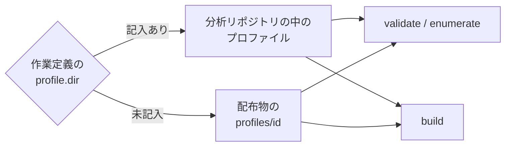
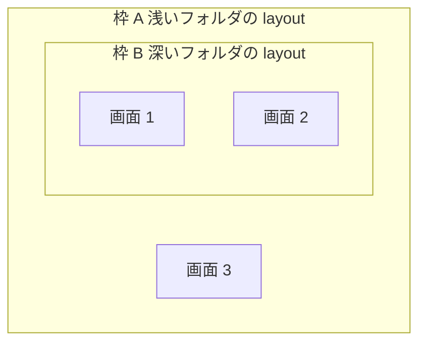

# プロファイル (分析の型)

[← architecture の地図へ](README.md)

プロファイルは、対象の種類ごとの「分析の型」です。形式の定義・ETL・コアの集計表・webapp は、プロファイルに依りません。

## 中身

`profiles/<id>/` に、次を置きます。

| ファイル | 読む人 | 内容 |
|---|---|---|
| `profile.yaml` | ツール | 層の連鎖、階層の段の名前、抽出器と既定のパラメータ |
| `context.md` | エージェント | 入口の判別、層ごとに見るもの、事実・解釈・不明の付け方、データの当てはめ |
| `dbt-template/` | ツール | プロファイル固有の集計表。無くてもよい |

いまあるプロファイルは 2 つです。

| プロファイル | 対象 | 層の連鎖 | 入口と階層 | 抽出器 |
|---|---|---|---|---|
| `batch-kestra` | Kestra で定期起動されるバッチ | scheduler → shell → agent_skill / program → external | Flow 1 本 = 入口。`[namespace+, flow]` | structured-query (Flow 定義の YAML) |
| `ui-nextjs` | Next.js (App Router) の画面を持つシステム | page / layout → component → api_route → query → external | page ファイル 1 つ = 入口 (画面)、layout ファイル 1 つ = 入口 (画面を包む共通の枠)。`[section+, page]` | glob (`app/**/page.*` と `app/**/layout.*`) |

## ツールが読むプロファイル

**ツールが読むプロファイルは、1 か所に決まります。** 作業定義の `profile.dir` です。



| 場合 | 読むもの |
|---|---|
| `profile.dir` がある | そのディレクトリの `profile.yaml`。検査 (`validate`)・列挙 (`enumerate`)・集計 (`build`) が、同じファイルを読む |
| `profile.dir` が無い | 配布物 (イメージ) の `profiles/<id>` |

検査と列挙の `--profile` は、省けます。

| `--profile` | 検査と列挙の動き |
|---|---|
| 省く | 分析リポジトリの作業定義から、上の決まりで読む。読んだ場所を出す |
| 渡す | 渡されたファイルを使う。集計が読むものと違うときは、警告する |
| 省いたが、読めない (検査するファイルが分析リポジトリの外、`profile.dir` の場所に無い) | 読めない旨を出して、プロファイルとの突き合わせを省く (黙って省かない) |
| 省いた。as-built-atlas の `examples/` に置かれた公開の見本で、分析リポジトリとして初期化していない (配布物のコピーを指しているが、`.abatlas/` が無い) | その旨を出して、配布物の `profiles/<id>` を読む |

- 読み先は、検査するファイルごとに決めます。そのファイルを含む、いちばん内側の `analysis/` の親が、分析リポジトリです。そこに作業定義が無ければ、外側へは進みません。カレントディレクトリも見ません。
- それ以外の分析リポジトリ (checkout の外、checkout の中でも `examples/` 以外) で、配布物のコピーが無いときは、配布物へは切り替えません。読めないとして扱います (集計も止まります)。
- 「プロファイルを自動で読めない」と出たら、検査が OK でも、完了にしません。

- `profile.dir` は、分析リポジトリのルートからの相対パスです。
- `init` は、`.abatlas/profiles/<id>` (配布物のコピー) を書きます。
- プロファイル固有の集計表は、そのディレクトリに `dbt-template/` があればそれを、無ければ配布物の `profiles/<id>/dbt-template/` を使います (配布物のコピーは、`dbt-template/` を持ちません)。

`build` は、読んだプロファイルが配布物のコピー (`.abatlas/profiles/<id>`) で、中身が配布物と違うときに、警告します (配布物を新しくして、`upgrade` を忘れた場合)。集計は止めません。自分用に写したプロファイルは、対象外です。

`build` は、読んだプロファイルを確かめます。合わなければ、**配布物へ黙って切り替えずに止まります。**

| 止まる条件 |
|---|
| `profile.dir` の場所に `profile.yaml` が無い |
| `profile.dir` が、分析リポジトリの外を指している (`profile.yaml` そのものが、外を指すリンクの場合も) |
| `profile.dir` が空の文字 (項目を消せば、配布物を使う) |
| プロファイルの `id` が、作業定義の `profile.id` と違う |
| プロファイルが、`validate profile` と同じ検査に通らない |

### 自分のシステムに合わせて直す

例: 使っていない層を外す。

`.abatlas/` は `upgrade` で置き換わるので、そこを直接は直しません。

| 手順 | やること |
|---|---|
| 1 | `.abatlas/profiles/<id>/` を、`analysis/profiles/<id>/` に写す |
| 2 | 写した `profile.yaml` を直す。**分析の判断が変わる直し (層の増減、入口の拾い方、包む関係) なら、`version` も上げる** |
| 3 | 作業定義の `profile.dir` を `analysis/profiles/<id>` に書き換える |
| 4 | (検査と列挙は、`profile.dir` から自動で読む。`--profile` を自分で渡している手順があれば、そこへ向ける) |
| 5 | `validate profile` に通す |
| 6 | 入口の拾い方を変えたときは、`analysis/entry-list.yaml` の `extractors` も、新しい拾い方に書き換える (列挙が実行するのは、一覧に書かれた抽出器とパラメータ。プロファイルの既定値は、最初に書くときの元) |
| 7 | 入口の拾い方か、包む関係 (`within`) を変えたときは、`enumerate` をやり直し (直したプロファイルが、`profile.dir` から読まれる)、入口の一覧を確かめて承認する |
| 8 | `version` を上げたときは、影響する入口を分析し直す |
| 9 | `build` し直す (分析し直した結果が、画面と MCP に反映される) |

手順 7 の理由: `build` は、入口の一覧の `within` が、今のプロファイルの宣言と一致することを検査します。一覧が古いままだと、集計が止まります。

`version` を上げる理由: 再分析するかどうかと、「古い版で分析した結果」の印は、プロファイルの版の比較だけで決まります ([formats.md](formats.md) の「来歴」)。版を据え置くと、古い決まりで分析した結果が、そのまま残ります。表示だけの直し (使っていない層を外すなど、既存の結果と矛盾しないもの) なら、版はそのままで構いません。

写したプロファイルは、分析リポジトリの持ち物になります。配布物の更新は、自分で取り込みます。

## 抽出器の契約

抽出器は、入口の候補を出す実行ファイルです。言語は問いません。

| 項目 | 契約 |
|---|---|
| 引数 | `--scope <dir> --layer <層の id> --params <JSON>` |
| 出力 | 標準出力に、`schema/entry-candidate.schema.json` の JSON を、1 行 1 件で書く |
| 終了コード | 0 以外は失敗 |

コアに同梱の抽出器は 4 つです。専用のパーサーは、プロファイルの `extractors/` に置きます (イメージの中で動くので、依存はイメージに入れます)。

| コア同梱の抽出器 | 向いている対象 | 入口の決まり方 |
|---|---|---|
| `abatlas-extract structured-query` | 定義ファイルに入口が書いてある (ジョブ定義の YAML / JSON / CSV) | ファイルの中身を JMESPath で読む。1 要素 = 入口 1 件 |
| `abatlas-extract glob` | ファイルの置き場が入口を決める (ファイルベースのルーティング、1 ファイル = 1 ジョブのスクリプト置き場) | glob に一致したファイル 1 つ = 入口 1 件。相対パスの段を加工して、階層パスと id にする |
| `abatlas-extract ast` | コードの中で入口を定義する (ルーティングの定義、登録の呼び出し) | コードの構文を ast-grep の規則で読む。一致 1 つ = 入口 1 件 |
| `abatlas-extract listed` | 上の 3 つで取れない入口 | エージェントがコードを読んで、設定に書いた入口を、そのまま候補にする |

`params` の全項目は、それぞれのファイル (`abatlas/extractors/`) の冒頭にあります。

`glob` の加工は、次のとおりです: 先頭を落とす、ファイル名を落とす、正規表現に合う段を落とす、置換、固定の段を先頭に置く。同じ id が 2 つのファイルから出たら失敗します。

### 構文を読む抽出器 (`ast`)

| 項目 | 内容 |
|---|---|
| 読める言語 | bash, c, cpp, csharp, dart, elixir, go, hcl, html, java, javascript, json, kotlin, lua, php, python, ruby, rust, scala, swift, tsx, typescript, yaml。ほかの言語を渡すと、止まる |
| 規則 | `params.rule` に、ast-grep の規則を書く。値を取り出す所に、名前付きの穴 (`$NAME`) を置く |
| 入口の項目 | `params.fields` のひな形で作る。`{NAME}` が、穴に一致した文字に置き換わる。階層パスの元を `/` で区切って段にする。段の加工は、`glob` のうち 4 つ (正規表現に合う段を落とす、置換、固定の段を先頭に置く、段が残らないときの段) が使える。先頭を落とす (`strip_prefix`) と、ファイル名を落とす (`drop_last`) は使えず、書くと止まる。id の作り方は、`glob` と同じ |
| 読めない定義 | 別のファイルから来る定義や、関数が作る定義は、取れない。`params.unresolved` に、そういう場所に一致する規則を書くと、列挙のときに「読めなかった参照」として、ファイルと行を知らせる。入口にはしない |

その場で調べるときは、`abatlas code-search` を使います。規則に一致した場所を出すだけで、入口の一覧は変えません。

```bash
abatlas code-search analysis/work-definition.yaml --language typescript --files "ui/src/**/*.ts" --pattern "import(\$PATH)"
```

### エージェントが足す入口 (`listed`)

入口を列挙する主体は、エージェントです。抽出器は、その土台です。抽出器で取れない入口は、エージェントがコードを読んで、`listed` の設定に書きます。

```yaml
extractors:
  - name: agent-listed
    run: abatlas-extract listed
    layer: screen
    rationale: 画面の定義の配列に、別のファイルで定義した画面が 2 つある。構文を読む抽出器では、中身を取れない
    params:
      entries:
        - id: orders
          path: /orders
          source: { file: ui/src/orders/orderTabs.ts, line: 1 }
          reason: 画面の定義の配列に ORDER_ROUTE として入っている。定義は、このファイルにある
```

| 決まり | 理由 |
|---|---|
| 入口ごとに、根拠 (`source`) と理由 (`reason`) を必ず書く。`listed` は、ファイルの実在と行を確かめる | 人が承認するときに、定義を開いて確かめられる |
| 入口の一覧の `entries[]` には、直接書かない | 列挙をやり直すと消える。設定に書けば、列挙のたびに同じ候補が出て、承認の状態も引き継がれる |
| `listed` が出した候補には、`attributes.listed_by: agent` と `attributes.reason` が付く | 抽出器が取った入口と、見分けられる |
| 入口の層は、抽出器の `layer` で決まる。入口の層が 2 つ以上あるプロファイルでは、層ごとに別の名前の `listed` を書く | 層は、承認と、入口を包む関係の判定に使う |
| 同じ入口が、ほかの抽出器からも出たら、先に書いた抽出器の候補が残る。`listed` は、最後に書く | 道具で取れた入口を、手で書いたもので上書きしない |

### 列挙をやり直したとき

どの抽出器でも、同じです。入口が「指す先」は、階層パス、層、定義のファイルの 3 つです。

| 場合 | 列挙の動き | 理由 |
|---|---|---|
| 同じ id の入口が、前の一覧にある | 承認の状態 (`status`) と、人の判断の理由 (`note`) を引き継ぐ | 設定を直すたびに、承認をやり直さない |
| 人が判断した後に、同じ id の指す先が変わった | 引き継がずに `candidate` に戻し、その入口を知らせる | 人が見ていない入口を、承認済みにしない |
| 行か、付随する情報 (`attributes`。`listed` の理由を含む) だけが変わった | 同じ入口として引き継ぐ | 対象のコミットを進めると、行はずれる。理由の文は、エージェントが書き直すたびに言い回しが変わる |
| 同じ id が、2 つの抽出器から出て、指す先が違う | 止まる。一覧は変えない | 別の入口の片方を、黙って捨てない |
| 同じ id が、2 つの抽出器から出て、指す先が同じ | 先に書いた抽出器の候補を残し、知らせる | 同じ入口を 2 回拾っただけ |
| 前の一覧にあった入口が、今回は出なかった | 一覧から外し、その入口を知らせる | — |

## 入口を包む入口 (`within`)

ある入口が、別の入口の中で動くことがあります。例: Next.js の画面は、祖先のフォルダの layout (共通の枠) の中で動きます。



画面 1 と 2 は、枠 A と枠 B の中で動きます。画面 3 は、枠 A の中だけで動きます。

**包む側も 1 件の入口として、1 回だけ分析します。** 関係は、入口の一覧が持ちます。

| やり方 | 起きること |
|---|---|
| 包む側の処理を、包まれる入口ごとに書く | 同じ通り道を、入口の数だけ繰り返す。umami の試し分析では、1 画面の処理の段の 4 割、読み書きの 5 割が枠だった |
| 包む側を 1 件の入口にする (採用) | 枠の処理は、枠の結果に 1 回だけ現れる |

仕組みのどこが、何をするかです。

| どこ | 何をするか |
|---|---|
| `profile.yaml` の `within` | 包む側の層 (`role: entry`) と、包む相手の決め方 (`rule`) を宣言する |
| `abatlas enumerate` | 宣言から、入口ごとの `entries[].within` (包む入口の id、外側から) を埋める。決定論で、エージェントは決めない。プロファイルを読めないときは付けない |
| `abatlas validate entries` | `within` の指す入口が実在し、自分を指さず、循環しないこと。プロファイルを読めたときは、宣言から決まる値と一致すること (古い一覧、手で直した一覧を指摘する) |
| `abatlas build` | 上と同じ検査を、プロファイルの宣言との一致まで行う。合わなければ集計せず、前の版を残す (`abatlas etl` 単体は宣言を知らないので、実在と循環だけ) |
| `context.md` | 分析の範囲を決める。包まれる側は包む側を辿らない。包む側は、包まれる側の中身を辿らない |
| ETL と dbt | `entry_within.csv` → `stg_entry_within` → `mart_entry_within` |
| webapp | 入口の詳細に「この入口を包む入口」「この入口の中で動く入口」を出し、行き来する。処理と読み書きは足し合わせない (包む側の分は、包む側のページで見る) |

いまある決め方 (`rule`) は、`source_dir` だけです。

- ソースのファイルが、自分と同じフォルダか、その配下にある入口を包みます。
- 包む側どうしは、フォルダが深い方だけが、浅い方に包まれます。
- 同じフォルダの包む入口は、互いを包みません。

分析結果の形式は変わりません (包む側の結果も、入口の段から始まる 1 本の木です)。`within` は任意の項目で、宣言の無いプロファイルの一覧と結果は、そのまま使えます。

### 包む入口を `rejected` にしたとき

その処理は、どの入口の結果にも現れなくなります (包まれる側は辿らないため)。データを読まない枠を外すのは正当な判断なので、検査では落としません。列挙が警告を出し、`mart_entry_within` の `within_status` に承認の状態を出します。

### 古い決まりで分析した結果が残っているとき

包む入口を足す前に分析した結果は、包む入口の処理を含んだままです。包む入口の結果と、二重になります。

| 誰が | 何をするか |
|---|---|
| `abatlas build` | 今のプロファイルの版と違う版で分析した結果を警告する (件数は `stale_results`)。`mart_entry_overview` の `profile_stale` に印を付ける。集計は止めない (全件の再分析が済むまで、画面を見られなくなるため) |
| webapp | 入口の一覧で、古い版で分析したものに絞れる |
| 分析 skill | 版が違う結果を、再分析の対象にする |

## プロファイルを増やす手順

2 本目の `ui-nextjs` も、この手順で作りました。

| 手順 | やること |
|---|---|
| 1 | 対象を読んで、層の連鎖と入口の単位を決める |
| 2 | 入口を、コア同梱の抽出器で拾えるか確かめる。拾えない入口が多ければ、専用の抽出器をプロファイルの `extractors/` に置く。少なければ、エージェントが読んで足す前提で、`context.md` に、取れない入口の探し方を書く |
| 3 | `profile.yaml` を書いて、`abatlas validate profile` に通す |
| 4 | `context.md` に、分析の癖を書く |
| 5 | 分析リポジトリを `init --profile <id>` して、列挙 → 承認 → 数件を分析し、集計表と画面で確かめる |

## `ui-nextjs` の決まり

### 入口の id と階層

| 対象 | 決まり |
|---|---|
| 画面 (page) | URL の区切りが段。`[section+, page]` |
| 枠 (layout) | 階層は `/(layout)/<置き場のフォルダ>`。id は `layout_l` で始まる |
| URL に出ない入れ物 `(group)` | 落とす |
| `_folder` の下 | 拾わない |
| id | 記号を除き、段の種類を印で区別する (`[id]` → `id_d`、`@modal` → `modal_s`、app 直下 → `root_r`)。名前の中の `_` は重ねるので、同じ名前の静的な段と同居できる |
| 小窓版 (並行ルート + 割り込みルート) | 階層は、割り込み先の URL ではなく、置き場を表す |

### 既定では入口にならないもの

| もの | 扱い |
|---|---|
| API の受け口 (`route` ファイル) | 入口にしない。画面から辿った途中の段として現れる。画面を通らない受け口 (外部向けの API、計測の受信) は、分析の対象にならない |
| `template`、`loading`、`error`、`not-found`、`default` のファイル | 既定の抽出器では拾わない。画面も枠もこれらを辿らないので、入口を発見するときに、有無と中身を確かめる |

枠の動きが、画面や URL によって変わることがあります。その差は、枠の要約に文で書くだけで、表にはなりません。

### バッチと違う所

どちらも `context.md` に書いてあります。

**1. 画面の部品から API の受け口への入り方が、2 通りある。**

| 入り方 | 辿り方 | 根拠 |
|---|---|---|
| URL (Route Handler) | ブラウザ側のフックが呼ぶ URL の文字列 (例 ``get(`/websites/${websiteId}/stats`)``) を、その形に当たる `route` ファイルの、HTTP メソッドの関数に対応付ける | URL の行。形が決まらなければ `unknown` + `dynamic_dispatch` |
| 関数の参照 (`'use server'` の Server Function) | URL を通らないので、import や props を辿って、関数の定義へ行く | — |

同じ `route` ファイルの GET と POST は、別の段にします。突き合わせ (`evaluate`) は、ファイル単位で照合します (メソッドの取り違えは、読み書きの照合に現れます)。

**2. 接続先 (host / database) が環境変数で決まるときは、その段を書かず、それだけを理由に `unknown` にしない。**

| プロファイル | 接続先が環境変数のとき | 理由 |
|---|---|---|
| `ui-nextjs` | 接続先の段を書かない。テーブルやキーがコードから読めれば `fact` | 接続先は実行環境の設定で決まり、どの画面でも同じになる |
| `batch-kestra` | 読み書き全体を `unknown` + `not_traceable_in_repo` にする | プロファイルごとの決まり。形式は同じ |

接続先がコードに直接書いてあるときは、その段も書きます。

### 分析者によって書き方が割れた所

umami での試し分析で、3 つありました。`context.md` で、次のように決めています。

| 割れた所 | 決まり | 理由 |
|---|---|---|
| `external` の段の場所 | ライブラリのメソッドを実際に呼んでいる行を `source` にする (クライアントを作るだけの共通ファイルにしない) | 突き合わせが、段を「層とファイル」で照合する。場所の取り方が割れると、中身が同じでも食い違う |
| 全画面共通の枠 (祖先の layout と、そこから描かれる部品) | 枠を 1 件の入口 (`layout`) として、1 回だけ分析する。画面は枠を辿らず、枠は `children` の中身を辿らない | 画面を開いただけで起きる書き込みや外部への送信を表に出しつつ、同じ通り道を画面の数だけ繰り返さない。はじめは「画面ごとに終端まで辿る」と決めたが、1 画面の分析の 4〜5 割が枠になった |
| 同じ処理が、複数の呼び出し元から呼ばれるとき | 1 つの入口の中では、呼び出しの行の順 (ファイルのパスの辞書順、同じファイルなら行番号順) でいちばん早い呼び出し元の下に、1 回だけ書く。他の呼び出し元は、`summary` で「同じ経路」と指す。例外: そうすると呼び出し元が終端になって機械チェックに落ちるときだけ、もう一度書く | 何度も書くと、読み書きの件数が水増しされ、分析の費用も増える |
