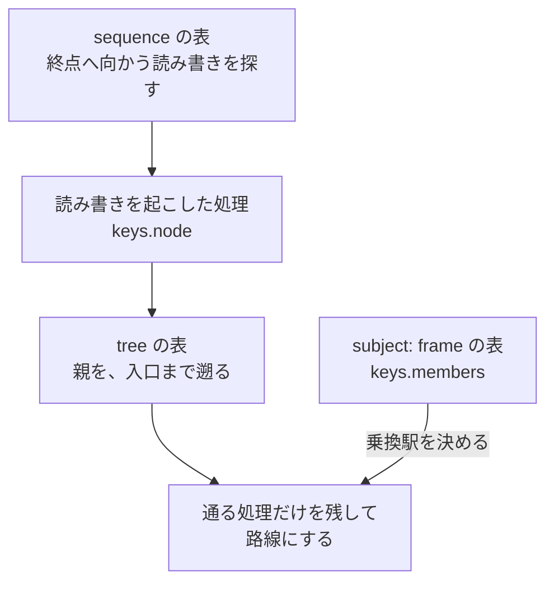
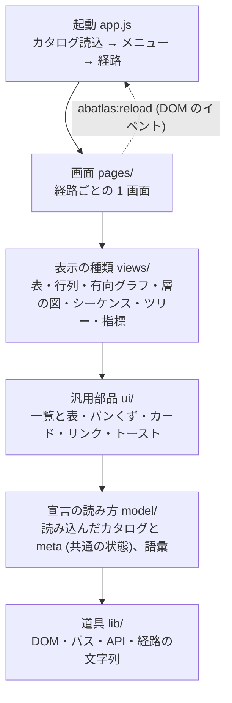

# webapp (宣言から画面を組む)

[← architecture の地図へ](README.md)

webapp は、`abatlas serve` が配る静的ファイル (`abatlas/webapp/`) です。

| 決まり | 内容 |
|---|---|
| ビルド工程が無い | `index.html`、ES モジュール、CSS 5 つを、そのまま配る。外部のライブラリも読まない |
| API だけを読む | `/meta`、`/marts`、`rows` / `tree` / `pivot` ([api.md](api.md)) |
| 集計表の名前を知らない | 宣言 (`subject` / `view` / `keys`) と `/meta` だけを読んで画面を組む ([pipeline.md](pipeline.md) の「集計表の宣言」) |

見た目の決まり (色、線、余白、部品の形) の正本は、as-built-atlas のリポジトリのルートにある `DESIGN.md` です (分析リポジトリには配りません)。この文書は、作りと、足し方を書きます。

## 画面の一覧

メニューは、利用者の問いから導いています。先頭が全体を見る「構成」で、続けて問いに対応する項目が並びます。項目は、その `subject` の表が宣言されているときだけ現れます。

メニューの見出しには、分析対象の名前とコミットを出します (どのページでも、どのシステムを見ているかが分かる)。

| メニュー (画面での呼び名) | 経路 | 答える問い | 何を読むか |
|---|---|---|---|
| 構成 (architecture) | `#/overview` | 全体はどんな層でできているか | meta の `layers` と、`view: layers` の表 |
| 入口 (entry point) | `#/entries/<path>` → `#/entry/<path>` | どんな入口があり、何をするか | `subject: entry` の表 |
| データ (datastore) | `#/data` → `#/data/<kind>/<path>` | このデータを誰が触るか | `subject: data` の行列 |
| 読み書きの表 | `#/access/<kind>/<入口の節>` | 入口とデータの組み合わせ | 同上 |
| 外部接続 (external API) | `#/external` | この外部サービスを誰が呼ぶか | `subject: external` の表 |
| 共有処理 (shared function) | `#/frames` | この共通処理を直すと誰に影響するか | `subject: frame` の表 |
| 分析の状態 (analysis status) | `#/status` | 分析はどこまで進んだか | `subject: analysis` か `tags: [monitor]` |
| 集計表 (mart) | `#/marts`、`#/mart/<name>` | 集計表そのものと、API・MCP での読み方 | `view` と `keys` |

`layers` が無い集計表 (古い build) では、構成を出さず、入口のページから始まります。

### 入口

| 画面 | 出すもの |
|---|---|
| 入口の階層 (`#/entries/<path>`) | 階層を 1 段ずつ降りる。分類の行に、件数、0 件でない `filters` の件数、先頭の `filters` の割合の線。配下の入口は、検索・絞り込み・50 件ずつの一覧 |
| 入口の詳細 (`#/entry/<path>`) | 上から順に: 種類の札と名前、この入口を包む入口の並び (あるときだけ)、要約、**触る相手の表 (左) と、選んだ相手までの経路 (右)**、図 (タブで 1 つずつ: 処理の流れ / 呼び出しの構造 / データの流れ / 不明な点)、この入口の中で動く入口、同じ部品を使う入口、この入口の数字 |

まだ分析していない入口は、その旨と、包む関係だけを出します。

| 出すもの | 宣言のどこを読むか |
|---|---|
| 階層 | `subject: entry` の table (`keys.path`) を `tree` で辿る。段の名前は meta の `hierarchy.level_labels` |
| 要約、一覧の列 | `keys.summary`、`show` |
| 図 | `subject: entry` の sequence / tree / graph を、`keys.path` で絞る |
| 触る相手 | graph の `from` / `to`。読む = この入口へ入る辺、書く = 出る辺 |
| 経路 | 下の「経路」 |
| 同じ部品を使う入口 | `subject: frame` の `keys.members` を、`__contains` で引く |
| 包む入口、中で動く入口 | `tags: within` の table。`keys.path` = この入口 (包む入口の行。`keys.order` の順)、`keys.members` = この入口 (中で動く入口の行) |

### データ

| 画面 | 出すもの |
|---|---|
| 最初のページ (`#/data`) | 種類 (RDB / KVS / キュー / ファイルシステム / オブジェクトストレージ) ごとの読み書きの表。種類はタブで切り替える。列の名前から、個々のデータへ降りる |
| データの詳細 (`#/data/<kind>/<path>`) | **触る入口の表 (左) と、選んだ入口からそのデータまでの経路 (右)**。読む操作と書く操作を別の列に分け、書く入口を上に並べる。上位の段では配下をまとめる。「このデータを含む流れ」も出す |
| 読み書きの表 (`#/access/…`) | 行 (入口) も列 (データ) も、節ごとに開閉する表。畳んだ節の値は `pivot` が集計する |

読み書きの表の操作は次のとおりです。

- 見出しの右クリックで「配下をすべて開く / 閉じる」。
- 「表示中の行が使う列だけ」(既定)、「不明を含むものだけ」、列の検索で絞る。
- セルを押すと内訳が出る。

分析済みの入口が全部でないときは、その旨を上に出します。

| 出すもの | 宣言のどこを読むか |
|---|---|
| 階層 | `subject: data` の matrix (`keys.kind` / `col` / `row` / `value` / `flag`) を `tree` で辿る |
| 触る入口 | `col__under` で 2000 行まで読み、入口ごとにまとめる |
| 段の名前、操作 (読む / 書くの向きは `direction`) | meta の `resource_kinds` |
| 進み具合 | `subject: analysis` の stat (`keys.value` / `keys.total`) |

### 外部接続と共有処理

表の一覧 (検索・絞り込み・50 件ずつ) から、1 件の詳細へ降ります。詳細は、**呼んでいる入口の表 (左) と、選んだ入口からそこまでの経路 (右)** です。

| 読むもの | 内容 |
|---|---|
| `subject` の table | `keys.id` / `keys.label` / `keys.members` |
| 経路の終点 (外部接続) | `/external_api/<id>` 配下への読み書き |
| 経路の終点 (共有処理) | `keys.id` の値と同じ名前の処理 |

### 分析の状態と集計表

| 画面 | 出すもの |
|---|---|
| 分析の状態 | 進み具合、不明な点、集計表の作り直し (`POST /recompute`) |
| 集計表の一覧 | 論理名と物理名 |
| 集計表 1 つ | 表の全体 (列で絞り込み)。同じものを読む API の URL と、MCP の呼び方。宣言と列は折りたたみ |

集計表のページ以外では、表の名前を出しません。集計表へのリンクは「mart で見る」だけです。

## 読む量の上限

数千のテーブルやファイルがあっても動くように、画面は必要な分だけを読みます。

| 対象 | 読み方と上限 |
|---|---|
| 階層 | `tree` で 1 段ずつ |
| 開閉する表 | `pivot` で、畳んだ値だけ |
| 一覧 | 50 件ずつ。検索 (`__contains`)、`filters` の絞り込み、`order` の並べ替えは、サーバー側で行う |
| データの詳細の「触る入口」 | 2000 行まで |
| 外部接続・共有処理の詳細の行 | 200 行まで |
| 流れの図 | 両方向の合計 200 辺で打ち切る |
| 図 (有向グラフ・シーケンス・ツリー・経路) | 1 つの入口 (または 1 つのデータを含む流れ) の分だけ |

上限を超えた分は、集計表のページ (一覧) へ誘導します。

行列の汎用の表示 (集計表のページと、入口の画面に貼ったとき) は、行の一覧 (50 件ずつ) です。開閉する表は、読み書きの表のページだけです。

## 表示の種類ごとの描き方

宣言の `view` ごとに、描き方が 1 つあります。

| `view` | 描き方 |
|---|---|
| `table` | 宣言の `labels` で見出し。階層パスはリンク。並べ替えができる |
| `matrix` | 開閉できる表 (上の「データ」) |
| `graph` | 有向グラフ (下の表) |
| `layers` | 層の図。箱の並びと枠はプロファイルの `layers` から、線は表の行から ([pipeline.md](pipeline.md) の「層の並び」) |
| `sequence` | シーケンス。`group` ごとに 1 図。参加者は出現順 |
| `tree` | ツリー (`id` / `parent` / `label`)。根から辿れない行は、循環として別に出す |
| `stat` | 指標。`value` / `total` の割合 |

有向グラフの並べ方です。

| 決めること | 決め方 |
|---|---|
| 層 (左右の位置) | 辺を入口側から辿った最長路の長さ。読むデータは入口より左、書くデータは右 |
| 層の中の順番 | 隣の層のつながり先の重心で並べ替えて、交差を減らす。層は縦に中央揃え |
| 同じ両端の辺 | 1 本にまとめて、ラベルを列挙する |
| 線の形 | 角を丸めた直角。箱に付く点と、層の間のレーンをずらして重ねない |
| 循環する辺 | 図の上を通る戻り線 |
| ラベルの位置 | 辺の少ない側 |

図の入れ物 (`views/figure-box.js`) は 1 つで、有向グラフとシーケンスの両方が使います。

| 機能 | 内容 |
|---|---|
| 枠 | 見切れている側に印を出す |
| 拡大縮小 | 最初は横幅に合わせる。合わせると 50% 未満になる図は、文字が読める 60% で左上から始める。全体の形は「全体」のボタンで見る。最小は 5% |
| 全画面 | 図が画面から外れたら、全画面とリスナーを後始末する |
| 見出しの固定 | シーケンスは、見出しと本文を別の SVG にして、参加者の見出しを固定する |
| 絞り込み | 種類、名前、不明の辺だけ。図の下の辺の一覧 (開閉) と同期する |
| 強調 | 箱や矢印に触れると、つながる箱と辺だけを濃く残す。クリック / タップで固定。Tab + Enter / Space でも選べる |

種類での絞り込みは、図によって動きが違います。

| 図 | 種類で絞ったとき | 理由 |
|---|---|---|
| シーケンス | どちらかの端が合えば残す。相手側は文脈として描く | — |
| 有向グラフ | 外した種類の箱と、その辺を隠す | 辺は入口 ↔ データの 2 部構造なので、シーケンスと同じ決まりでは何も消えない |

図は、参加者 (箱) の数を減らさずに見せます。参加者が多いと、最初は形だけが見え、文字は拡大して読みます。

## 経路

経路 (`views/route.js`) は、宣言の `view` ではありません。2 つの表から組む、画面の部品です。入口から終点 (データ、外部接続、探している部品) までを、1 本の路線として縦に描きます。

| 形 | 意味 |
|---|---|
| 駅 (細い縁の丸) | 処理の段 |
| 乗換駅 (黒の縁の角丸) | ほかの入口も通る部品 |
| 終点 (塗りつぶし) | 探している相手 |

| 元になる表 | 使う `keys` |
|---|---|
| `subject: entry` の tree | `group` (入口に絞る)、`id`、`source` (定義場所)、`tag` (種類の札)、`detail` (概要) |
| `subject: entry` の sequence | `node` (そのメッセージを起こした処理の id。tree の `keys.id` と対応する)、`evidence` (根拠の場所)、`to` (終点のパスか、その配下) |
| `subject: frame` の table | `members` (この入口とほかの入口がある部品が、乗換駅)。`source` を持てば、定義場所も合う行だけを見る |

- 行き先が 2 つ以上に分かれる処理では、枝を字下げして並べます。
- 線の色は、入口の種類ごとの路線の色です (`model/catalog.js` の `lineOf`)。種類は `entry_labels` と `level_labels` の末尾から決まり、出た順に 6 色を割り当てます。
- tree か、`keys.node` を持つ sequence が宣言されていなければ、その旨を出します。

## ファイルの分け方 (6 層)

webapp は、ブラウザ標準の ES モジュール (`<script type="module" src="app.js">`) で、6 層に分かれています。**上の層は、下の層 (と同じ層) だけを `import` できます。** ビルド工程が無いので、崩れは `tests/test_webapp.py` が止めます。

| 層 (上から) | 場所 | 中身 |
|---|---|---|
| 起動 | `app.js` | カタログ読込 → メニュー (`buildNav` / `markNav`) → 経路 (`route`)。経路の表はここ。分析対象の名前の表示と、メニューの折り畳みもここ |
| 画面 | `pages/` | `overview.js` (構成)、`entries.js` (入口の階層)、`entry.js` (入口の詳細)、`data.js` (データ)、`access.js` (読み書きの表)、`subject.js` (外部接続・共有処理)、`status.js` (分析の状態)、`marts.js` (集計表) |
| 表示の種類 | `views/` | 下の表 |
| 汎用部品 | `ui/` | `table.js` (一覧と表、行を選べる表 `pickTable`)、`crumbs.js`、`card.js`、`link.js` (階層パスの行き先を 1 か所で決める)、`toast.js` |
| 宣言の読み方 | `model/` | `catalog.js` (共通の状態 `model` と、宣言・meta を読む関数)、`vocab.js` (画面に出す呼び名。用語集を引く `term`)、`kinds.js` (図の参加者の種類と絞り込み) |
| 道具 | `lib/` | `dom.js`、`path.js`、`api.js` (API の呼び方と、階層のキャッシュ)、`hash.js` (経路の文字列) |

`views/` の中身です。

| ファイル | 役割 |
|---|---|
| `index.js` | 宣言の `view` → 描き方の登録表 (`renderers`)、`render`、`panelBody` |
| `table.js`、`stat.js`、`tree.js`、`matrix.js`、`graph.js`、`sequence.js` | 表示の種類ごとの描き方 |
| `layer-flow.js` | 層の図の組み立て。行から箱と線を組み、絞り込みと注記を付ける。構成のページと、集計表のページが共有する |
| `layers.js` | 層の図そのもの (箱と線の配置)。箱をまとめる枠は、部品の中では `group` と呼ぶ (上の段は、プロファイルの `layers[].tier`。下の段は、データと外部接続) |
| `figure-box.js` | 図の入れ物 (枠・拡大縮小・全画面・絞り込み・強調) |
| `route.js` | 経路 |

### 約束

| 約束 | 内容 |
|---|---|
| 共通の状態は 1 つ | 読み込んだカタログと meta は、`model/catalog.js` の `model` だけが持つ。書くのは `loadCatalog` だけで、他は読むだけ |
| 下から上へは DOM のイベントで知らせる | 画面は、起動を `import` できない。再計算の後の読み直しは、画面が `abatlas:reload` を発火し、`app.js` が受けて読み直す。上の層を呼びたくなったら、同じ形にする |
| 書き方は、検査できる範囲に抑える | `import` / `export` は行頭から、名前付きだけ (`import { a, b } from "./x.js"`)。`export default`、`import x from`、動的 `import()` は使わない。読み込み先は相対パス |
| CSS は `css/` の 5 ファイルだけ | `index.html` が `base → shell → ui → views → pages` の順に読む (同じ詳細度の上書きは、読み込み順で決まる)。`ui.css` / `views.css` / `pages.css` は、JS の同名の層に対応する。狭い画面の `@media` は、上書きする規則と同じファイルの末尾に置く |
| 置き場に迷ったら | 「それを使うのは誰か」で決める (使う側より下の層に置く)。1 ファイルが 400 行を超えるなら分ける |

`model` が持つものは次のとおりです: `catalog` / `meta` / `subj` / `entryMart` / `dataMart` / `graphMart` / `withinMart` / `treeMart` / `seqMart` / `frameMart` / `progressMart` / `layerMart`。

### 足し方

| 足したいもの | 触る場所 |
|---|---|
| 新しい図の種類 (宣言の `view` を増やす) | `views/<name>.js` を作り、`views/index.js` の `renderers` に 1 行。`abatlas/declarations.py` の `VIEWS` と、`model/vocab.js` の `VIEW_ORDER` / `viewHint` にも 1 行。`css/views.css` に節を足す |
| 新しい区分の画面 (宣言の `subject` を増やす) | `pages/<name>.js` を作り、`app.js` の経路 (`route`) に 1 行、`buildNav` に 1 行。`abatlas/declarations.py` の `SUBJECTS` と、`model/vocab.js` の `SUBJECT_TERM` にも 1 行 (呼び名は用語集に足す) |
| 図の共通の機能 (枠・拡大縮小・強調のような) | `views/figure-box.js` だけ。シーケンスと有向グラフに、自動で効く |
| 見た目の共通の部品 | `ui/<name>.js` と `css/ui.css` |
| API の呼び方 | `lib/api.js` だけ。例外が 1 つ: 再計算の `POST /recompute` は応答の扱いが違うので、`pages/status.js` が直接呼ぶ |

### テストが守ること

`tests/test_webapp.py` が、機械で次を確かめます。

- 層の向き (上の層を読んでいない)。
- 読み込み先のファイルと、`import` した名前が実在する。
- 検査できない書き方が無い。
- 外部の URL を読まない (全ファイル)。
- `<script>` が、起動のモジュール 1 つだけである。
- CSS の読み込み順が正しく、`css/` の全ファイルが、ちょうど 1 回ずつ読まれる。
- サブディレクトリのモジュールが、JavaScript の MIME 型と `cache-control: no-cache` で配られる。

**JavaScript の構文と、画面の動きは検査していません** (CI に node が無いため)。変更したら、ブラウザで開いて、コンソールにエラーが無いことを確かめます。
