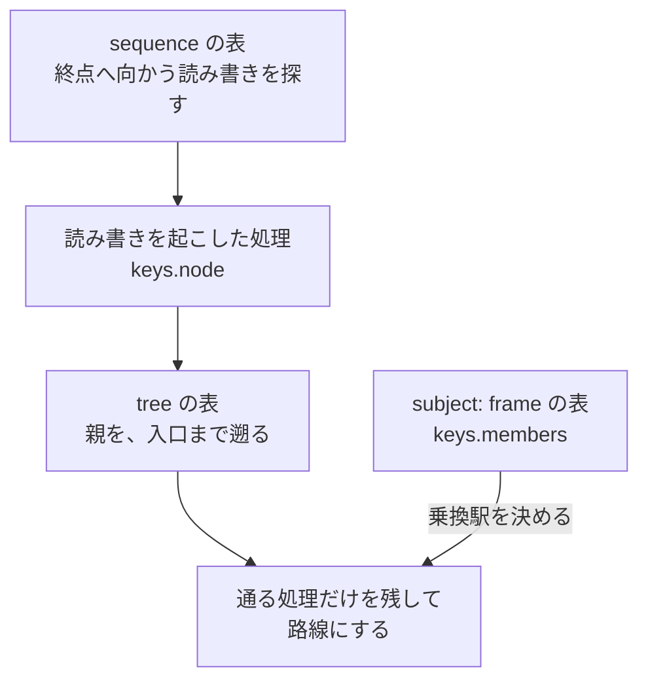

# webapp (宣言から画面を組む)

[← architecture の地図へ](README.md)

webapp は、`abatlas serve` が配る静的ファイル (`abatlas/webapp/`) です。

| 決まり | 内容 |
|---|---|
| ビルド工程が無い | `index.html`、ES モジュール、CSS 5 つを、そのまま配る。外部のライブラリも読まない |
| API だけを読む | `/meta`、`/marts`、`rows` / `tree` / `pivot` ([api.md](../reference/api.md)) |
| 集計表の名前を知らない | 宣言 (`subject` / `view` / `keys`) と `/meta` だけを読んで画面を組む ([marts.md](../reference/marts.md) の「集計表の宣言」) |

見た目の決まり (色、線、余白、部品の形) の正本は、as-built-atlas のリポジトリのルートにある `DESIGN.md` です (分析リポジトリには配りません)。この文書は、作りを書きます。ファイルの分け方と足し方は、as-built-atlas のリポジトリの `docs/rules/webapp.md` にあります (分析リポジトリには配りません)。

## 画面の一覧

メニューは、利用者の問いから導いています。先頭が全体を見る「構成」で、続けて問いに対応する項目が並びます。項目は、その `subject` の表が宣言されているときだけ現れます。

メニューの見出しには、分析対象の名前とコミットを出します (どのページでも、どのシステムを見ているかが分かる)。

| メニュー (画面での呼び名) | 経路 | 答える問い | 何を読むか |
|---|---|---|---|
| 構成 (architecture) | `#/overview` | 全体はどんな層でできているか | meta の `layers` と、`view: layers` の表 |
| 入口 (entry point) | `#/entries/<path>` → `#/entry/<path>` | どんな入口があり、何をするか | `subject: entry` の表 |
| データ (datastore) | `#/data` → `#/data/<kind>/<path>` | このデータを誰が触るか | `subject: data` の行列 |
| 読み書きの表 | `#/access/<kind>/<入口の節>` | 入口とデータの組み合わせ | 同上 |
| 外部接続 (external API) | `#/external` | この外部サービスを誰が呼ぶか | `subject: external` の表 |
| 共有処理 (shared function) | `#/frames` | この共通処理を直すと誰に影響するか | `subject: frame` の表 |
| 分析の観点 (aspects) | `#/aspects`、`#/aspects/<組の id>` (集計表の名前でも、その表のある組が開く) | 「これを直すと、どの入口に響くか」を、直す物から引く。権限、データの細部、つながり、動きを変える物、分析の届く範囲 | `subject: aspect`。表を、答える問いの組 (`topic`) ごとのタブにまとめる。組の中は、図 (全体の形) → 物ごとのまとめ (`rollup`) の順。下の「分析の観点のページ」 |
| 分析の状態 (analysis status) | `#/status` | 分析はどこまで進んだか | `subject: analysis` か `tags: [monitor]` |
| 集計表 (mart) | `#/marts`、`#/mart/<name>` | 集計表そのものと、API・MCP での読み方 | `view` と `keys` |

`layers` が無い集計表 (古い build) では、構成を出さず、入口のページから始まります。

### 3D

「全体図」の隣の「3D」は、円筒を高さ順に見渡せる斜めの視点で開く。上からプロファイル順のアプリケーションの区分、データストア、外部 API の順。Next.js では frontend、backend、データストア、外部 API の4段になる。「上から」では外部 API が最外周、データストアが最内周に見える。側面を層やデータストアの種類ごとに分け、個々の処理や接続先をその面の点で示す。

- 全体図でアプリの区分名を選ぶと、その区分に属する層がプロファイルの順に一段ずつ並ぶ。各段の側面を入口の階層パスで分ける。同じパスは段をまたいで同じ方角を占め、記録のある段だけに面を持つ。凡例のパスを選ぶと、そのパスが通る全段の面と線が濃くなる。面を選ぶと、その段とパスに属する処理をたどれる。矢印は表示中の入口で記録された親から子へ向かう。段をまたぐ線は層間の呼び出し、同じ段の線は層内の呼び出しを表す。点を選ぶと、図の下で入口からその関数までの順序を読める。「全体図に戻る」で元の選択と視点に戻る。
- 面は層やデータストアの種類を表す。各入口のコールスタックを読み、処理をその層に、読み書きしたテーブル・キュー・外部 API などをその種類の面に点で置く。白丸は呼び出しの起点。複数の入口が同じ接続先に触れたときは、その点を共有する。
- 細い線は親から子への呼び出しと、処理から個別の接続先への読み書きに対応する。点を選ぶと起点までの経路と直接の呼び先が濃くなり、図の下で呼び出し元と相手を読める。面を選ぶと、その面の各点と直接の呼び先に加え、入口から各点までに通る処理・面・線を強調する。RDB の面では、各テーブルを読み書きした処理から入口までをたどれる。図の下には、その面に至る表示中の入口が並ぶ。
- 最初はパス順に分析済みの入口を 3 件重ねる。3 件ずつ追加するか、入口を一つ選んで追える。入口の候補は 50 件ずつ読み込む。
- 図の外には入口、面、開く区分の順に選択欄が並ぶ。図の左上には「斜め」「上から」、回転、縮小、拡大、手のひらの移動ボタンが並ぶ。ドラッグで回転し、上下に傾ける。ホイールかボタンで拡大縮小し、移動モードか Shift＋ドラッグで移動する。点は視点を変えても同じ面にとどまり、透けた面の奥にある処理との接続も追える。
- `#/overview?view=3d` で全体、`#/overview?view=3d&entry=<入口のパス>` で入口別の構成を開く。細い画面では同心円図を画面幅に収め、拡大した後は「移動モード」で図を動かせる。

### 入口

| 画面 | 出すもの |
|---|---|
| 入口の階層 (`#/entries/<path>`) | 階層を 1 段ずつ降りる。分類の行に、件数、0 件でない `filters` の件数、先頭の `filters` の割合の線。配下の入口は、検索・絞り込み・50 件ずつの一覧 |
| 入口の詳細 (`#/entry/<path>`) | 上から順に: 種類の札と名前、この入口を包む入口の並び (あるときだけ)、要約、**触る相手の表 (左) と、選んだ相手までの経路 (右)**、図 (タブで 1 つずつ: 処理の流れ / 呼び出しの構造 / データの流れ / 不明な点)、この入口の中で動く入口、同じ部品を使う入口、この入口の数字 |

まだ分析していない入口は、その旨と、包む関係だけを出します。

| 出すもの | 宣言のどこを読むか |
|---|---|
| 階層 | `subject: entry` の table (`keys.path`) を `tree` で辿る。段の名前は meta の `hierarchy.level_labels` |
| 要約、一覧の列 | `keys.summary`、`show` |
| 図 | `subject: entry` の sequence / tree / graph を、`keys.path` で絞る |
| 触る相手 | graph の `from` / `to`。読む = この入口へ入る辺、書く = 出る辺 |
| 経路 | 下の「経路」 |
| 同じ部品を使う入口 | `subject: frame` の `keys.members` を、`__contains` で引く |
| 包む入口、中で動く入口 | `tags: within` の table。`keys.path` = この入口 (包む入口の行。`keys.order` の順)、`keys.members` = この入口 (中で動く入口の行) |

### データ

| 画面 | 出すもの |
|---|---|
| 最初のページ (`#/data`) | 種類 (RDB / KVS / キュー / ファイルシステム / オブジェクトストレージ) ごとの読み書きの表。種類はタブで切り替える。列の名前から、個々のデータへ降りる |
| データの詳細 (`#/data/<kind>/<path>`) | **触る入口の表 (左) と、選んだ入口からそのデータまでの経路 (右)**。読む操作と書く操作を別の列に分け、書く入口を上に並べる。上位の段では配下をまとめる。「このデータを含む流れ」も出す |
| 読み書きの表 (`#/access/…`) | 行 (入口) も列 (データ) も、節ごとに開閉する表。畳んだ節の値は `pivot` が集計する |

読み書きの表の操作は次のとおりです。

- 見出しの右クリックで「配下をすべて開く / 閉じる」。
- 「表示中の行が使う列だけ」(既定)、「不明を含むものだけ」、列の検索で絞る。
- セルを押すと内訳が出る。

分析済みの入口が全部でないときは、その旨を上に出します。

| 出すもの | 宣言のどこを読むか |
|---|---|
| 階層 | `subject: data` の matrix (`keys.kind` / `col` / `row` / `value` / `flag`) を `tree` で辿る |
| 触る入口 | `col__under` で 2000 行まで読み、入口ごとにまとめる |
| 段の名前、操作 (読む / 書くの向きは `direction`) | meta の `resource_kinds` |
| 進み具合 | `subject: analysis` の stat (`keys.value` / `keys.total`) |

### 外部接続と共有処理

表の一覧 (検索・絞り込み・50 件ずつ) から、1 件の詳細へ降ります。詳細は、**呼んでいる入口の表 (左) と、選んだ入口からそこまでの経路 (右)** です。

| 読むもの | 内容 |
|---|---|
| `subject` の table | `keys.id` / `keys.label` / `keys.members` |
| 経路の終点 (外部接続) | `/external_api/<id>` 配下への読み書き |
| 経路の終点 (共有処理) | `keys.id` の値と同じ名前の処理 |

### 分析の状態と集計表

| 画面 | 出すもの |
|---|---|
| 分析の状態 | 進み具合、不明な点、集計表の作り直し (`POST /recompute`) |
| 集計表の一覧 | 論理名と物理名 |
| 集計表 1 つ | 表の全体 (列で絞り込み)。同じものを読む API の URL と、MCP の呼び方。宣言と列は折りたたみ |

集計表のページ以外では、表の名前を出しません。集計表へのリンクは「mart で見る」だけです。

## 読む量の上限

数千のテーブルやファイルがあっても動くように、画面は必要な分だけを読みます。

| 対象 | 読み方と上限 |
|---|---|
| 階層 | `tree` で 1 段ずつ |
| 開閉する表 | `pivot` で、畳んだ値だけ |
| 物ごとのまとめ | `groups` で、50 件ずつ。数えるのはサーバー側 |
| 入口をまたぐ図 (数の表、3 列のつながり、数つきのツリー) | 10000 行まで。超えたら、切ったことを図の上に出す |
| 数の表が描く範囲 | 60 列、500 行まで (行は、検索や並べ替えの後の先頭から。列は、印のあるセルを持つ列を先に残す)。超えたら、切ったことを表の上に出す |
| 一覧 | 50 件ずつ。検索 (`__contains`)、`filters` の絞り込み、`order` の並べ替えは、サーバー側で行う |
| データの詳細の「触る入口」 | 2000 行まで |
| 外部接続・共有処理の詳細の行 | 200 行まで |
| 流れの図 | 両方向の合計 200 辺で打ち切る |
| 図 (有向グラフ・シーケンス・ツリー・経路) | 1 つの入口 (または 1 つのデータを含む流れ) の分だけ |

上限を超えた分は、集計表のページ (一覧) へ誘導します。

行列の汎用の表示 (集計表のページと、入口の画面に貼ったとき) は、行の一覧 (50 件ずつ) です。開閉する表は、読み書きの表のページだけです。

## 分析の観点のページ

入口をまたいで見る表は、同じ物が入口の数だけ行になるので、行の一覧のままでは読めません。このページは、「直す前に、響く範囲を調べる」場面を主役にして、**直す物から入口を引く**形にしています (経緯は、利用者への確認。ADR は書いていません)。

| 段 | 見せるもの | 仕組み |
|---|---|---|
| 1. 組を選ぶ | 答える問いごとの 5 つのタブ。タブの下に、その組の問いの文 | 宣言の `topic`。組の名前と問いの文は `model/vocab.js` の `topics()` |
| 2. 全体の形を見る | 数の表 (`heat`)、3 列のつながり (`bridge`)、数つきのツリー (`tree` の `value`) | 表示の種類。図の表を、まとめの表より先に並べる |
| 3. 物ごとに見る | 1 つの物 = 1 行。棒は、関わる入口の数 (端から端までが、全体)。朱は、そのうち印の付くもの (書く入口) | 宣言の `rollup` と、API の `groups`。部品は `ui/rollup.js` |
| 4. 物を開く | 次の段のまとめか、その物の行の一覧 (入口と、根拠の場所) | 行の一覧は、いつもの一覧の部品 (`listTable`) を、その物に絞って出す |

- まとめは、「まとめ / 行」の切り替えで、行の一覧に戻せます。
- 経路の後ろが、組の id と表の名前の両方に当たるときは、組を開きます (タブのリンクが、組の id を使うため。表の名前を `access` などの組の id と同じにしない)。
- `rollup` の無い表は、これまでどおり行の一覧です。`topic` の無い表は、「そのほか」のタブに出ます (プロファイルや分析リポジトリが足した表)。
- 入口のページのタブ (その入口に絞った表) は、変えていません。行の一覧のままです。

## 表示の種類ごとの描き方

宣言の `view` ごとに、描き方が 1 つあります。

| `view` | 描き方 |
|---|---|
| `table` | 宣言の `labels` で見出し。階層パスはリンク。並べ替えができる |
| `matrix` | 開閉できる表 (上の「データ」) |
| `graph` | 有向グラフ (下の表) |
| `layers` | 層の図。箱の並びと枠はプロファイルの `layers` から、線は表の行から ([marts.md](../reference/marts.md) の「層の並び」) |
| `sequence` | シーケンス。`group` ごとに 1 図。参加者は出現順 |
| `tree` | ツリー (`id` / `parent` / `label`)。根から辿れない行は、循環として別に出す。数の列 (`value`) があれば、名前の横に棒と数を出し、子を数の多い順に並べて、畳んで出す。数の無い行は「?」で、棒を引かない |
| `stat` | 指標。`value` / `total` の割合 |
| `heat` | 数の表。行と列の値の組ごとに数を出す。行が無い組は「—」、値が無いセルは「?」、数えて 0 は「0」。その列の中で数が多いセルほど、地色を濃くする (3 段)。`flag` が真のセルは朱の字で、既定では、印のある行を先に並べる。列の見出しを押すと、その列の数の多い順 |
| `bridge` | 左の一覧から物を 1 つ選ぶと、右に「左の入口 → 物 → 右の入口」を 3 列で描く。全部を 1 枚に描く図は、線が絡むので作らない。片側は 12 件まで並べ、残りは開く |

有向グラフの並べ方です。

| 決めること | 決め方 |
|---|---|
| 層 (左右の位置) | 辺を入口側から辿った最長路の長さ。読むデータは入口より左、書くデータは右 |
| 層の中の順番 | 隣の層のつながり先の重心で並べ替えて、交差を減らす。層は縦に中央揃え |
| 同じ両端の辺 | 1 本にまとめて、ラベルを列挙する |
| 線の形 | 角を丸めた直角。箱に付く点と、層の間のレーンをずらして重ねない |
| 循環する辺 | 図の上を通る戻り線 |
| ラベルの位置 | 辺の少ない側 |

図の入れ物 (`views/figure-box.js`) は 1 つで、有向グラフとシーケンスの両方が使います。

| 機能 | 内容 |
|---|---|
| 枠 | 見切れている側に印を出す |
| 拡大縮小 | 最初は横幅に合わせる。合わせると 50% 未満になる図は、文字が読める 60% で左上から始める。全体の形は「全体」のボタンで見る。最小は 5% |
| 全画面 | 図が画面から外れたら、全画面とリスナーを後始末する |
| 見出しの固定 | シーケンスは、見出しと本文を別の SVG にして、参加者の見出しを固定する |
| 絞り込み | 種類、名前、不明の辺だけ。図の下の辺の一覧 (開閉) と同期する |
| 強調 | 箱や矢印に触れると、つながる箱と辺だけを濃く残す。クリック / タップで固定。Tab + Enter / Space でも選べる |

種類での絞り込みは、図によって動きが違います。

| 図 | 種類で絞ったとき | 理由 |
|---|---|---|
| シーケンス | どちらかの端が合えば残す。相手側は文脈として描く | — |
| 有向グラフ | 外した種類の箱と、その辺を隠す | 辺は入口 ↔ データの 2 部構造なので、シーケンスと同じ決まりでは何も消えない |

図は、参加者 (箱) の数を減らさずに見せます。参加者が多いと、最初は形だけが見え、文字は拡大して読みます。

## 経路

経路 (`views/route.js`) は、宣言の `view` ではありません。2 つの表から組む、画面の部品です。入口から終点 (データ、外部接続、探している部品) までを、1 本の路線として縦に描きます。

| 形 | 意味 |
|---|---|
| 駅 (細い縁の丸) | 処理の段 |
| 乗換駅 (黒の縁の角丸) | ほかの入口も通る部品 |
| 終点 (塗りつぶし) | 探している相手 |

| 元になる表 | 使う `keys` |
|---|---|
| `subject: entry` の tree | `group` (入口に絞る)、`id`、`source` (定義場所)、`tag` (種類の札)、`detail` (概要) |
| `subject: entry` の sequence | `node` (そのメッセージを起こした処理の id。tree の `keys.id` と対応する)、`evidence` (根拠の場所)、`to` (終点のパスか、その配下) |
| `subject: frame` の table | `members` (この入口とほかの入口がある部品が、乗換駅)。`source` を持てば、定義場所も合う行だけを見る |

- 行き先が 2 つ以上に分かれる処理では、枝を字下げして並べます。
- 線の色は、入口の種類ごとの路線の色です (`model/catalog.js` の `lineOf`)。種類は `entry_labels` と `level_labels` の末尾から決まり、出た順に 6 色を割り当てます。
- tree か、`keys.node` を持つ sequence が宣言されていなければ、その旨を出します。
