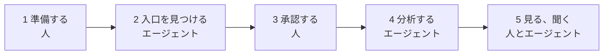

# 手引き

as-built-atlas で自分のシステムを分析する人に向けた文書です。
人が何をすると何が手に入るか、その途中でどの skill とコマンドが動くかを、場面ごとに示します。

仕組みの理由を知りたいときは、[仕組みの説明](../architecture/README.md)を読みます。

## 先に知っておく言葉

| 言葉 | 意味 |
|---|---|
| **入口** | 処理が始まる所。バッチのジョブ、画面、API の操作。分析の単位になる |
| **分析リポジトリ** | 分析の対象ごとに 1 つ作る Git リポジトリ。設定、入口の一覧、分析結果を置く |
| **プロファイル** | 対象の種類ごとの分析の型。何を入口と見るか、どの層を辿るかを決める |
| **skill** | エージェントに作業のやり方を教える指示書。分析に使うものが、分析リポジトリに 5 つ配られる |
| **コマンド** | 決まった入力から決まった結果を出すツール。分析リポジトリでは `docker compose run --rm abatlas <名前>` で動かす |

初めて分析するときに人が直接使うのは、準備と表示のコマンドだけです。
残りのコマンドは、skill に従ってエージェントが実行します。

## 初めて分析するときの流れ

人の判断が要るのは、3 の承認だけです。

| 段階 | 人がやること | 裏で動くもの | 手に入るもの |
|---|---|---|---|
| 1 準備する | 分析リポジトリを作る。対象のコードの場所とコミットを書く | コマンド `init`、`validate work` | エージェントを起動できる分析リポジトリ |
| 2 入口を見つける | エージェントに「分析を進めて」と頼む | skill `abatlas-discover-entries`。コマンド `code-map`、`enumerate` | 入口の候補の一覧。定義ファイルの規則を書いた対象では、照合の結果も |
| 3 承認する | エージェントの質問に答える。示された案を一度だけ承認する | skill `abatlas-run-analysis`。コマンド `propose`、`approve` | 分析する入口と、作業の一覧 |
| 4 分析する | 待つ。止まったら「中断した分析を再開して」と頼む | skill `abatlas-analyze-entry`、`abatlas-review-entry`。コマンド `validate result`、`evidence`、`queue`、`build` | 入口ごとの分析結果 (根拠のファイルと行つき) と、レビューの指摘。集計の結果 |
| 5 見る、聞く | 画面を起動して開く。自分のエージェントを MCP につなぐ | 画面と MCP | 変更の影響を画面で調べられる。エージェントも同じデータで答える |

手順は [初めて分析する](first-analysis.md) にあります。

## 配られる skill

skill は、エージェントが頼まれた内容に合わせて選びます。
人が skill の名前を覚える必要はありません。

| skill | いつ動くか | 何をするか | 頼み方の例 |
|---|---|---|---|
| `abatlas-run-analysis` | 分析を始めるとき、再開するとき | 全体を取りまとめる。入口と作業の案を作り、承認を受け、入口ごとの分析を割り振る | 「分析を進めて」「中断した分析を再開して」 |
| `abatlas-discover-entries` | 初回に、取りまとめ役から呼ばれる | 入口の拾い方を決めて、入口の候補を出す。道具で取れない入口は、コードを読んで根拠つきで足す | 「入口の一覧を作って」 |
| `abatlas-analyze-entry` | 承認の後、入口 1 件ごと | 入口から処理を辿り、分析結果を 1 ファイル書く。機械チェックに通す | 「この入口を分析して」 |
| `abatlas-review-entry` | 分析結果が書かれるたび | 分析した文脈を持たない別のエージェントが、根拠が主張を支えているかを確かめる | 「この分析結果をレビューして」 |
| `abatlas-classify-data` | 分析結果がたまった後 | 分析結果に出てきた列を集め、個人情報などの区分の案を書く | 「データの辞書を作って」 |

## 場面から読む文書を選ぶ

| 場面 | 人がやること | 裏で動くもの | 読む文書 |
|---|---|---|---|
| 同梱の見本で試す | 見本をコピーして、集計と起動のコマンドを実行する | コマンド `init`、`build` | リポジトリの `README.md` の「10-minute quickstart」(日本語は `README.ja.md` の「10 分で試す」) |
| 初めて分析する | 上の表の 1 から 5 | 上の表のとおり | [初めて分析する](first-analysis.md) |
| 結果を読む | 画面で、知りたい問いに合うページを開く。エージェントに MCP で聞く | 画面と MCP | [結果を読む](read-results.md) |
| 対象のコードが進んだ | 新しいコミットを指定して「分析を進めて」と頼む。案を承認する。前の結果と比べる | skill `abatlas-run-analysis`。コマンド `impact`、`propose`、`approve`、`diff` | [対象のコードが進んだら更新する](update-analysis.md) |
| 個人情報の列を洗い出す | 「データの辞書を作って」と頼む。区分の案を確かめて承認する | skill `abatlas-classify-data`。コマンド `dictionary` | [個人情報の列を洗い出す](data-dictionary.md) |
| 自分のシステムに合わせる | プロファイルを写して直す | コマンド `validate profile`、`enumerate` | [プロファイルを自分のシステムに合わせる](customize-profile.md) |
| 配布物を新しくする | 更新のコマンドを実行する | コマンド `upgrade`。形式の項目名が変わった版では `migrate` も | [配布物を新しくする](upgrade.md) |
| エージェントの精度を測る | 見本の正解と突き合わせる | コマンド `evaluate` | [エージェントの精度を測る](evaluate.md) |
