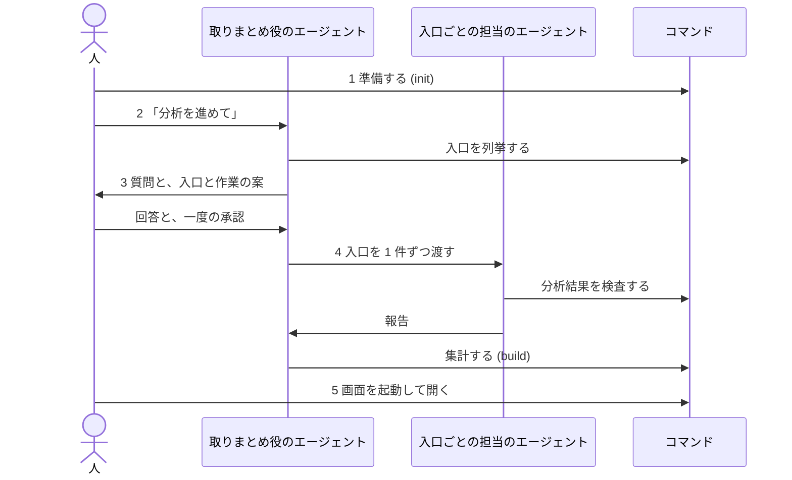

# 初めて分析する

[← 手引きの入口へ](README.md)

自分のシステムを初めて分析するときの手順です。
分析リポジトリを作る所から、画面で結果を開く所までを扱います。

段階ごとに、人がやること、裏で動くもの、手に入るものを分けて書きます。

## 用意するもの

| もの | 用途 |
|---|---|
| Docker と Docker Compose | コマンド、集計、画面を動かす |
| git | 分析リポジトリと、対象のコードの版を管理する |
| 対象のコードの clone | 分析の対象。コンテナからは読み取り専用で見える |
| コーディングエージェント | 入口を見つけ、分析する (Claude Code、Codex など) |
| ホストの `python3` | エージェントの hook が使う。標準ライブラリだけでよい |

## 全体の流れ



**取りまとめ役**は、人が起動したエージェントです。
**入口ごとの担当**は、取りまとめ役が入口 1 件ごとに起動する別のエージェントです。

## 1. 準備する

### 人がやること

1. 分析リポジトリを作ります。`<プロファイル>` は、対象に合うプロファイルの名前に置き換えます (例: `batch-kestra`)。

   ```bash
   mkdir my-analysis && cd my-analysis
   docker run --rm -v "$PWD:/ws/analysis" -w /ws/analysis ghcr.io/suwa-sh/as-built-atlas:latest init . --profile <プロファイル>
   ```

2. 対象の場所を 2 つのファイルに書きます。

   | ファイル | 書くこと |
   |---|---|
   | `.env` | `ABATLAS_TARGET` に、対象の clone の場所 |
   | `analysis/work-definition.yaml` | `target.repo` (対象の識別)、`target.clone_path` (`.env` と同じ場所)、`target.commit` (分析するコミット) |

   コミットは、対象の clone で `git rev-parse HEAD` を実行して調べます。

3. 分析する範囲に、コミットしていない変更が無いことを確かめます。分析リポジトリで次を実行し、何も出なければ進めます。`<分析する範囲>` は、作業定義の `target.scope` です (既定は `.`)。

   ```bash
   git -C <対象の clone の場所> status --porcelain --untracked-files=all -- <分析する範囲>
   ```

   承認 (段階 3) は、対象の clone が指定したコミットのままで、分析する範囲に変更も未追跡のファイルも無いときだけ確定できます。
   範囲の中を開発中の clone では、指定したコミットを取り出した別の clone を用意します。

   分析する範囲に、サブモジュールか Git LFS で管理するファイルがあると、承認する案を作れません。
   サブモジュールは、親とは別に clone して、別の対象として分析します。親を分析するときは、`target.scope` にサブモジュールを含めません。

4. 書いた内容を検査します。

   ```bash
   docker compose run --rm abatlas validate work analysis/work-definition.yaml
   ```

5. 分析リポジトリのルートで、コーディングエージェントを起動します。

プロファイルの一覧は、[プロファイル](../reference/profiles.md) の「中身」にあります。
`analysis/work-definition.yaml` のほかの項目は、[作業定義に書くこと](../reference/work-definition.md)にあります。

入口が多いときは、`analysis.models` に、分析のモデル (`analyze`) とレビューのモデル (`review`) を書いておきます。
書かなかった役の担当は、使っているコーディングエージェントの既定のモデルで動きます。
多くの製品では、起動した側と同じモデルになり、入口が多いと費用がかさみます。

### 裏で動くもの

`init` が、次の 3 種類を分析リポジトリに置きます。

| 置かれるもの | 例 | 扱い |
|---|---|---|
| 配布物のコピー (skill、プロファイル、形式の定義、文書) | `.abatlas/`、`compose.yaml` | 配布物の更新で置き換わる。手で直さない |
| エージェントの設定 | `AGENTS.md`、`.agents/harness.yaml` | 分析リポジトリの持ち物。対象に合わせて直せる |
| 分析の資産の置き場 | `.env`、`analysis/` | 分析リポジトリの持ち物。残る |

製品別の設定 (`.claude/` など) は、エージェントの設定から作られる生成物です。手で直しません。
パスごとの持ち主は、[分析リポジトリと配布物](../architecture/analysis-repo.md) の「分析リポジトリの中身」にあります。

### 手に入るもの

エージェントを起動すれば分析を頼める分析リポジトリです。

## 2. 入口を見つける

### 人がやること

エージェントに「分析を進めて」と頼みます。

### 裏で動くもの

取りまとめ役が skill `abatlas-run-analysis` を選び、初回は skill `abatlas-discover-entries` で入口を調べます。

| 順 | エージェントがすること | コマンド |
|---|---|---|
| 1 | 対象のコミットにあるファイルの配置を確かめる | `code-map` |
| 2 | 入口を定義するファイルの規則を、作業定義に書く (規則を決められる対象だけ) | |
| 3 | 入口の拾い方 (抽出器とパラメータ) を、入口の一覧に書く | |
| 4 | 一覧を書き換えずに、候補を試しに出す。漏れと重複を見て、拾い方を直す | `enumerate --dry-run` |
| 5 | 抽出器で取れない入口を、コードを読んで、根拠と理由を付けて一覧の設定に足す | `code-search` (コードを探すとき) |
| 6 | 候補を一覧に保存する | `enumerate` |
| 7 | 入口が 1 つも出ていない定義ファイルが無いかを照合する (2 で規則を書いたときだけ) | `code-map --check` |

**抽出器**は、入口の候補を出す道具です。
プロファイルが、対象の種類に合う抽出器と既定の設定を持っています。

2 の規則は、「この場所のファイルは、どれも入口を定義している」と確かめられる対象でだけ書きます (例: ジョブの定義を置くディレクトリ)。
規則を書かない対象では、7 の照合を飛ばします。

読むファイルは、コマンドで違います。

| コマンド | 読むファイル |
|---|---|
| `enumerate` (4 と 6) | 対象の clone に、いまあるファイル。Git が無視するファイルも読む |
| `code-map` (1 と 7) と、承認の案 | 作業定義のコミットから取り出したファイル。コミットに無いファイルは読まない |

Git が無視するファイル (例: ビルドの生成物) に入口の定義があり、抽出器が探す範囲に入っていると、4 と 6 の候補にだけ、その入口が出ます。

どの対象でも、エージェントは最後に、入口の一覧を検査します (`validate entries`)。
検査が通り、候補が 1 件以上あれば、承認へ進みます。

### 手に入るもの

- `analysis/entry-list.yaml` に、入口の候補が並びます。この時点では、どれも未承認です。
- 規則を書いた対象では、定義ファイルとの照合の結果も得られます。規則を書かない対象では、定義ファイルの取りこぼしは検査されていません。
- エージェントの報告が出ます。件数と内訳、読んで足した入口と理由、入口かもしれないが足さなかったものが書かれます。

## 3. 承認する

### 人がやること

1. エージェントの質問に答えます。質問は、エージェントが調べても決まらなかった業務上の判断だけです (例: 「手動の再決済フローを本番運用で使いますか」)。
2. エージェントが示す案を確かめます。案には、対象のコミット、入口と作業の件数、理由が書かれます。分析のモデル (`analysis.models.analyze`) を書いていないときは、今回使うモデルの確認も、ここで求められます。
3. 質問がなくなった案を、一度だけ承認します。

回答しただけでは、承認になりません。
案の内容が変わると、案の ID が変わり、新しい案への承認が要ります。

### 裏で動くもの

| エージェントがすること | コマンド |
|---|---|
| 調べた根拠、入口を含めるか外すかの判断、人への質問を、下書きに書く | |
| 案を作って示す。分析リポジトリは書き換えない | `propose` |
| 承認を受けたら、案の ID と承認者を付けて確定する | `approve` |

未回答の質問や、採否を決めていない候補が残っていると、確定できません。

### 手に入るもの

- 入口ごとの採否が、`analysis/entry-list.yaml` に確定します。
- 今回分析する入口の一覧が決まります。入口ごとの再承認は要りません。

## 4. 分析する

### 人がやること

待ちます。
途中で止まったときは、「中断した分析を再開して」と頼みます。

### 裏で動くもの

取りまとめ役が、入口を 1 件ずつ担当のエージェントに渡します。
はじめに 2 件から 3 件を確かめ、残りは同時に動かす数を抑えて流します。

入口 1 件ごとに、次の順で進みます。

| 順 | 誰が | すること | 使うもの |
|---|---|---|---|
| 1 | 入口の担当 | 入口から処理を辿り、分析結果を 1 ファイル書く。主張ごとに、事実、解釈、不明のどれかを付ける。事実と解釈には根拠のファイルと行を、不明には分からなかった理由を書く | skill `abatlas-analyze-entry` |
| 2 | コマンド | 形式と、根拠の行が実在することを検査する | `validate result` |
| 3 | コマンドと、入口の担当 | 根拠の行の近くに、主張した名前が見つからない主張を並べる。入口の担当が、根拠を直すか、理由を書く | `evidence` |
| 4 | 別のエージェント | 分析した文脈を持たない立場で読み直し、指摘を書く。3 で並んだ主張から確かめる | skill `abatlas-review-entry`、`evidence` |
| 5 | 入口の担当 | 重い指摘を直す。残す指摘には理由を書く | |

はじめの数件で、書き方の決まり (分析リポジトリの分析の規約) を足すことがあります。
規約は承認した案の条件に含まれるので、規約を変えると、取りまとめ役が同じコミットで案を作り直します。
人は、変わった理由と、分析し直す入口を確かめて、新しい案を承認します。

再開のときは、コマンド `queue` が、検査とレビューの済んでいない入口を返します。
残りが無くなると、取りまとめ役がコマンド `build` で集計します。

### 手に入るもの

| 置き場 | 内容 |
|---|---|
| `analysis/results/` | 分析結果。入口 1 件が 1 ファイル |
| `analysis/reviews/` | レビューの指摘。入口 1 件が 1 ファイル |
| `analysis/data/` | 集計の結果。git では管理しない。分析結果から作り直せる |

分析結果の読み方は、[分析結果の形式](../reference/formats.md) にあります。

## 5. 見る、聞く

### 人がやること

1. 画面を起動します。

   ```bash
   docker compose up -d api
   ```

   取りまとめ役の報告に集計の完了が無いときは、先に、残っている入口が無いかを取りまとめ役に確かめます。

   | 状態 | すること |
   |---|---|
   | 分析かレビューの済んでいない入口が残っている | 「中断した分析を再開して」と頼む (段階 4 に戻る) |
   | 残りは無く、集計だけが済んでいない | `docker compose run --rm abatlas build .` で集計する |

2. ブラウザで <http://localhost:8765> を開きます。
3. 自分のエージェントから聞くときは、MCP を登録します。Claude Code の例です。

   ```bash
   claude mcp add --transport http abatlas http://localhost:8765/mcp
   ```

4. 分析リポジトリの変更を、git にコミットします。次に対象のコードが進んだとき、このコミットが比較の起点になります。

### 裏で動くもの

段階 4 の終わりの `build` が、分析結果を表に直し、**集計表** (画面と MCP が読む表) を作っています。
画面と MCP は、同じ API から同じ集計表を読みます。

### 手に入るもの

| 使う人 | 使い方 | 分かること |
|---|---|---|
| 人 | 画面のメニュー 8 つ | 全体の層のつながり、入口ごとの処理、データや外部サービスや共通処理を使う入口、分析の進み具合と不明な点 |
| エージェント | MCP のツール (`describe_atlas`、`describe_mart`、`query_mart` など) | 画面と同じ集計表の行 |

画面のページごとの説明は [webapp](../architecture/webapp.md) に、MCP のツールの一覧は [集計表 API と MCP](../reference/api.md) にあります。

## うまく進まないとき

| 起きること | 原因 | すること |
|---|---|---|
| 検査の出力に「プロファイルを自動で読めない」と出る | 作業定義の `profile.dir` の場所に、プロファイルが無い | `profile.dir` を直す。検査が OK でも、完了にしない |
| `code-map --check` が終了コード 1 で終わる | 入口が 1 つも出ていない定義ファイルがある | エージェントが、表示されたファイルを読み、入口の拾い方を直す |
| `code-map --check` が「照合するには作業定義に analysis.entry_file_patterns を指定してください」で止まる | 定義ファイルの規則を書いていない | 規則を決められる対象なら、作業定義に書く。決められない対象なら、照合を飛ばす |
| `code-map --check` が終了コード 2 で終わる | 入口の列挙そのものが失敗した (例: 探す場所に定義が無い、対象の範囲にサブモジュールがある) | 標準エラーの原因に従って、設定を直す |
| 承認の確定が「対象を指定コミットの clean checkout に合わせてください」で止まる | 対象の clone が指定したコミットと違う。または、分析する範囲に変更か未追跡のファイルがある | 対象の clone を指定したコミットに合わせ、変更を無くす。承認し直しても、この状態のままでは通らない |
| 承認の確定が「確認者・未解決の質問・計画 ID を確認し、最新の案で全体を承認してください」で止まる | 承認者の名前が空。未回答の質問か、採否を決めていない候補が残っている。または、承認した後に案の内容が変わった | 人への質問が残っていれば、答える。採否を決めていない候補は、エージェントに、根拠を調べて採否の案を埋めてもらう。その後で、エージェントが示す最新の案を確かめ、承認者の名前を伝えて承認し直す |
| Linux で、作られたファイルの所有者が root になる | コンテナが root で書く | 所有者を自分に戻す。macOS の Docker Desktop では起きない |

## 次に読む文書

分析の後の場面 (対象のコードが進んだ、個人情報の列を洗い出す、配布物を新しくする) は、[手引きの入口](README.md) の「場面から読む文書を選ぶ」から選びます。
