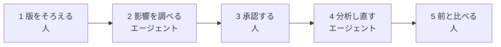

# 対象のコードが進んだら更新する

[← 手引きの入口へ](README.md)

対象のコードのコミットが進んだ後に、分析を更新する手順です。
全部を分析し直すのではなく、変更の影響を受けた入口だけを分析し直し、残りは前の結果を再利用します。

## 全体の流れ



[初めて分析する](first-analysis.md) との違いは、2 で前回の結果と対象の差分を使うことです。

## 1. 版をそろえる

### 人がやること

1. 更新前の分析リポジトリの変更を、すべてコミットします。このコミットを**前回の分析コミット**と呼びます。

   ```bash
   git rev-parse HEAD
   ```

2. 対象の clone を、今回分析するコミットにします。次の 3 種類のコミットが、手元の clone に入っている状態にします。今回のコミット、前回の作業定義のコミット、いまの分析結果が実際に分析したコミットです。前に再利用した結果は、前回より古いコミットを指しています。履歴を省いた浅い clone は使わず、履歴をすべて持つ clone を使います。
3. `analysis/work-definition.yaml` と `analysis/entry-list.yaml` の `target.commit` を、今回のコミットに書き換えます。
4. 分析する範囲に、コミットしていない変更が無いことを確かめます (確かめ方は、[初めて分析する](first-analysis.md) の「1. 準備する」)。

### 手に入るもの

比較の起点 (前回の分析コミット) と、今回のコミットにそろった対象です。

## 2. 影響を調べる

### 人がやること

エージェントに「分析を進めて」と頼み、前回の分析コミットを伝えます。

### 裏で動くもの

取りまとめ役 (skill `abatlas-run-analysis`) が、コマンド `impact` で作業の一覧を出します。
`impact` は、今回のコミットで入口を列挙し直し、前回の結果の根拠と、対象の差分を突き合わせます。
入口の一覧と分析結果は、書き換えません。

| 作業の種類 | そうなる理由 | その後に起きること |
|---|---|---|
| 追加の分析 | 新しい入口の候補が出た。または、承認済みで結果が無い | 採否を決めて、分析する |
| 再分析 | 前回の入口の定義、または主張の根拠のファイルが、変更、移動、削除された。または、分析の条件 (プロファイル、規約) が変わった | エージェントが差分を読み、入口を分析し直す |
| 廃止の確認 | 前回の入口が、列挙から消えた。または、前に外すと決めた入口に、結果が残っている | 人が確かめた後に、いまの結果から外す。前の結果は git の履歴に残る |
| 再利用の候補 | 根拠のファイルと分析の条件が、前回と同じ | 前の結果をそのまま使う |

`impact` の判定は、ファイルの単位です。
変更の中身が入口の動きを変えるかどうかは、エージェントが差分を読んで判断します。

### 手に入るもの

入口ごとの、作業の種類と理由の一覧です。

今回の質問への回答で入口を外すと決めた場合、その判断は、この一覧にはまだ出ません。
次の段階で示される案に出ます。
結果のある入口は廃止として、結果の無い候補は外した入口 (却下済み) として出ます。

## 3. 承認する

### 人がやること

初めて分析するときと同じです。

1. エージェントの質問に答えます。
2. 案を確かめます。案には、対象のコミット、入口と作業の件数、再利用できる理由、廃止する入口が書かれます。
3. 質問がなくなった案を、一度だけ承認します。

確かめる点は、次のとおりです。

| 確かめる点 | 理由 |
|---|---|
| 再利用の理由が、変更の中身と合っているか | 再利用した入口は、分析し直されない。新しい登録や動的な呼び出しが増えた変更では、前の根拠に出ていない入口にも影響しうる |
| 列挙から消えて廃止になる入口が、本当に無くなったか | 入口の拾い方が外れただけの場合がある |
| 外すと決めて廃止になる入口は、外す理由が正しいか。いまの結果を外してよいか | コードには入口が残っている。外すと、その入口の結果は画面と MCP から消える |

### 裏で動くもの

エージェントが、コマンド `propose` で案を作り、承認を受けてからコマンド `approve` で確定します。
再利用は、承認と同時に確定します。

### 手に入るもの

- 今回分析し直す入口の一覧が決まります。
- 再利用する入口には、理由と承認者の記録が残ります。

## 4. 分析し直す

### 人がやること

待ちます。
途中で止まったときは、「中断した分析を再開して」と頼みます。

### 裏で動くもの

| 作業 | エージェントがすること |
|---|---|
| 追加の分析、再分析 | 入口ごとの担当が、skill `abatlas-analyze-entry` で分析する。共通の処理の差分は一度だけ読み、同じ変更を扱う入口の間で共有する |
| 廃止 | 前の結果が前回の分析コミットに残っていることを確かめてから、いまの結果、レビュー、再利用の記録から外す |
| 集計 | コマンド `queue` が返す、検査とレビューの済んでいない作業が無くなると、コマンド `build` で集計する |

### 手に入るもの

今回のコミットで有効な分析結果と、集計です。
入口の概要の集計表は、入口ごとに、今回分析した結果 (`analyzed`) か、再利用した結果 (`reused`) かを持ちます。

## 5. 前と比べる

### 人がやること

前回の分析コミットと、いまの分析結果を比べます。

```bash
docker compose run --rm abatlas diff . --from <前回の分析コミット>
```

確かめた後に、分析リポジトリの変更をコミットします。

### 手に入るもの

| 出るもの | 内容 |
|---|---|
| 1 行目 | 分析結果が変わった入口、足された入口、消えた入口の数 |
| `~ <入口>` | 変わった入口。観点ごとに、足されたもの (`+`) と消えたもの (`-`) |
| `+ <入口>`、`- <入口>` | 分析結果が足された入口、消えた入口 |

比べるのは中身 (何を呼ぶか、どのデータをどう使うか) です。
根拠の行番号と説明の文は比べないので、行がずれただけの違いは出ません。
業務のルールだけは、内容の文で比べます。
言い回しが変わっただけでも、「消えて、足された」と出ます。

## うまく進まないとき

| 起きること | 原因 | すること |
|---|---|---|
| 作業の一覧を出す前に、「足した入口に問題がある」で止まる | エージェントが読んで足した入口の、定義のファイルか行が、今回のコミットで動いたか消えた | エージェントが対象の差分を確かめ、入口の一覧の設定 (読んで足した入口) を直してから、もう一度進める |
| コミットを読めずに止まる | 前回の作業定義のコミットか、いまの分析結果が分析したコミットが、対象の clone に入っていない | 履歴をすべて持つ clone を使う。対象の履歴が書き換えられて、そのコミットがブランチやタグから外れているときは、取り直した clone にも入らない。そのコミットを持つ前の clone から、今回使う clone に取り込む |
| 承認の確定が止まる | [初めて分析する](first-analysis.md) の「うまく進まないとき」と同じ | 同じ表を見る |

## 詳しい仕様

| 知りたいこと | 文書 |
|---|---|
| 作業の一覧の作り方、入口ごとに再利用を確定するコマンド `reuse`、結果の状態の読み方 (「結果の状態と差分」) | [入口の照合、一括の承認、差分からの更新のコマンド](../reference/update-commands.md) |
| 差分に出るもの、出ないもの | [コマンド](../reference/commands.md) の「分析結果の差分」 |
| 分析し直すかどうかの条件 | [分析結果の形式](../reference/formats.md) の「来歴」 |
