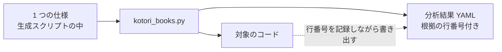

# 公開サンプルと突き合わせ

[← 仕様の地図へ](README.md)

`examples/` に、見本を、プロファイルごとに 1 つ持ちます (経緯は ADR 0017)。イメージには入れません (リポジトリからコピーして使います)。

| プロファイル | 見本 | 対象 | 対象のライセンス | 入口の一覧 | 分析結果 |
|---|---|---|---|---|---|
| `batch-kestra` | `kotori-books-atlas` | ことり書店 (架空。同梱) | — | 34 | 34 (正解) |
| `ui-nextjs` | `umami-atlas` | umami | MIT | 83 | 83 |
| `api` | `abatlas-api-atlas` | as-built-atlas 自身の API と MCP | MIT | 15 | 3 |
| `cli` | `stfw-atlas` | stfw のシナリオ実行・検証・レポート | Apache-2.0 | 20 | 3 |
| `transform-dbt` | `abatlas-dbt-atlas` | as-built-atlas 自身の集計 (dbt) | MIT | 39 | 3 |
| `batch-github-actions` | `listmonk-ci-atlas` | listmonk のワークフロー | AGPL-3.0 | 6 | 3 |
| `ui-vue-router` | `kestra-ui-atlas` | Kestra の画面 | Apache-2.0 | 62 | 7 |
| `ui-nuxt` | `nocodb-gui-atlas` | NocoDB の画面 | Sustainable Use License 1.0 | 69 | 3 |
| `ui-sveltekit` | `chat-ui-atlas` | chat-ui | Apache-2.0 | 15 | 3 |
| `ui-android` | `nowinandroid-atlas` | Now in Android | Apache-2.0 | 13 | 3 |
| `ui-ios` | `icecubes-atlas` | Ice Cubes | AGPL-3.0 | 102 | 3 |

- ことり書店のほかは、公開されているソフトを AI が分析した**実例**です。正解ではありません (人が 1 件ずつ確かめてはいません)。
- 対象のコードは入れません。結果が持つのは、パスと行番号、要約、データの名前です。使う人が、見本の隣に対象を clone します (手順は、見本ごとの `README.md`)。
- umami とことり書店は、全部の入口を分析しています。ほかの見本は、プロファイルの書き方が分かる数 (承認した 3 件から 7 件) だけを分析しています。承認していない入口は、候補のまま一覧に残っています (表の「入口の一覧」と「分析結果」の差)。
- どの見本にも当てはまる検査 (プロファイルと見本の 1 対 1、形式、プロファイルとの整合、一覧と結果とレビューの対応、手元の情報が残っていないこと、init → build で集計が通ること) は、`tests/test_examples_profiles.py` が行います。

下の 2 つは、中身まで確かめるテストを持つ見本です。

| | kotori-books-atlas (バッチの見本) | umami-atlas (画面の見本) |
|---|---|---|
| 対象 | 架空。このリポジトリに同梱 (`examples/kotori-books/`) | 実在の公開ソフト umami (v3.4.1、MIT License)。同梱しない (使う人が、隣に clone する) |
| プロファイル | `batch-kestra` | `ui-nextjs` |
| 分析結果 | 生成スクリプトが作る**正解** (34 件すべて) | AI が分析した**実例** (83 件すべて)。正解ではない (人が 1 件ずつ確かめてはいない) |
| 更新の仕方 | 生成スクリプトを直して、再生成する | 手元の分析リポジトリで分析し直し、資産を写す |
| テスト | `tests/test_examples.py` | `tests/test_examples_umami.py` |

## ことり書店 (kotori-books)

| 場所 | 中身 |
|---|---|
| `examples/kotori-books/` | 架空のオンライン書店「ことり書店」の Kestra バッチ。Flow 34 本、共通ランナー `scripts/run_job.sh`、Python のジョブ、共有ライブラリ `jobs/lib/` |
| `examples/kotori-books-atlas/analysis/` | それを分析した状態の、分析リポジトリの資産。`results/*.yaml` は正解として使える |
| `examples/generator/kotori_books.py` | 上の 2 つを生成するスクリプト |

### 正解が正しい理由

対象のコードと分析結果を、同じ仕様から生成します。根拠の行番号は、コードを書き出しながら記録するので、ずれません。

`tests/test_examples.py` が、次を確かめます。

- 再生成して、差が無い。
- 全件が、機械チェックに通る。
- 列挙の出力と一致する。
- init → build で、集計表が埋まる。

### 知っておくこと

| 点 | 内容 |
|---|---|
| `target.commit` | 対象のディレクトリの**内容ハッシュ** (sha1、40 桁)。対象は as-built-atlas の一部で、独立した git の履歴を持たないため、コミットの代わりに置く |
| 自分のエージェントで分析し直すとき | 対象を git リポジトリにして、`commit` を書き換える (手引きの [エージェントの精度を測る](../guide/evaluate.md)) |
| 使うとき | checkout の外へ、`kotori-books/` と `kotori-books-atlas/` を**並べて**コピーする (`.env` が `ABATLAS_TARGET=../kotori-books` で、`init` が git init するため) |
| checkout の中で init したとき | 生成物は `.gitignore` で除外している |

### 正解に入れてある「不明」

| 不明の内容 | 理由 (`reason`) |
|---|---|
| チャット Webhook と、判定 API のホスト | `not_traceable_in_repo` |
| 設定ファイル・顧客コード・レポート定義で決まる読み書き先 | `dynamic_dispatch` |
| DB に保存された SQL の実行 | `generated_at_runtime` |
| ソースの無いバイナリ | `binary_or_vendored` |

Jinja テンプレートから組み立てる SQL は、`fact` です。表名がテンプレートに静的に書かれているためです (根拠は、テンプレートの行)。

## umami-atlas

`examples/umami-atlas/analysis/` は、umami の画面を分析した状態の、分析リポジトリの資産です。

| 入っているもの | 件数 |
|---|---|
| 入口の一覧 | 83 件 (画面 60 + 枠 6 + 部品 17)。すべて承認済み。`within` 付き |
| 分析結果と、そのレビュー | 83 件 (枠 6 つ + 画面 60 件 + 部品 17 件)。使ったモデルは、結果ごとの `analyzer.model` に書いてある |

- 対象のコードは入れません。結果が持つのは、パスと行番号、要約、データの名前です。
- 資産を写すとき、手元の絶対パス (`clone_path`) は `../umami` に置き換えます。
- テストは、対象が無くても確かめられること (形式、プロファイルとの整合、一覧と結果の対応、集計と「包む入口」の表) を見ます。
- 根拠の行の実在は、umami を隣に clone して、`abatlas validate result --work` で確かめます。

## 突き合わせ (`evaluate`)

`abatlas evaluate <results> --truth <truth> [--json]` が、分析結果を、正解 (または別の分析結果) と突き合わせます。

入口の id で対応付け、次のキーで照合します。文 (summary / detail) は比べません。

| 項目 | 照合のキー | 吸収する表記ゆれ |
|---|---|---|
| 処理の段 | (層, 定義のファイル) | — |
| 読み書き | (種類, 操作, 段の値の組) | 前後の空白と末尾の `/`、host / dbms / bucket / account / broker の大文字と小文字、`schema` 無しで `table` が `a.b` のときの分割 |
| パラメータ | (段のキー, 名前) | — |

### 出す数字

| 数字 | 意味 |
|---|---|
| 適合率 | 一致 / 結果の数 |
| 再現率 | 一致 / 正解の数 |
| 状態の一致 | 一致した読み書きについて、状態 (fact / interpretation / unknown) と、不明の理由が合った数 |
| 操作だけ違う件数 | 同じデータで、操作だけが違う数 |

同じキーが複数あれば、多重集合で照合します (並び順に依りません)。

### 片方にしか無い入口

| 場合 | 数え方 |
|---|---|
| 正解にだけある入口 | 「未分析」。全項目を、正解だけ (FN) に数える |
| 結果にだけある入口 | 「正解に無い」。全項目を、結果だけ (FP) に数える |

総合の適合率と再現率は、これらを含みます。1 件だけ分析しても、100% にはなりません。

### 数え方は 2 通り

| 数え方 | 内容 | 使い道 |
|---|---|---|
| 重複込み (既定) | 同じキーが 2 回書いてあれば、2 つに数える | 終了コードは、こちらで決める |
| 重複を除いた比較 (`distinct`) | 同じ入口の中で、同じキーは 1 つに数える。入口ごとの数を足して、総合にする | 「どのデータに触れるか」「どのファイルを通るか」が合っているかを見る |

同じ処理を、呼び出し元ごとに何度書くかは、分析者によって揺れます。重複込みでは、その差だけで適合率が下がります。
