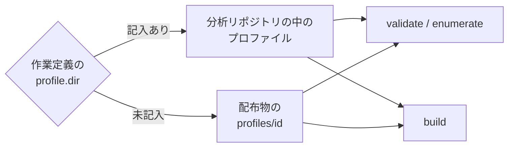
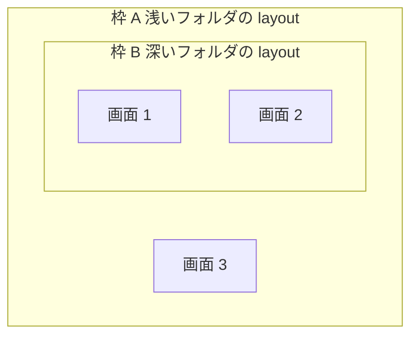

# プロファイル (分析の型)

[← 仕様の地図へ](README.md)

プロファイルは、対象の種類ごとの「分析の型」です。形式の定義・ETL・コアの集計表・webapp は、プロファイルに依りません。

## 中身

`profiles/<id>/` に、次を置きます。

| ファイル | 読む人 | 内容 |
|---|---|---|
| `profile.yaml` | ツール | 層の連鎖、階層の段の名前、抽出器と既定のパラメータ |
| `context.md` | エージェント | 入口の判別、層ごとに見るもの、事実・解釈・不明の付け方、データの当てはめ |
| `dbt-template/` | ツール | プロファイル固有の集計表。無くてもよい |

いまあるプロファイルは 11 個です。

| プロファイル | 対象 | 層の連鎖 | 入口と階層 | 抽出器 |
|---|---|---|---|---|
| `batch-kestra` | Kestra で定期起動されるバッチ | scheduler → shell → agent_skill / program → external | Flow 1 本 = 入口。`[namespace+, flow]` | structured-query (Flow 定義の YAML) |
| `ui-nextjs` | Next.js の画面を持つシステム (App Router と Pages Router。両方が同居する、移行の途中のものも) | page / layout / part → component → api_route → query → external | page ファイル 1 つ = 入口 (画面。Pages Router は pages の下のファイル 1 つ)、layout ファイル 1 つ = 入口 (画面を包む共通の枠)。Pages Router の `_app`、データに届く middleware、多くの page が自分で描く共通の枠も、枠の入口。保存された設定で選ばれて描かれる部品 (part) も、分けたときは入口。`[section+, page]` | glob (`app/**/page.*`、`app/**/layout.*`、`pages/**/*`、`pages/_app.*`、`middleware.ts`)。page が自分で描く共通の枠は、エージェントが読んで足す (listed) |
| `ui-vue-router` | Vue Router の画面を持つシステム。画面の定義をコードの中に書き、バックエンドは範囲の外 | screen / shell / part → component → store → api_client → external | route 1 つ = 入口 (画面)、アプリ全体の枠 = 入口。保存された設定で選ばれて描かれる部品 (part) も、分けたときは入口。`[section+, screen]` | ast (routes の配列)。取れない定義と、アプリ全体の枠は、エージェントが読んで足す (listed) |
| `cli` | コマンドラインから起動する道具。スケジューラの定義がリポジトリに無く、呼ばれる側のコマンドだけがある対象 | command → logic → adapter → external | 実行ファイル 1 つ = 入口。サブコマンドがあれば、サブコマンド 1 つ。`[group+, command]` | glob (`bin/*` など)。コードの中で定義したサブコマンドは、ast か、エージェントが読んで足す (listed) |
| `api` | サーバー側で操作を受けて処理するシステム。ほかのシステムやアプリから呼ばれる API と、サーバー側で画面を作って返す webapp | operation → handler → logic → adapter → external | 操作 1 つ = 入口 (HTTP なら、URL とメソッドの組)。`[resource+, operation]` | nested-keys (OpenAPI、AsyncAPI の定義ファイル)。定義ファイルが無い API、ツールを提供するサーバー、RPC は、ast か、エージェントが読んで足す (listed) |
| `batch-github-actions` | GitHub Actions で組んだ自動処理 (テスト、ビルド、公開、定期の処理) | workflow → job → step → program → external | workflow ファイル 1 つ = 入口。`[group+, workflow]` | glob (`.github/workflows/*.yml`) |
| `transform-dbt` | dbt で組んだデータの変換 | model → macro → external | model 1 つ = 入口 (snapshot も)。`[folder+, model]` | glob (`models/**/*.sql`、`snapshots/**/*.sql`) |
| `ui-sveltekit` | SvelteKit の画面を持つシステム | page / layout / shell / part → component → api_route → query → external | `+page.svelte` 1 つ = 入口 (画面)、`+layout.svelte` 1 つ = 入口 (画面を包む枠)、`hooks.server` = 入口 (どの要求でも動く枠、shell)。`[section+, page]` | glob (`src/routes/**/+page.svelte`、`+layout.svelte`、`src/hooks.server.ts`) |
| `ui-nuxt` | Nuxt の画面を持つシステム (サーバー側 `server/` を持つものも、別のバックエンドを呼ぶものも) | page / layout / shell / part → component → store → api_client → (api_route → query) → external | page ファイル 1 つ = 入口、layout ファイル 1 つ = 入口、app.vue・global の route middleware・server middleware・データに届くプラグイン = 入口 (shell)。`[section+, page]` (階層は置き場。`index` も段に残す) | glob (`pages/**/*.vue`、`layouts/**/*.vue`、`app.vue`、`middleware/*.global.ts`、`server/middleware/*`)。プラグインと、枠が描く共通の部品は、エージェントが読んで足す (listed) |
| `ui-android` | Android のアプリ (Jetpack Compose / Navigation 3 / Fragment。端末の中の保存とサーバーの API を使う) | screen / activity / shell / background → ui → viewmodel → usecase → repository → datasource → external | Navigation の destination 1 つ = 入口 (画面)。manifest の Activity 1 つ、枠が描く共通の composable 1 つ、OS から起動される class (Application、Service、Receiver、Provider、Worker) 1 つも入口。`[section+, screen]` | ast (Kotlin の `entry<K>` / `composable<R>` / `composable("...")`、`html` で読む manifest と navigation の XML、Worker の継承)。定数の route と、枠の composable は、エージェントが読んで足す (listed) |
| `ui-ios` | iOS のアプリ (SwiftUI、UIKit)。端末の中の保存もデータとして扱う | screen / shell / system → view → view_model → repository → client → external | 行き先の enum の case 1 つ = 入口 (画面)。アプリ全体の枠、OS から起動される入口 (ウィジェット、App Intents、拡張、URL の受け口) も入口。`[section+, screen]` | ast (行き先の enum の case、準拠するプロトコル)。push で開く View、UIKit の画面、枠、Info.plist だけで決まる入口は、エージェントが読んで足す (listed) |

## ツールが読むプロファイル

**ツールが読むプロファイルは、1 か所に決まります。** 作業定義の `profile.dir` です。



| 場合 | 読むもの |
|---|---|
| `profile.dir` がある | そのディレクトリの `profile.yaml`。検査 (`validate`)・列挙 (`enumerate`)・集計 (`build`) が、同じファイルを読む |
| `profile.dir` が無い | 配布物 (イメージ) の `profiles/<id>` |

検査と列挙の `--profile` は、省けます。

| `--profile` | 検査と列挙の動き |
|---|---|
| 省く | 分析リポジトリの作業定義から、上の決まりで読む。読んだ場所を出す |
| 渡す | 渡されたファイルを使う。集計が読むものと違うときは、警告する |
| 省いたが、読めない (検査するファイルが分析リポジトリの外、`profile.dir` の場所に無い) | 読めない旨を出して、プロファイルとの突き合わせを省く (黙って省かない) |
| 省いた。as-built-atlas の `examples/` に置かれた公開の見本で、分析リポジトリとして初期化していない (配布物のコピーを指しているが、`.abatlas/` が無い) | その旨を出して、配布物の `profiles/<id>` を読む |

- 読み先は、検査するファイルごとに決めます。そのファイルを含む、いちばん内側の `analysis/` の親が、分析リポジトリです。そこに作業定義が無ければ、外側へは進みません。カレントディレクトリも見ません。
- それ以外の分析リポジトリ (checkout の外、checkout の中でも `examples/` 以外) で、配布物のコピーが無いときは、配布物へは切り替えません。読めないとして扱います (集計も止まります)。
- 「プロファイルを自動で読めない」と出たら、検査が OK でも、完了にしません。

- `profile.dir` は、分析リポジトリのルートからの相対パスです。
- `init` は、`.abatlas/profiles/<id>` (配布物のコピー) を書きます。
- プロファイル固有の集計表は、そのディレクトリに `dbt-template/` があればそれを、無ければ配布物の `profiles/<id>/dbt-template/` を使います (配布物のコピーは、`dbt-template/` を持ちません)。

`build` は、読んだプロファイルが配布物のコピー (`.abatlas/profiles/<id>`) で、中身が配布物と違うときに、警告します (配布物を新しくして、`upgrade` を忘れた場合)。集計は止めません。自分用に写したプロファイルは、対象外です。

`build` は、読んだプロファイルを確かめます。合わなければ、**配布物へ黙って切り替えずに止まります。**

| 止まる条件 |
|---|
| `profile.dir` の場所に `profile.yaml` が無い |
| `profile.dir` が、分析リポジトリの外を指している (`profile.yaml` そのものが、外を指すリンクの場合も) |
| `profile.dir` が空の文字 (項目を消せば、配布物を使う) |
| プロファイルの `id` が、作業定義の `profile.id` と違う |
| プロファイルが、`validate profile` と同じ検査に通らない |

### 自分のシステムに合わせて直す

配布物のコピー (`.abatlas/`) は `upgrade` で置き換わるので、分析リポジトリの中に写したプロファイルを直します。手順と、版を上げるかどうかの決まりは、[手引きの「プロファイルを自分のシステムに合わせる」](../guide/customize-profile.md) にあります。

## 抽出器の契約

抽出器は、入口の候補を出す実行ファイルです。言語は問いません。

| 項目 | 契約 |
|---|---|
| 引数 | `--scope <dir> --layer <層の id> --params <JSON>` |
| 出力 | 標準出力に、`schema/entry-candidate.schema.json` の JSON を、1 行 1 件で書く |
| 終了コード | 0 以外は失敗 |

コアに同梱の抽出器は 5 つです。専用のパーサーは、プロファイルの `extractors/` に置きます (イメージの中で動くので、依存はイメージに入れます)。

| コア同梱の抽出器 | 向いている対象 | 入口の決まり方 |
|---|---|---|
| `abatlas-extract structured-query` | 定義ファイルに入口が書いてある (ジョブ定義の YAML / JSON / CSV) | ファイルの中身を JMESPath で読む。1 要素 = 入口 1 件 |
| `abatlas-extract nested-keys` | 定義ファイルの、入れ子のキーの組が入口を決める (OpenAPI の `paths.<URL>.<メソッド>`、AsyncAPI の `channels.<チャネル>.<操作>`) | キーの組 1 つ = 入口 1 件。キーを区切った段を加工して、階層パスと id にする。出典の行は、最後のキーの行 |
| `abatlas-extract glob` | ファイルの置き場が入口を決める (ファイルベースのルーティング、1 ファイル = 1 ジョブのスクリプト置き場) | glob に一致したファイル 1 つ = 入口 1 件。相対パスの段を加工して、階層パスと id にする |
| `abatlas-extract ast` | コードの中で入口を定義する (ルーティングの定義、登録の呼び出し) | コードの構文を ast-grep の規則で読む。一致 1 つ = 入口 1 件 |
| `abatlas-extract listed` | 上の 4 つで取れない入口 | エージェントがコードを読んで、設定に書いた入口を、そのまま候補にする |

`params` の全項目は、`abatlas extractors <名前>` で出せます (名前は `structured-query` / `nested-keys` / `glob` / `ast` / `listed`)。ファイルのパス (抽出器の `files`、候補の `source.file`) は、すべて、作業定義の `target.scope` からの相対です。

`glob` の加工は、次のとおりです: 先頭を落とす、ファイル名を落とす、正規表現に合う段を落とす、置換、固定の段を先頭に置く。同じ id が 2 つのファイルから出たら失敗します。

### 構文を読む抽出器 (`ast`)

| 項目 | 内容 |
|---|---|
| 読める言語 | bash, c, cpp, csharp, dart, elixir, go, hcl, html, java, javascript, json, kotlin, lua, php, python, ruby, rust, scala, swift, tsx, typescript, yaml。ほかの言語を渡すと、止まる |
| 規則 | `params.rule` に、ast-grep の規則を書く。値を取り出す所に、名前付きの穴 (`$NAME`) を置く |
| 入口の項目 | `params.fields` のひな形で作る。`{NAME}` が、穴に一致した文字に置き換わる。階層パスの元を `/` で区切って段にする。段の加工は、`glob` のうち 4 つ (正規表現に合う段を落とす、置換、固定の段を先頭に置く、段が残らないときの段) が使える。先頭を落とす (`strip_prefix`) と、ファイル名を落とす (`drop_last`) は使えず、書くと止まる。id の作り方は、`glob` と同じ |
| 読めない定義 | 別のファイルから来る定義や、関数が作る定義は、取れない。`params.unresolved` に、そういう場所に一致する規則を書くと、列挙のときに「読めなかった参照」として、ファイルと行を知らせる。入口にはしない |

その場で調べるときは、`abatlas code-search` を使います。規則に一致した場所を出すだけで、入口の一覧は変えません。

```bash
abatlas code-search analysis/work-definition.yaml --language typescript --files "src/**/*.ts" --pattern "import(\$PATH)"
```

### エージェントが足す入口 (`listed`)

入口を列挙する主体は、エージェントです。抽出器は、その土台です。抽出器で取れない入口は、エージェントがコードを読んで、`listed` の設定に書きます。

```yaml
extractors:
  - name: agent-listed
    run: abatlas-extract listed
    layer: screen
    rationale: 画面の定義の配列に、別のファイルで定義した画面が 2 つある。構文を読む抽出器では、中身を取れない
    params:
      entries:
        - id: orders
          path: /orders
          source: { file: src/orders/orderTabs.ts, line: 1 }   # scope からの相対
          reason: 画面の定義の配列に ORDER_ROUTE として入っている。定義は、このファイルにある
```

| 決まり | 理由 |
|---|---|
| 入口ごとに、根拠 (`source`) と理由 (`reason`) を必ず書く。`listed` は、ファイルの実在と行を確かめる | 人が承認するときに、定義を開いて確かめられる |
| 入口の一覧の `entries[]` には、直接書かない | 列挙をやり直すと消える。設定に書けば、列挙のたびに同じ候補が出て、承認の状態も引き継がれる |
| `listed` が出した候補には、`attributes.listed_by: agent` と `attributes.reason` が付く | 抽出器が取った入口と、見分けられる |
| 入口の層は、抽出器の `layer` で決まる。入口の層が 2 つ以上あるプロファイルでは、層ごとに別の名前の `listed` を書く | 層は、承認と、入口を包む関係の判定に使う |
| 同じ入口が、ほかの抽出器からも出たら、先に書いた抽出器の候補が残る。`listed` は、最後に書く | 道具で取れた入口を、手で書いたもので上書きしない |

### 列挙をやり直したとき

どの抽出器でも、同じです。入口が「指す先」は、階層パス、層、定義のファイルの 3 つです。

| 場合 | 列挙の動き | 理由 |
|---|---|---|
| 同じ id の入口が、前の一覧にある | 承認の状態 (`status`) と、人の判断の理由 (`note`) を引き継ぐ | 設定を直すたびに、承認をやり直さない |
| 人が判断した後に、同じ id の指す先が変わった | 引き継がずに `candidate` に戻し、その入口を知らせる | 人が見ていない入口を、承認済みにしない |
| 行か、付随する情報 (`attributes`。`listed` の理由を含む) だけが変わった | 同じ入口として引き継ぐ | 対象のコミットを進めると、行はずれる。理由の文は、エージェントが書き直すたびに言い回しが変わる |
| 同じ id が、2 つの抽出器から出て、指す先か行が違う | 止まる。一覧は変えない | 別の入口の片方を、黙って捨てない。1 回の列挙の中では行はずれないので、行も比べる |
| 同じ id が、2 つの抽出器から出て、指す先も行も同じ | 先に書いた抽出器の候補を残し、知らせる | 同じ入口を 2 回拾っただけ |
| 前の一覧にあった入口が、今回は出なかった | 一覧から外し、その入口を知らせる | — |

## 入口を包む入口 (`within`)

ある入口が、別の入口の中で動くことがあります。例: Next.js の画面は、祖先のフォルダの layout (共通の枠) の中で動きます。



画面 1 と 2 は、枠 A と枠 B の中で動きます。画面 3 は、枠 A の中だけで動きます。

**包む側も 1 件の入口として、1 回だけ分析します。** 関係は、入口の一覧が持ちます。

| やり方 | 起きること |
|---|---|
| 包む側の処理を、包まれる入口ごとに書く | 同じ通り道を、入口の数だけ繰り返す。umami の試し分析では、1 画面の処理の段の 4 割、読み書きの 5 割が枠だった |
| 包む側を 1 件の入口にする (採用) | 枠の処理は、枠の結果に 1 回だけ現れる |

仕組みのどこが、何をするかです。

| どこ | 何をするか |
|---|---|
| `profile.yaml` の `within` | 包む側の層 (`role: entry`) と、包む相手の決め方 (`rule`) を宣言する |
| `abatlas enumerate` | 宣言から、入口ごとの `entries[].within` (包む入口の id、外側から) を埋める。決定論で、エージェントは決めない。プロファイルを読めないときは付けない |
| `abatlas validate entries` | `within` の指す入口が実在し、自分を指さず、循環しないこと。プロファイルを読めたときは、宣言から決まる値と一致すること (古い一覧、手で直した一覧を指摘する) |
| `abatlas build` | 上と同じ検査を、プロファイルの宣言との一致まで行う。合わなければ集計せず、前の版を残す (`abatlas etl` 単体は宣言を知らないので、実在と循環だけ) |
| `context.md` | 分析の範囲を決める。包まれる側は包む側を辿らない。包む側は、包まれる側の中身を辿らない |
| ETL と dbt | `entry_within.csv` → `stg_entry_within` → `mart_entry_within` |
| webapp | 入口の詳細に「この入口を包む入口」「この入口の中で動く入口」を出し、行き来する。処理と読み書きは足し合わせない (包む側の分は、包む側のページで見る) |

いまある決め方 (`rule`) は、`source_dir` だけです。

- ソースのファイルが、自分と同じフォルダか、その配下にある入口を包みます。
- 包む側どうしは、フォルダが深い方だけが、浅い方に包まれます。
- 同じフォルダの包む入口は、互いを包みません。

分析結果の形式は変わりません (包む側の結果も、入口の段から始まる 1 本の木です)。`within` は任意の項目で、宣言の無いプロファイルの一覧と結果は、そのまま使えます。

### 包む入口を `rejected` にしたとき

その処理は、どの入口の結果にも現れなくなります (包まれる側は辿らないため)。データを読まない枠を外すのは正当な判断なので、検査では落としません。列挙が警告を出し、`mart_entry_within` の `within_status` に承認の状態を出します。

### 古い決まりで分析した結果が残っているとき

包む入口を足す前に分析した結果は、包む入口の処理を含んだままです。包む入口の結果と、二重になります。

| 誰が | 何をするか |
|---|---|
| `abatlas build` | 今のプロファイルの版と違う版で分析した結果を警告する (件数は `stale_results`)。`mart_entry_overview` の `profile_stale` に印を付ける。集計は止めない (全件の再分析が済むまで、画面を見られなくなるため) |
| webapp | 入口の一覧で、古い版で分析したものに絞れる |
| 分析 skill | 版が違う結果を、再分析の対象にする |

## プロファイルごとの決まり

入口の id と階層、既定では入口にならないもの、バッチと違う所を、プロファイルごとの文書に書いています。

| プロファイル | 文書 |
|---|---|
| `batch-kestra` | 個別の文書は無い。決まりは、上の「中身」の表と、プロファイルの `context.md` にある |
| `ui-nextjs` | [profiles/ui-nextjs.md](profiles/ui-nextjs.md) |
| `ui-vue-router` | [profiles/ui-vue-router.md](profiles/ui-vue-router.md) |
| `cli` | [profiles/cli.md](profiles/cli.md) |
| `api` | [profiles/api.md](profiles/api.md) |
| `batch-github-actions` | [profiles/batch-github-actions.md](profiles/batch-github-actions.md) |
| `transform-dbt` | [profiles/transform-dbt.md](profiles/transform-dbt.md) |
| `ui-sveltekit` | [profiles/ui-sveltekit.md](profiles/ui-sveltekit.md) |
| `ui-nuxt` | [profiles/ui-nuxt.md](profiles/ui-nuxt.md) |
| `ui-android` | [profiles/ui-android.md](profiles/ui-android.md) |
| `ui-ios` | [profiles/ui-ios.md](profiles/ui-ios.md) |
