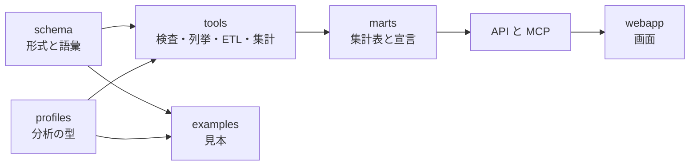

# rules

このリポジトリを開発するときに守ることです。人とコーディングエージェントの両方が読みます。

- 常に守る短い契約は [AGENTS.md](../../AGENTS.md) にあります。ここには、根拠と詳細を置きます。
- ここに書くのは「何を守るか」です。「どう進めるか」(手順) は、開発用の skill (`.agents/skills/dev-*`) にあります。
- 決まりの経緯は [ADR](../adr/README.md) にあります。ここには、いま守ることだけを書きます。

## 触る場所から、読むルールを選ぶ

[common.md](common.md) は、どの変更でも読みます。

| 触るもの | 場所 | 読むルール |
|---|---|---|
| 形式の定義と語彙 | `schema/` | [schema.md](schema.md) |
| 検査・列挙・ETL・集計・API・MCP | `abatlas/*.py` | [tools.md](tools.md) |
| 集計表と宣言 | `dbt-template/` `profiles/*/dbt-template/` `abatlas/declarations.py` | [marts.md](marts.md) |
| 画面 | `abatlas/webapp/` | [webapp.md](webapp.md) [DESIGN.md](../../DESIGN.md) |
| プロファイル | `profiles/` | [profiles.md](profiles.md) |
| 見本 | `examples/` | [examples.md](examples.md) |
| 文書 | `README.md` `docs/` | [docs.md](docs.md) |
| 版と配布物 | `pyproject.toml` の `version` `.github/workflows/release.yml` | [release.md](release.md) |

`DESIGN.md` は、画面の見た目の決まりです。

矢印の元を変えると、先に影響します。元に近い部分を変えたときは、先の部分のルールも読みます。

## 知識の置き場

| 置き場 | 書くこと | 読み手 |
|---|---|---|
| `docs/adr/` | 決定の経緯 | 人とエージェント |
| `docs/` の ADR 以外 | 守るべき最新の状態 | 人とエージェント |
| `.agents/memory/` | 作業中に得た、今後の作業でも理解しておくべきこと | エージェントだけ |

詳しくは [common.md](common.md) の「知識を残す」と、[ADR 0001](../adr/0001-knowledge-placement.md) にあります。

## 開発用の skill

| skill | いつ使うか |
|---|---|
| `dev-change` | このリポジトリを直すとき、いつも |
| `dev-webapp-verify` | 画面を直したとき |
| `dev-add-view` | 表示の種類か、メニューの項目を足すとき |
| `dev-sample-regen` | 見本に関わる変更をしたとき |
| `dev-docs` | 文書を直したとき |

開発用の skill は、分析リポジトリには配りません (配るのは `abatlas-*` と `mid-harness` だけです)。
