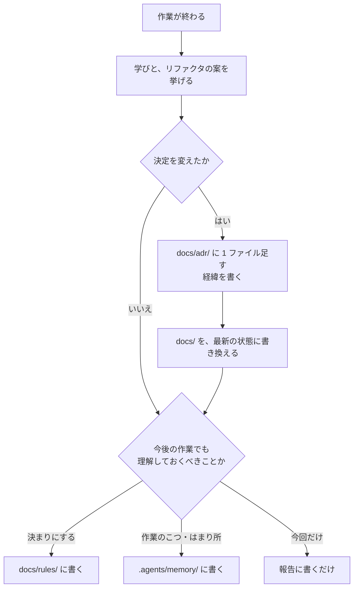

# 共通のルール

[← rules の地図へ](README.md)

どの部分を変えるときも守ることです。

## 進め方

| 決まり | 理由 |
|---|---|
| 変更は小さく、目的ごとにコミットする | 見直しと、巻き戻しがしやすい |
| コミットと push は、頼まれたときだけ行う | 外へ出す操作は、人が決める |
| 推測で、設定やライブラリの使い方を変えない。公式の文書か実装で確かめる | 推測の試行錯誤は、失敗が重なる |
| 破壊的な操作 (削除、履歴の書き換え、外への送信) は、実行の前に確かめる | 取り消せない |
| 決定論でできることは、ツールにする。エージェントに任せるのは、入口を見つけること (抽出器の設定を書き、抽出器で取れない入口を、根拠を付けて足す) と、処理の読み取りだけ | 同じ入力から、同じ結果を出す。入口の列挙は、道具だけでは漏れる ([ADR 0011](../adr/0011-agent-enumerates-entries.md)) |
| 観点を補うと方向が変わるときは、進める前に人に確かめる | 作り直しを避ける |

## 完了の前に確かめること (品質ゲート)

| 確かめること | やり方 |
|---|---|
| テストが通る | `uv run pytest -q`。main への push と、pull request のたびに、GitHub Actions (`.github/workflows/test.yml`) が、同じテストと、製品別の設定のずれの検査を流す |
| 実物で動く | 変えた部分ごとの確かめ方 (下の表) |
| 文書が今の状態と合う | 変えた事実を、`docs/` で探して直す |
| 別の目で見てもらう | 外部レビュー (下の「レビュー」) |

| 変えた部分 | 実物での確かめ方 |
|---|---|
| 形式、ツール、集計表 | 見本の分析リポジトリで、検査と集計をやり直す |
| プロファイル | 見本の分析リポジトリで、配布物のコピーを置き換えて (`upgrade`) から、集計をやり直す |
| 画面 | 配布物のイメージを作り直し、見本 2 つ (バッチ、画面を持つシステム) をブラウザで開く。広い幅と狭い幅。コンソールにエラーが無いこと |
| 配布物の中身 | イメージを作り直し、分析リポジトリで `upgrade` を試す |
| 文書 | 図を実際に描く。リンク切れを調べる |

**テストが通っても、実物で確かめるまでは完了にしません。** 画面の動きは、自動のテストでは見ていないためです ([webapp.md](webapp.md))。GitHub Actions が流すのも、テストだけです。実物での確かめ (集計、画面) は、手元で行います。

## 報告

| 決まり | 内容 |
|---|---|
| 確かめたことと、確かめていないことを分ける | 「目で見た画面」「数値だけ確かめた」「見ていない」を、そのまま書く |
| 失敗は、出力と一緒に書く | 通ったことにしない |
| 判断したことを書く | 頼まれていないが決めたこと (例: 手順を短くした) と、その理由 |
| 作業が終わったら、学び、リファクタの案、残っている作業を挙げる。**どれにも番号を振る** | 下の「学び・リファクタの案・残っている作業の書き方」 |

### 学び・リファクタの案・残っている作業の書き方

| 決まり | 理由 |
|---|---|
| 学び、リファクタの案、残っている作業には、それぞれ 1 から番号を振る (「学び 1」「リファクタ 1」「残り 1」)。表なら、先頭の列を番号にする | 返事で、番号を指して選べる (例: 「リファクタ 2 と、残り 1 を進める」) |
| 1 つの報告の中で、番号は変えない。前の報告の番号を、別のものに使い回さない | 番号で指したものが、ずれない |
| 前の報告の案を、もう一度挙げるときは、「前の報告のリファクタ 2」のように、どの報告の番号かを書く | 同じ番号が、2 つの案を指すのを防ぐ |
| 学びには、書いた場所を添える。リファクタの案には、効くところと、手間を添える | 選ぶための材料 |
| 残っている作業には、いまの状態 (指示待ち、未調査、未決など) と、進めるのに要ること (人の判断、確認) を添える。前の報告から持ち越したものも、済むまで毎回挙げる | 抜けたまま忘れない。誰の番かが分かる |
| 無いときは、「学びは無い」「リファクタの案は無い」「残っている作業は無い」と書く | 挙げ忘れと、区別する |

## レビュー

- コードの実装、テスト、文書の作成の後は、作った本人とは別系統のレビュアーに見てもらいます。
- レビューの前に、観点 (5 つまで) と、報告する重さの下限を決めます。途中で変えません。
- 指摘は鵜呑みにしません。1 件ずつ確かめ、反証できないものだけを直します。反証したものは、理由を残します。
- 直したら、同じ観点でもう一度見てもらいます (3 回まで)。
- 変更が大きいとき (30 ファイル、5000 行が目安) は、コードと文書のように分けて回します。

## 知識を残す

| 置き場 | 書くこと | 書かないこと |
|---|---|---|
| `docs/adr/` | 背景、決定、捨てた案、結果 | いま守る手順の全文 (それは `docs/` に書く) |
| `docs/` の ADR 以外 | 守るべき最新の状態 | 経緯 (ADR を指す)、エージェントだけに要る作業のこつ |
| `.agents/memory/` | はまり所、確かめ方のこつ、道具の癖 | 人も守る決まり (それは `docs/rules/` に書く)、手元の環境だけの値 (絶対パス、個人の情報) |

- `docs/` は、人とエージェントの両方が読みます。`.agents/memory/` は、エージェントだけが読みます。
- `docs/` から `.agents/memory/` は参照しません。
- 1 つの skill だけで使う知識は、その skill の `references/` に置きます。2 つ以上の skill で繰り返したら、`.agents/memory/` に上げます。
- リファクタの案は、番号を振って、報告に挙げます。やるかどうかは、人が決めます。
