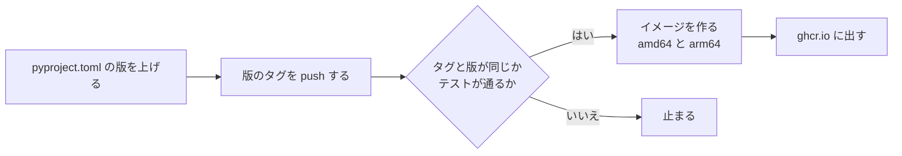

# 配布物を出すときのルール

[← rules の地図へ](README.md)

対象: 版 (`pyproject.toml` の `version`)、版のタグ、配布物のイメージ (`.github/workflows/release.yml`)。

## 何が出るか

配布物は、コンテナイメージ 1 つです。版のタグを push すると、GitHub Actions がイメージを作って、ghcr.io に出します。



| 出るタグ | 例 | 使いみち |
|---|---|---|
| 版 | `1.2.3` | 版を固定したいとき。分析リポジトリの `.env` の `ABATLAS_IMAGE` に書く |
| `latest` | `latest` | ふだん使うもの。分析リポジトリの既定 |

## 版の決まり

| 決まり | 理由 |
|---|---|
| 版は `pyproject.toml` の `version` が正本。タグは、その前に `v` を付けたもの | 2 か所で別々に決めると、ずれる。ずれたタグは、release の検査が止める |
| 想定しているプロファイルと分析の型がそろうまでは、0 系 | そろう前は、形式とコマンドが変わりうる |
| 0 系では、形式かコマンドの互換が切れる変更で、2 番目の数を上げる。それ以外は 3 番目 | 利用者が、更新で手を動かす必要があるかを、版で見分けられる |
| 互換が切れる変更には、移し方 (`migrate`) か、直し方の説明を付ける。説明は、変更の記録 (`CHANGELOG.md`) の「更新で気を付けること」に書く | 利用者は `latest` を使うので、更新のたびに当たる |
| 出したタグは、作り直さない。直すときは、版を上げる | 同じ版で中身が変わると、固定している利用者が気づけない |

## 手順

| 順 | やること |
|---|---|
| 1 | `uv version <新しい版>` で、`pyproject.toml` と `uv.lock` の版を上げ、変更の記録 (`CHANGELOG.md`) にその版の節を足して、commit する |
| 2 | main に push して、テスト (`test`) が通るのを待つ |
| 3 | `git tag v<新しい版>` を打って、タグを push する |
| 4 | `release` が終わったら、`docker pull` でイメージを取り、見本の分析リポジトリで `upgrade` と `build` を試す |

`release` は、タグを push したときだけ動きます。main への push では、イメージは出ません。

## GitHub Pages の紹介ページ

紹介ページの配布元は `site/` です。HTML、CSS、JavaScript、公開見本の静止画と動画をそのまま配信します。手元ではリポジトリのルートで次のコマンドを実行し、ブラウザで `http://127.0.0.1:8000/` を開きます。

```bash
uv run python - <<'PY'
import uvicorn
from starlette.staticfiles import StaticFiles

uvicorn.run(StaticFiles(directory="site", html=True), port=8000)
PY
```

紹介ページは日本語と英語（`en/`）で配信します。ルートではブラウザの優先言語から対応する言語を選び、該当しない場合は英語を表示します。ヘッダーで選んだ言語は次回も優先します。各言語のクイックスタートとプロファイルへのリンクは、同じ言語の README の見出しを指します。

初回はリポジトリの Settings → Pages → Source で GitHub Actions を選びます。`main` に紹介ページか `.github/workflows/pages.yml` の変更を push すると、ワークフローが `site/` を公開します。初回設定後の再実行には、Actions の「GitHub Pages」から `main` を指定して手動実行もできます。

公開 LP は言語の確定後に Google タグ マネージャーのコンテナ `GTM-PNWG3TNJ` を読み込みます。GA4 の測定先とトリガーはコンテナで管理します。手元でのプレビューは計測対象外です。

## OSS を周知するときの確認項目

初めて知った人が、検索で見つけ、共有されたリンクを開き、同梱の見本を試せるかを確かめます。

| 場面 | 用意するもの | 確かめ方 |
|---|---|---|
| GitHub で見つける | About の一行説明、公開した LP の Website、用途を表す Topics。候補は `impact-analysis`、`code-analysis`、`software-architecture`、`dependency-analysis`、`model-context-protocol`、`python` | リポジトリのトップで用途が伝わり、Website から LP に移れる |
| LP を共有する | ロゴ・製品名・「その変更、どこに影響しますか？」と実画面の一部を載せた横長画像。HTML の `og:title`、`og:description`、`og:type`、`og:url`、`og:image`、`og:image:alt`、大画像用の `twitter:card` | `og:url` と canonical を公開 URL に合わせる。`og:image` の HTTPS 絶対 URL をログインせずに開き、LP の URL を共有したときの文字・画像を確認する。[Open Graph 仕様](https://ogp.me/) |
| GitHub リポジトリを共有する | 同じ画像を GitHub の Settings → Social preview に登録し、README 冒頭でも使う。共用画像の目安は 1280 × 640 px、1 MB 未満 | リポジトリ URL を共有して、LP の URL とそれぞれのカードを確認する。[GitHub の画像仕様と登録手順](https://docs.github.com/en/repositories/managing-your-repositorys-settings-and-features/customizing-your-repository/customizing-your-repositorys-social-media-preview) |
| README から試す | 実画面、Docker と Git の前提、「10 分で試す」へのリンク。バッジ候補は CI、公開版、GHCR、MIT。日英 README を相互リンクする | 両言語から同じ公開済み配布物に着き、クイックスタートで見本を開ける。バッジから実際のテスト結果、配布物、ライセンスに着く |
| 版を選んで導入する | Git の版タグは `vX.Y.Z`、GHCR の固定タグは `X.Y.Z`。タグで動くワークフローの配布先は GHCR。GitHub Release を案内する場合は、既存タグに変更点と更新手順を紐付ける | GHCR からログインなしで取得できる。GitHub Release は公開ページを別途開き、タグ、CHANGELOG、更新手順が同じ版を指すことを確認する |
| 問い合わせ、改善を続ける | README に質問・不具合の Issues と参加方法、SECURITY.md に脆弱性の非公開報告先。依存更新、Actions の更新、main の保護設定を見直す | 公開の質問先と非公開の報告先にそれぞれ到達できる。依存更新の PR でテストが動く |
| 利用者に知らせる | Zenn ではエンジニア向けに CRUD 表から根拠行までを追う例を、note では保守責任者向けに調査結果の共有と判断の限界を扱う | 下書きの表・件数・画像を見本に照合する。両記事に公開リポジトリの URL を入れ、note では単独行に置いてカードを確認する。クイックスタートまでたどれたら、媒体ごとに公開時期を決める |
