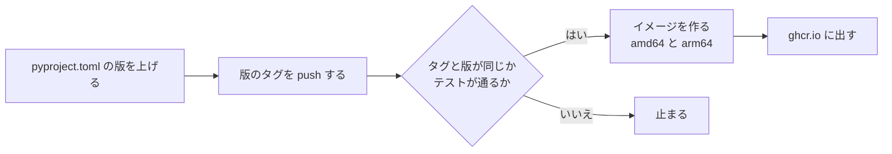

# 配布物を出すときのルール

[← rules の地図へ](README.md)

対象: 版 (`pyproject.toml` の `version`)、版のタグ、配布物のイメージ (`.github/workflows/release.yml`)。

## 何が出るか

配布物は、コンテナイメージ 1 つです。版のタグを push すると、GitHub Actions がイメージを作って、ghcr.io に出します。

| 出るタグ | 例 | 使いみち |
|---|---|---|
| 版 | `1.2.3` | 版を固定したいとき。分析リポジトリの `.env` の `ABATLAS_IMAGE` に書く |
| `latest` | `latest` | ふだん使うもの。分析リポジトリの既定 |

## 版の決まり

| 決まり | 理由 |
|---|---|
| 版は `pyproject.toml` の `version` が正本。タグは、その前に `v` を付けたもの | 2 か所で別々に決めると、ずれる。ずれたタグは、release の検査が止める |
| 想定しているプロファイルと分析の型がそろうまでは、0 系 | そろう前は、形式とコマンドが変わりうる |
| 0 系では、形式かコマンドの互換が切れる変更で、2 番目の数を上げる。それ以外は 3 番目 | 利用者が、更新で手を動かす必要があるかを、版で見分けられる |
| 互換が切れる変更には、移し方 (`migrate`) か、直し方の説明を付ける。説明は、変更の記録 (`CHANGELOG.md`) の「更新で気を付けること」に書く | 利用者は `latest` を使うので、更新のたびに当たる |
| 出したタグは、作り直さない。直すときは、版を上げる | 同じ版で中身が変わると、固定している利用者が気づけない |

## 手順

| 順 | やること |
|---|---|
| 1 | `uv version <新しい版>` で、`pyproject.toml` と `uv.lock` の版を上げ、変更の記録 (`CHANGELOG.md`) にその版の節を足して、commit する |
| 2 | main に push して、テスト (`test`) が通るのを待つ |
| 3 | `git tag v<新しい版>` を打って、タグを push する |
| 4 | `release` が終わったら、`docker pull` でイメージを取り、見本の分析リポジトリで `upgrade` と `build` を試す |

`release` は、タグを push したときだけ動きます。main への push では、イメージは出ません。
