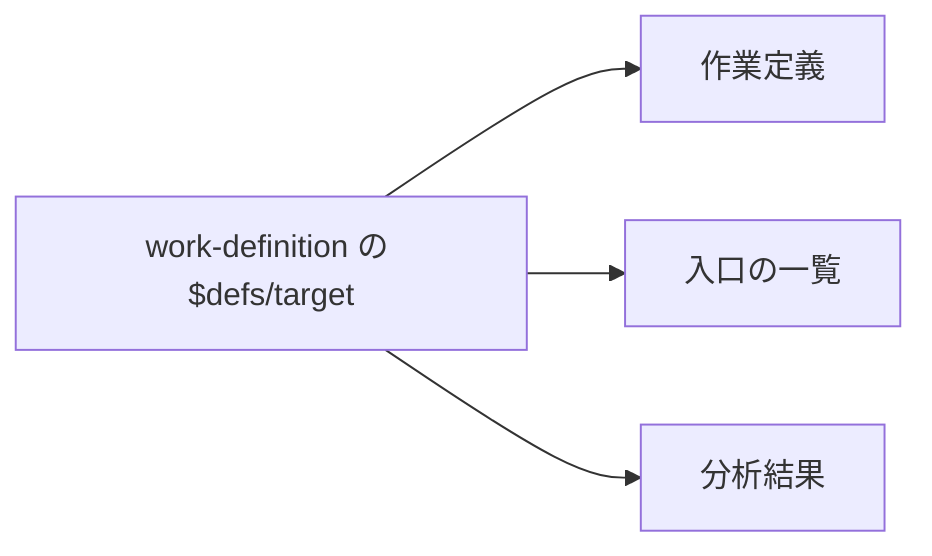

# 形式の定義と語彙のルール

[← rules の地図へ](README.md)

対象: `schema/*.schema.json` (形式の定義) と `schema/vocab/*.yaml` (語彙)。仕組みの説明は [../reference/formats.md](../reference/formats.md) です。

## 守ること

| 決まり | 理由 | 守っているもの |
|---|---|---|
| 形式の正本は `schema/`。コードや文書に、形式を写して書かない | 正本を 1 つにする | — |
| 形式を変えたら、同じ変更で 4 つを直す: 見本 (`tests/fixtures/`)、意味の検査 (`abatlas/validate.py`)、形式の説明 (`docs/reference/formats.md`)、公開サンプル (生成し直す) | 形式と、それを使うものがずれない | `tests/test_examples.py` |
| 共有している定義 (`$defs`) に項目を足すと、参照するすべての形式に効く。足す前に、参照元を調べる | 例: 作業定義の `target` は、入口の一覧と分析結果も参照している | — |
| 任意の項目は、空の値を許さない (`minLength: 1`)。「未記入」と「空」を区別する | 空の値が、黙って既定の動きに切り替わるのを防ぐ | 形式の検査 |
| 語彙 (データの種類と操作、不明の理由、呼び名) は、`schema/vocab/` だけに書く | 検査、ETL、画面が、同じ語彙を読む | `tests/test_terms.py` |
| 呼び名に、一般的な 1 語 (link、role、filter など) を選ばない。2 語にするか、意味を絞った語にする | 1 語の呼び名は、画面のコードの中の同じ綴りの文字列 (クラス名、属性の値) と区別できず、検査に落ちる | `tests/test_terms.py` |
| 画面に出す呼び名を足す・変えるときは、`terms.yaml` を直す。使わなくなった呼び名は `retired` に移す | 古い呼び名が画面に残らない | `tests/test_terms.py` |

## 共有している定義の例

作業定義だけが使う項目 (例: 表示名 `target.name`) も、形式の上では 3 つすべてで書けます。書く場所は、決まりで絞ります ([examples.md](examples.md) の「表示名」)。

## 版

- 分析結果の形や、判断の規則が変わる変更では、分析 skill の版 (`skill_version`) を上げます。理由は、skill の末尾に書きます。
- 版を上げると、旧版で書かれた結果が、すべて再分析の対象になります。形も規則も変わらない直し (参照先の変更、言い回し) では、上げません。
- ただし、3 つ目の数字だけを上げたときは、再分析の対象になりません (照合は 2 つ目の数字までを比べる)。前の版の結果も誤りではない小さな直し (分析者によって割れた書き方を 1 つに決める) は、3 つ目だけを上げます。このとき、レビューの手順に、前の版の結果では指摘しない違いを書きます。決まりと例は [formats.md](../reference/formats.md) の「再分析しない条件」にあります。
- 形が変わっても、**判断を変えずに、機械的な変換で移せる変更** (項目名の入れ替えなど) では、上げません。分析し直す必要が無いためです。代わりに、同じ変更で、変換のコマンド (`abatlas migrate`、`abatlas/migrate.py`) に変換を足し、見本を変換します ([ADR 0009](../adr/0009-field-names-match-labels.md)、[ADR 0010](../adr/0010-migrate-command.md))。

## 項目名

| 決まり | 理由 |
|---|---|
| 項目名は、画面の呼び名 (用語集) と同じ語にする。1 つの語を、2 つの意味に使わない | 画面で見た語を、そのまま設定・分析結果・API の検索に使える |
| 層の並びは `layers`、層の id を持つ項目は `layer`、層をまとめる区分は `tier`、集計表の持ち主は `origin` | [ADR 0009](../adr/0009-field-names-match-labels.md) |
