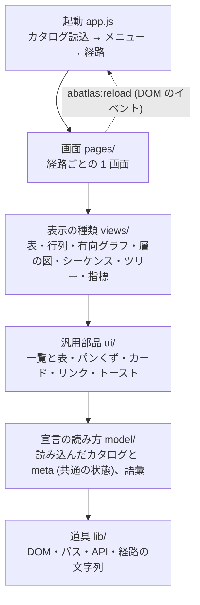

# 画面のルール

[← rules の地図へ](README.md)

対象: `abatlas/webapp/`。ここには、作りの決まりを書きます。

| 知りたいこと | 文書 |
|---|---|
| 見た目の決まり (色、線、余白、部品の形) | [DESIGN.md](../../DESIGN.md) |
| 誰が、どんな場面で使うか | [PRODUCT.md](../../PRODUCT.md) |
| 仕組み (宣言からの組み立て、画面の一覧、表示の種類ごとの描き方、経路) | [../architecture/webapp.md](../architecture/webapp.md) |
| ファイルの分け方、足し方、テストが守ること | 下の「ファイルの分け方 (6 層)」「足すとき」 |

## 作りの決まり

| 決まり | 理由 | 守っているもの |
|---|---|---|
| ビルド工程を持たない。外部のライブラリも読まない | 配ったファイルが、そのまま動く。依存の更新が要らない | `tests/test_webapp.py` |
| API だけを読む (`/meta`、`/marts`、`rows` / `tree` / `pivot`)。ほかのファイルを読まない | 人とエージェントが、同じものを読む | 同上 |
| 集計表の名前を知らない。宣言と `/meta` だけを読む | [marts.md](marts.md) | `tests/test_navigation_api.py` |
| 呼び名を直接書かない。`term("<id>")` で引く | [ADR 0002](../adr/0002-labels-from-glossary.md) | `tests/test_terms.py` |
| 6 層の向きを守る (上の層は、下の層だけを読む) | 崩れを、テストで止められる | `tests/test_webapp.py` |
| 同じ図は、同じ部品で描く。ページごとに組み立てない | 同じ表が、2 つの見え方にならない ([ADR 0003](../adr/0003-layer-diagram-view.md)) | — |
| 全行を読まない。階層は 1 段ずつ、表は畳んだ値だけ、一覧は 50 件ずつ | 数千のテーブルやファイルでも動く | — |
| 上限で切ったら、切ったことを出し、全体を見られる場所へ誘導する | 「全部」と「一部」を見分けられる | — |
| ブラウザの保存 (`localStorage`) は、見え方の好みだけに使う。読み書きは `try` で包み、使えなくても動くようにする | 保存できない環境がある | — |

## 区分ごとの「最初の表」

画面は、区分 (`subject`) ごとに、条件に合う最初の表を特別に扱います (入口の一覧の元になる表、データの行列、外部の接続先の数、など。`model/catalog.js` と `pages/overview.js`)。

| 決まり | 理由 |
|---|---|
| 入口・データ・外部接続・共有処理の区分に、表を足さない。入口をまたいで見る表は、分析の観点の区分 (`subject: aspect`) に置く | 同じ区分に、条件に合う表が 2 つあると、どちらが一覧の元になるかが、名前の順で決まってしまう |
| 入口ごとに絞って見せたい表は、入口の階層パスの列を `keys.path` に持たせる | 入口のページが、その入口に絞ったタブとして出す |

## 見せ方の決まり

| 決まり | 理由 |
|---|---|
| 利用者は、分析対象を保守するエンジニア。問い (影響の調査、障害の調査、全体の把握) から、画面と導線を決める | [PRODUCT.md](../../PRODUCT.md) |
| どのページでも、どのシステムを見ているかが分かる | [ADR 0005](../adr/0005-target-name-always-visible.md) |
| 絞り込みは、薄くするだけ。位置を動かさない | 図の形を覚えたまま読める ([ADR 0004](../adr/0004-dim-not-move.md)) |
| 0 件のもの、分かっていないもの (未分析、不明、上限で切った数) は、分かっていることと見分けが付く形で出す。消さない | 「無い」と「分析していない」を区別できる |
| 集計表の名前は、集計表のページ以外に出さない。リンクは「mart で見る」だけ | 利用者の言葉ではない |
| 表の列は、左から概念を絞り込む順に並べる | 左から読める |
| 長い説明は畳んでおく | 名前と並びを、先に読める |

## 確かめ方

pytest は Chromium で広い幅・狭い幅のナビゲーションを検査します。画面を変えたら、見本2つで表示と変更した操作も確かめます。手順は skill `dev-webapp-verify` にあります。

| 確かめること | 内容 |
|---|---|
| 見本 2 つで開く | バッチの見本 (ことり書店) と、画面を持つシステムの見本 (umami)。プロファイルが違うと、出る部品が違う |
| 幅を 2 つ | 広い幅 (1440px) と、狭い幅 (390px)。横にはみ出さないこと |
| コンソール | エラーが無いこと |
| 操作 | 足した操作 (絞り込み、開閉、畳む) を、実際に動かす。動かした後の状態を数える |
| 目で見る | 撮った画像を開いて見る。数値だけで済ませたときは、そう報告する |

片方の見本でしか出ない表示があります (例: 確かめられていない線、function が 0 件の層、入口を包む入口)。**変えた表示が出る見本で確かめます。** 出る見本が無いときは、確かめていないと報告します。

## ファイルの分け方 (6 層)

webapp は、ブラウザ標準の ES モジュール (`<script type="module" src="app.js">`) で、6 層に分かれています。**上の層は、下の層 (と同じ層) だけを `import` できます。** ビルド工程が無いので、崩れは `tests/test_webapp.py` が止めます。

| 層 (上から) | 場所 | 中身 |
|---|---|---|
| 起動 | `app.js` | カタログ読込 → メニュー (`buildNav` / `markNav`) → 経路 (`route`)。経路の表はここ。分析対象の名前の表示と、メニューの折り畳みもここ |
| 画面 | `pages/` | `overview.js` (構成)、`entries.js` (入口の階層)、`entry.js` (入口の詳細)、`data.js` (データ)、`access.js` (読み書きの表)、`subject.js` (外部接続・共有処理)、`aspects.js` (分析の観点)、`status.js` (分析の状態)、`marts.js` (集計表) |
| 表示の種類 | `views/` | 下の表 |
| 汎用部品 | `ui/` | `table.js` (一覧と表、行を選べる表 `pickTable`)、`rollup.js` (物ごとのまとめ)、`crumbs.js`、`card.js`、`link.js` (階層パスの行き先を 1 か所で決める)、`toast.js` |
| 宣言の読み方 | `model/` | `catalog.js` (共通の状態 `model` と、宣言・meta を読む関数)、`vocab.js` (画面に出す呼び名。用語集を引く `term`)、`kinds.js` (図の参加者の種類と絞り込み) |
| 道具 | `lib/` | `dom.js`、`path.js`、`api.js` (API の呼び方と、階層のキャッシュ)、`hash.js` (経路の文字列) |

`views/` の中身です。

| ファイル | 役割 |
|---|---|
| `index.js` | 宣言の `view` → 描き方の登録表 (`renderers`)、`render`、`panelBody` |
| `table.js`、`stat.js`、`tree.js`、`matrix.js`、`graph.js`、`sequence.js`、`heat.js`、`bridge.js` | 表示の種類ごとの描き方 |
| `layer-flow.js` | 層の図の組み立て。行から箱と線を組み、絞り込みと注記を付ける。構成のページと、集計表のページが共有する |
| `layers.js` | 層の図そのもの (箱と線の配置)。箱をまとめる枠は、部品の中では `group` と呼ぶ (上の段は、プロファイルの `layers[].tier`。下の段は、データと外部接続) |
| `figure-box.js` | 図の入れ物 (枠・拡大縮小・全画面・絞り込み・強調) |
| `route.js` | 経路 |

### 約束

| 約束 | 内容 |
|---|---|
| 共通の状態は 1 つ | 読み込んだカタログと meta は、`model/catalog.js` の `model` だけが持つ。書くのは `loadCatalog` だけで、他は読むだけ |
| 下から上へは DOM のイベントで知らせる | 画面は、起動を `import` できない。再計算の後の読み直しは、画面が `abatlas:reload` を発火し、`app.js` が受けて読み直す。上の層を呼びたくなったら、同じ形にする |
| 書き方は、検査できる範囲に抑える | `import` / `export` は行頭から、名前付きだけ (`import { a, b } from "./x.js"`)。`export default`、`import x from`、動的 `import()` は使わない。読み込み先は相対パス |
| CSS は `css/` の 5 ファイルだけ | `index.html` が `base → shell → ui → views → pages` の順に読む (同じ詳細度の上書きは、読み込み順で決まる)。`ui.css` / `views.css` / `pages.css` は、JS の同名の層に対応する。狭い画面の `@media` は、上書きする規則と同じファイルの末尾に置く |
| 置き場に迷ったら | 「それを使うのは誰か」で決める (使う側より下の層に置く)。1 ファイルが 400 行を超えるなら分ける |

`model` が持つものは次のとおりです: `catalog` / `meta` / `subj` / `entryMart` / `dataMart` / `graphMart` / `withinMart` / `treeMart` / `seqMart` / `frameMart` / `progressMart` / `layerMart`。

### テストが守ること

`tests/test_webapp.py` が、機械で次を確かめます。

- 層の向き (上の層を読んでいない)。
- 読み込み先のファイルと、`import` した名前が実在する。
- 検査できない書き方が無い。
- 外部の URL を読まない (全ファイル)。
- `<script>` が、起動のモジュール 1 つだけである。
- CSS の読み込み順が正しく、`css/` の全ファイルが、ちょうど 1 回ずつ読まれる。
- サブディレクトリのモジュールが、JavaScript の MIME 型と `cache-control: no-cache` で配られる。

**JavaScript の構文と、画面の動きは検査していません** (CI に node が無いため)。変更したら、ブラウザで開いて、コンソールにエラーが無いことを確かめます。

## 足すとき

| 足したいもの | 触る場所 |
|---|---|
| 新しい図の種類 (宣言の `view` を増やす) | `views/<name>.js` を作り、`views/index.js` の `renderers` に 1 行。`abatlas/declarations.py` の `VIEWS` と、`model/vocab.js` の `VIEW_ORDER` / `viewHint` にも 1 行。`css/views.css` に節を足す |
| 新しい区分の画面 (宣言の `subject` を増やす) | `pages/<name>.js` を作り、`app.js` の経路 (`route`) に 1 行、`buildNav` に 1 行。`abatlas/declarations.py` の `SUBJECTS` と、`model/vocab.js` の `SUBJECT_TERM` にも 1 行 (呼び名は用語集に足す) |
| 図の共通の機能 (枠・拡大縮小・強調のような) | `views/figure-box.js` だけ。シーケンスと有向グラフに、自動で効く |
| 見た目の共通の部品 | `ui/<name>.js` と `css/ui.css` |
| API の呼び方 | `lib/api.js` だけ。例外が 1 つ: 再計算の `POST /recompute` は応答の扱いが違うので、`pages/status.js` が直接呼ぶ |
| 表示の種類、メニューの項目を足すときの、集計表の側の決まりと手順 | [marts.md](marts.md) の表と、skill `dev-add-view` |
| 見た目の決まりを変える | `DESIGN.md` も、同じ変更で直す |
